# 汽车附件电机电磁激励频率设计软件 V1.0 操作说明书

本稿与当前真实界面对应。PDF为LibreOffice预览；Word实际分页与申请人模板待核实。

## 1. 软件介绍

应用背景：座椅、车窗和其他汽车附件电机在工作时，可能出现随转速变化的音调。工程师需要把测得频率放回电机结构、机械转速和电气周期中核对，但只凭一个峰值往往难以区分机械阶次、同步电气基频、槽通过或换向相关周期。同一频率还可能有多个候选。参数或单位记录不完整时，后续方案比较和试验复现也容易发生混淆。

软件概述：汽车附件电机电磁激励频率设计软件 V1.0 面向附件电机与 NVH 工程师。NVH 指噪声、振动与声振舒适性研究。本软件管理项目、电机条件、候选阶次、结构敏感频段、定转速频谱与参数快照，并计算可复核的频率关系。软件不是电磁场或声学求解器，不输出声压预测、根因保证或登记结论。

主要工作方式：用户从空白项目开始，先填写电机拓扑与转速，再选择需要观察的候选周期，填写自定义阶次及依据。频率—转速图随已应用条件更新；用户可叠加结构关注范围与定转速频谱，检查候选进入关注频段的转速和谱峰邻近关系。记录快照后修改参数，能在统一转速下查看候选频率差。最后保存项目并导出可追溯结果。

界面采用纵向工作簿。左侧管理项目和工作对象，中央电机剖面可选取磁极、槽与换向器，右侧条件检查器联动。下方依次展开频率图、候选、频段、频谱、比较、扫查和输出。它不依赖顶部模块按钮切换；每个对象与图形、公式和结果相互对应。

适用范围：首版支持同步永磁无刷电机及永磁有刷直流电机的限定参考周期。电气基频不是电磁力阶次；槽数和极对数不能直接证明声压主峰。用户仍需通过同步电流、振动和声学测量、变转速及变负载试验区分来源。独立示例和手册中的频谱均为模拟资料，不能证明真实车辆的应用效果。

## 2. 启动软件与认识空白状态

前提是本机已经安装 .NET SDK 10.0.100 或允许的后续 SDK。在软件目录打开终端，执行 dotnet build MotorFrequency.sln；构建成功后执行 dotnet run --project src/MotorFrequency.App。浏览器打开 http://127.0.0.1:8774。Windows 可运行 run.bat，Linux/macOS 可运行 ./run.sh。Visual Studio 用户可打开对应 .sln，并把 MotorFrequency.App 设为启动项目；该图形启动操作尚未在本环境实测。

首次启动应显示空白欢迎页，没有自动加载示例频谱或电机结果。左侧“新建空白项目”建立普通项目；“载入独立模拟示例”用于学习，示例不会自动写入项目库。本机项目库只列出已保存的项目。截图图号与标题位于本页图下方。

端口占用时在启动命令后加入 -- --port 8775，并使用相应地址。需要改变项目目录时加入 --data-directory 与可写路径。默认仅监听本机回环地址。程序没有远程账号体系，不应作为多人公网服务使用。

操作位置和当前界面状态见图 1。

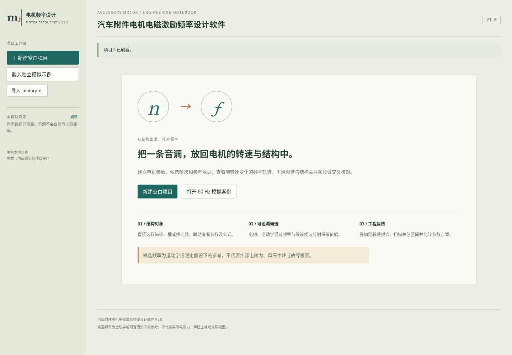

## 3. 建立项目与填写档案

在左侧点击“新建空白项目”，工作区出现电机结构与各业务区。此时项目只有合法的初始电机参数，没有用户频谱或敏感频段。默认 p=2、Q=12、K=10、扫描0～6000 r/min、步长100、观察1800 r/min、图表上限1500 Hz；这些是编辑起点，不是实际电机的推荐配置。

在电机图旁选“项目档案”。在项目名称填写“附件电机频率闭环验证”，负责人填写“验证工程师（模拟）”，分析目的写明要区分的候选和资料来源。点击“应用项目档案”后，页首项目条和左侧卡片更新。负责人可留空；名称必须填写，最长100字符；目的最长2000字符。

字段先形成草稿，只有点击应用才进入项目输入。界面会提示重要未应用草稿；保存或导出只使用已应用的值。切换结构对象保留电机草稿，打开另一个项目、恢复已应用值或撤销时会重置草稿。准备离开当前工作前，应应用并保存需要留存的输入。

操作位置和当前界面状态见图 2。

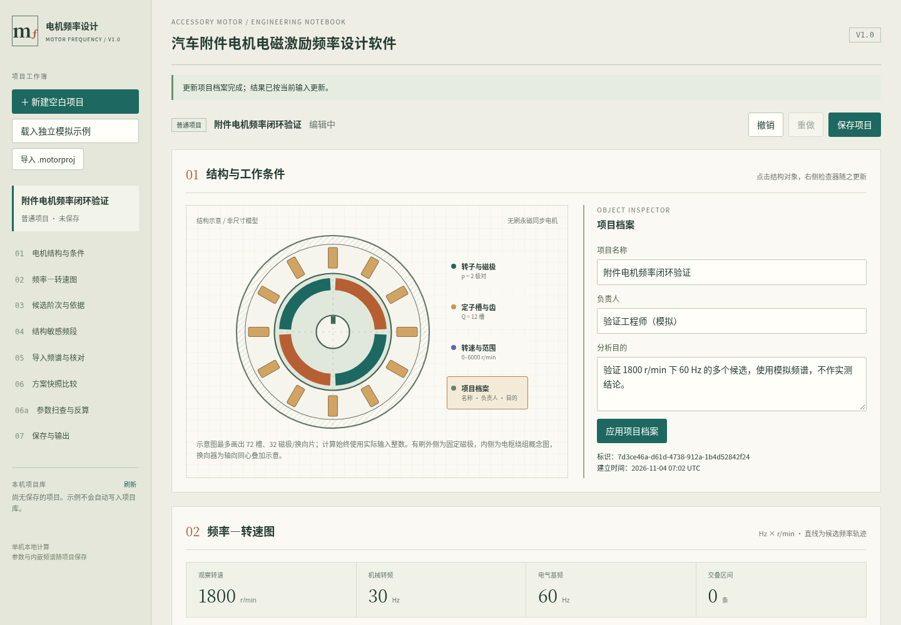

## 4. 配置电机拓扑与磁极

选择电机图或右侧对象按钮中的“转子与磁极”。检查器显示电机名称、电机拓扑和极对数。无刷示例选择“无刷永磁同步电机”，填写极对数2并点击“应用电机条件”。极对数 p 表示一对南北磁极的数量，总磁极数为2p；必须是1～64的整数。

电机名称用于区分当前方案，不代替项目名。切换到“有刷永磁直流电机”时会出现换向片数 K，必须是2～512整数。应用后不再自动产生同步电气基频、槽通过及理想齿槽候选，而提供单刷换向片通过参考。电机中未适用的结构档案参数会保留合法值。

结构图只作示意，不代表真实尺寸、绕组分布或装配关系。最多显示72槽、32磁极或换向片，实际计算仍使用输入值。有刷图的外侧为固定磁极，内侧为电枢绕组概念图；换向器为同心叠加示意，不表示真实轴向位置。可用对象按钮操作，不必准确点击狭小图形。

操作位置和当前界面状态见图 3。

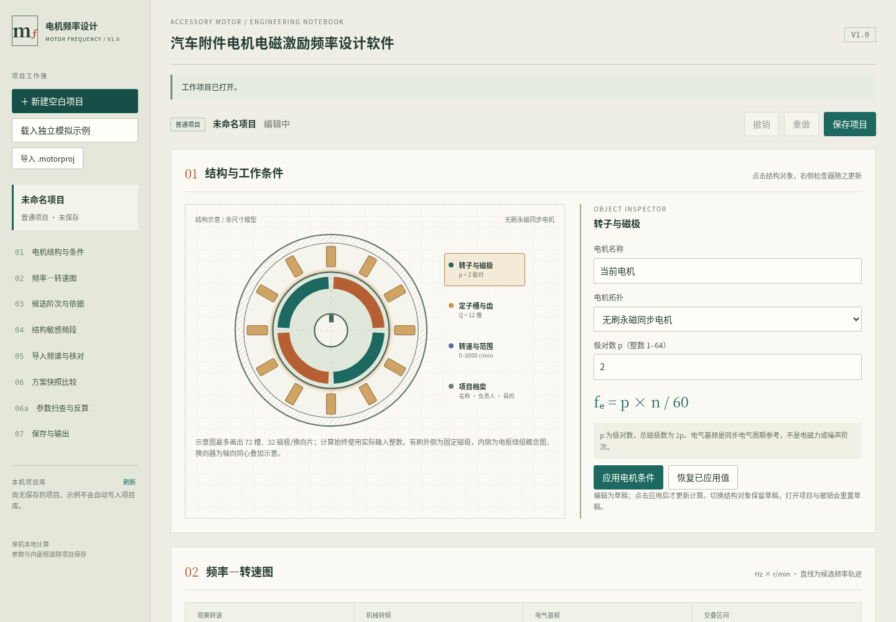

## 5. 配置槽数与理想齿槽假设

在无刷拓扑下，点击“定子槽与齿”。填写槽数 Q=12，保留“槽通过运动学参考”勾选。Q 必须是1～512整数；槽通过计算为 Q×n/60，只说明转子参考点相对等距定子槽的通过周期，不指认真实噪声主峰。

需要观察理想齿槽候选时，勾选“启用理想齿槽周期候选”，再勾选“确认等槽、对称永磁理想结构假设”，并填写假设依据。完整案例可写“模拟结构条件：等槽、对称永磁，仅用于周期公式核对”。点击应用后，候选表加入理想齿槽周期候选。

该候选阶次为 LCM(Q,2p)，LCM 表示最小公倍数。12槽、4磁极时为12阶；1800 r/min 下为360 Hz。制造偏差、偏心、斜槽与负载会影响真实特征；仅确认此选项不构成实际结构已经验证。缺少假设或依据时应用被拒绝，原计算结果保留。

操作位置和当前界面状态见图 4。

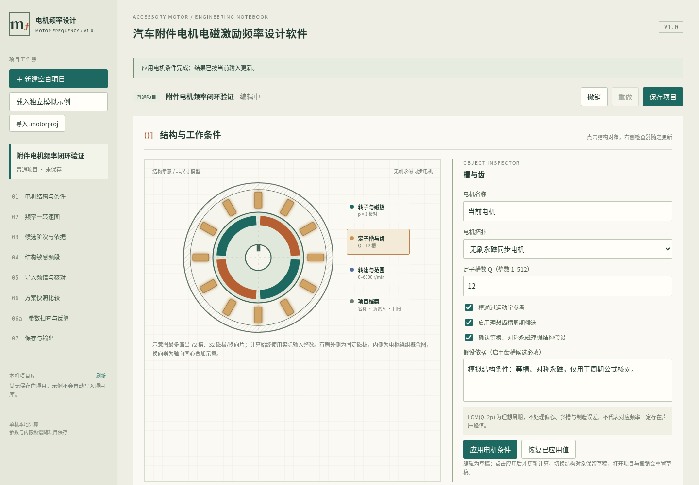

## 6. 设置扫描范围并读取频率图

选择“转速与范围”，填写起始0、终止6000、步长100、观察1800，单位均为 r/min；频率上限填1500 Hz，点击“应用电机条件”。转速必须在0～100000，终止大于起始，观察值位于区间内；步长至少0.1，最多2000个步长。频率上限1～1000000。

频率—转速图横轴为 r/min，纵轴为 Hz。彩色直线表示各候选随转速的关系，竖虚线表示当前观察转速。底部滑杆松开后更新观察转速；可以选图例或轨迹，让计算解释区显示所选候选。超出图表上限的频率仍在表格和扫描导出中保留。

案例 n=1800 时机械转频30 Hz；p=2 的同步电气基频60 Hz；Q=12 的槽通过360 Hz；理想齿槽候选也为360 Hz。相同阶次会重合。灰色虚线是选中快照，敏感频段为浅色横带；频谱黑点按自身转速定位，大小不表示声级。

操作位置和当前界面状态见图 5。

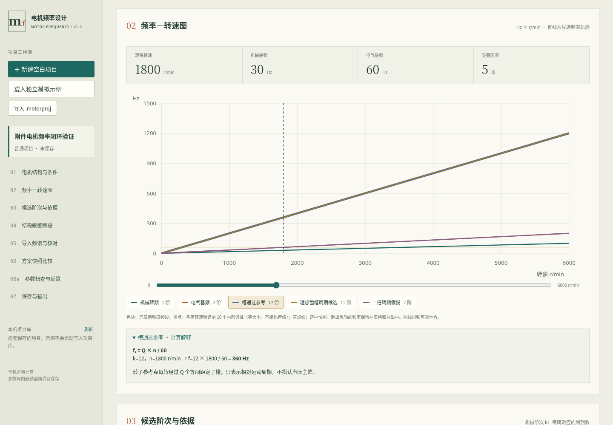

## 7. 添加自定义阶次并核对依据

展开“候选阶次与依据”下的“添加或管理自定义候选”。填写候选名称“二倍转频假设”，阶次 k=2，依据“模拟线索，需同步电流与振动试验区分”。点击“添加候选”，表中出现新行，1800 r/min 时显示60 Hz。允许0.001～10000的有限阶次，非整数也可以；名称和依据必填。

这里的 k 均相对机械轴，使用 f=k×n/60。固定频率载波不属于恒定机械阶次，不能仅因某个转速下相合就用单一 k 表示全转速区间。需要这种模型时应另行建立适用方法，首版不自动建模 PWM 边带或异步滑差。

勾选“绘制”决定候选是否参与图表、扫描、交叠、谱峰匹配和比较。点击名称联动选中对象和计算解释。删除自定义候选前有确认框；历史快照保留自己的副本。图中60 Hz可同时属于电气基频与自定义二阶候选，软件不会把两个依据合并为一个根因。

操作位置和当前界面状态见图 6。

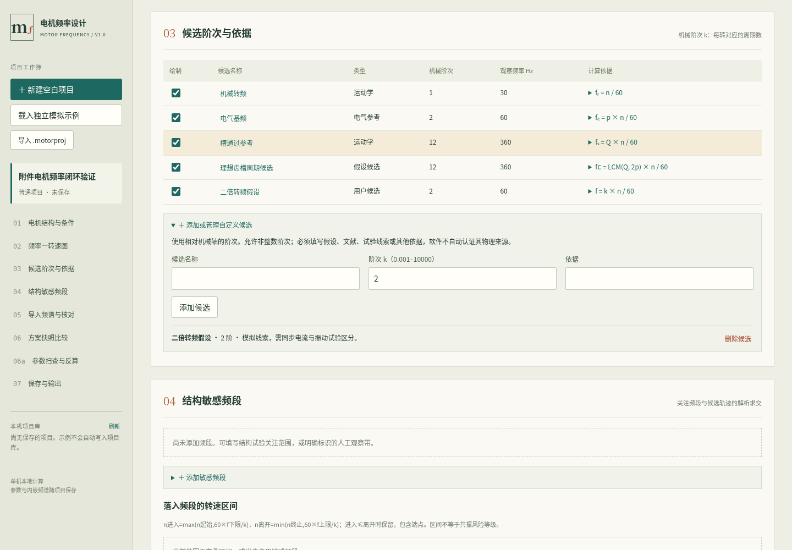

## 8. 添加敏感频段与观察交叠区间

展开“添加敏感频段”，名称填“60Hz关注带（模拟）”，下限55、上限65 Hz，来源选择“模拟演示”，依据填写“人为设定范围，不是实测模态”。点击“添加频段”后，图表出现横向关注带，下方列出候选进入和离开的转速。频段范围允许0～1000000 Hz，上限不可低于下限，依据必填。

对于2阶候选，进入转速为60×55/2=1650 r/min，离开为60×65/2=1950 r/min。表中应该出现这个区间。点击“观察区间中点”，观察转速变为1800。解析区间包含端点，不依赖扫描步长；其他阶次也可能在不同转速进入同一频段。

频段勾选可暂时停用，删除需确认。来源由用户声明，不自动验证模态试验条件。频率落入关注带不等于已经发生共振，因为实际力幅值、模态振型、阻尼和传递路径没有输入本软件。应结合实际试验确定下一步动作。

操作位置和当前界面状态见图 7。

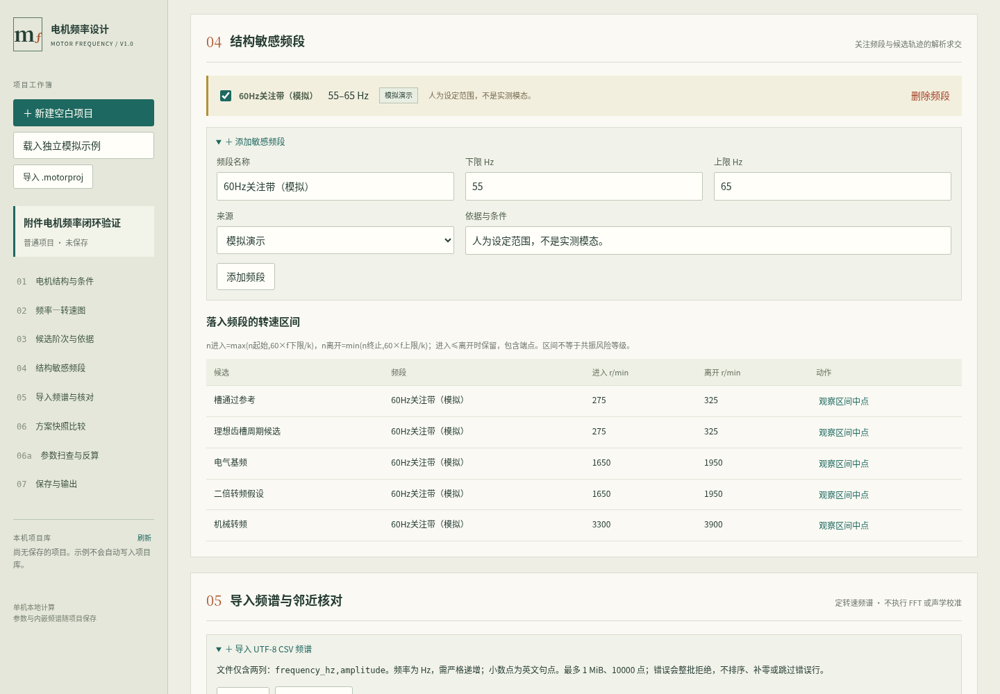

## 9. 导入频谱并执行预检

在“导入频谱与邻近核对”展开导入区，点击“下载频谱模板”查看两列格式。文件须为UTF-8，表头 frequency_hz,amplitude，英文逗号及英文小数点。频率必须严格递增，每谱2～10000点且不超过1 MiB；不支持千位分隔符、中间空行或额外列。

点击“选择 CSV”，载入 examples 中的“1800rpm-模拟频谱.csv”。填写名称“1800转模拟输入”、转速1800、单位dB、参考量“模拟dB标度，无声学校准”、工况“固定数式生成，非真实采集”，来源选“模拟演示”。参考量应说明幅值基准与口径，不能因为单位选dB就默认已经校准。

点击“预检频谱”后应显示解析751点。预检不写入项目，核对元数据和点数后点击“确认导入频谱”。确认时会再次验证当前文本与元数据。若出现错误行或字段提示，整条频谱不导入；修改对应位置后重新预检，不能用删除提示代替修复输入。

操作位置和当前界面状态见图 8。

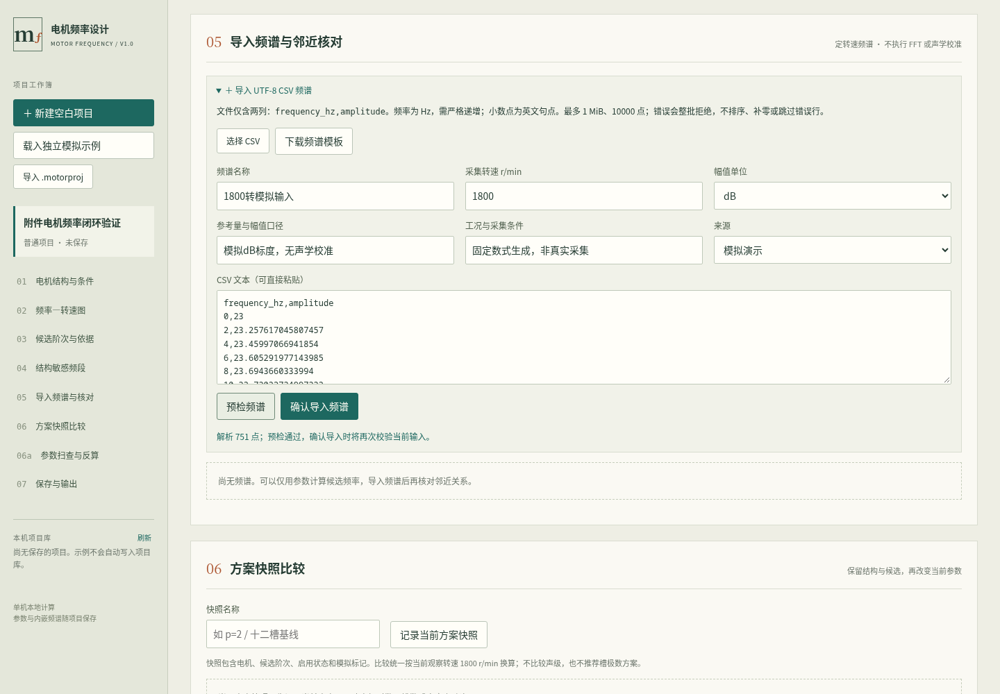

## 10. 查看频谱、网格与邻近候选

导入成功后，点击相应频谱名称选择它。摘要显示来源、转速、点数、幅值单位、参考量、工况、原文件及输入哈希；另一摘要给出网格间距与最大输入幅值。哈希用于辨别导入文本，不认证仪器与声学校准。原始频点随项目内嵌保存。

频谱图横轴Hz、纵轴为该频谱自己的单位。实线为选中谱，虚线为该谱采集转速下的候选频率。一次只绘一条幅值曲线；不同单位和工况不做幅值差。超过1000点时显示图形按区间保留极值，原始点及峰值计算不抽稀。

绝对频差容差默认3 Hz，每谱内部峰数默认10，可在允许范围内修改后“应用复核口径”。软件只找内部局部极大点，不找端点峰，不插值；随后列出所有容差内候选，频差为观察减计算。没有匹配不证明没有激励；有匹配不证明该候选就是来源。展开原始点表可核对前100点，并导出全部原始点。

操作位置和当前界面状态见图 9。

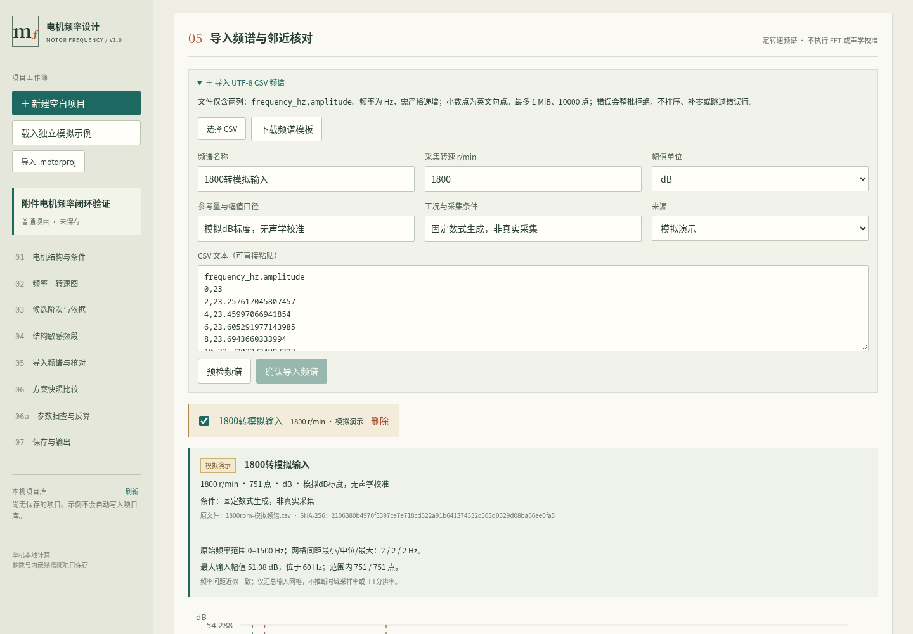

## 11. 记录与比较参数方案

在“方案快照比较”输入“两极对基线（模拟资料）”，点击“记录当前方案快照”。快照包含当前电机、候选和显示状态；来源标记沿用项目状态，用户另行命名时也应写清使用的模拟资料。之后回到转子检查器，将极对数改为3并应用。

点击保存的快照卡片，当前观察转速仍为1800 r/min 时，电气基频当前90、快照60、差值30 Hz。差值定义为当前减快照，所有项统一在当前观察转速换算；不是声级改善量。切换回p=2后可看到差值恢复。顶部“撤销”“重做”作用于已应用输入，审计记录继续保留。

拓扑不同会显著提示仅作频率对照；扫描范围不同会说明图轴采用当前范围。某候选缺失时显示破折号，不用零冒充。点击“导出当前快照比较 CSV”留存候选频率与口径；删除快照需确认。

操作位置和当前界面状态见图 10。

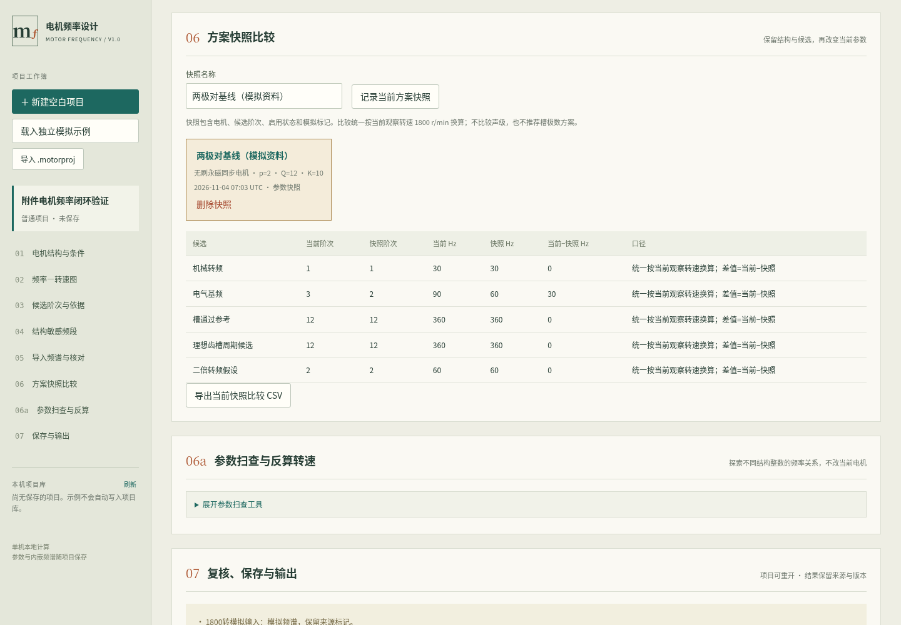

## 12. 参数扫查及观察频率反算

展开“参数扫查工具”，无刷输入极对数组1,2,3和槽数组6,12,18；有刷只枚举换向片数组，例如8,10,12。每组最多12个整数，英文逗号分隔，重复项明确拒绝。输入参考1800 r/min、观察60 Hz、容差3 Hz，点击“运行参数扫查与反算”。

工具枚举当前拓扑下的组合，保留当前启用候选和限定假设，列出计算频率及“计算减观察”频差；这是与谱峰核对相反方向的差值，表头已明确。勾选“仅显示容差内候选”可筛选，导出仍包含全部结果。工具不按低噪声优劣排序，也不验证绕组或制造可行性。

下表反算当前各候选与观察频率对应的中心转速和容差区间。60 Hz与2阶对应1800 r/min；±3 Hz对应1710～1890。该区间不裁切到扫描范围，另标记中心是否在范围内。项目参数变化时旧结果标为历史，须重新运行才能导出。扫查为会话工具，不随项目保存，请需要时导出。

操作位置和当前界面状态见图 11。

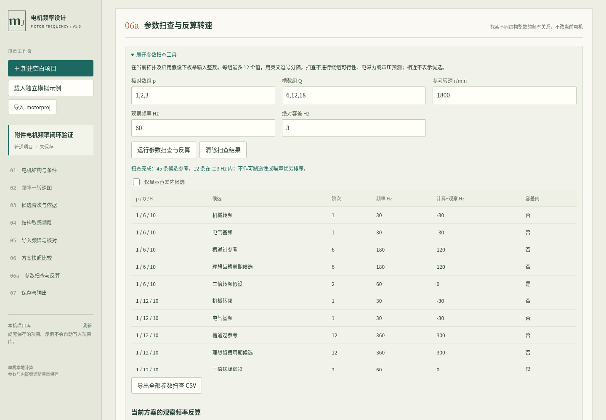

## 13. 保存项目、备份及搬迁重开

在“复核、保存与输出”填写需要补充的试验和假设，点击“应用复核备注”。输入核对表逐项显示当前证据和下一步，不自动判定合格。点击“保存项目”，核实显示的服务器本机路径。项目采用 .motorproj，格式版本1；原始频点内嵌，无需依赖原CSV路径。

保存后在左侧项目库点击项目名称，重新载入后检查电机条件、频谱751点和方案快照。再次保存保留上一版 .bak；“读取上一版备份为副本”以新标识恢复，避免直接覆盖现项目。若原文件被外部修改，程序拒绝覆盖；请先打开磁盘版本核对，或“复制为新项目”后保存。

点击“下载项目文件”，在浏览器下载列表核实文件。搬到其他目录或另一台机器后用“导入 .motorproj”打开。若相同标识磁盘项目已存在，导入副本不能直接覆盖它；先复制新项目，或打开原磁盘文件继续编辑。归档会暂停内容编辑，仍可保存、下载、复制和取消归档。

操作位置和当前界面状态见图 12。

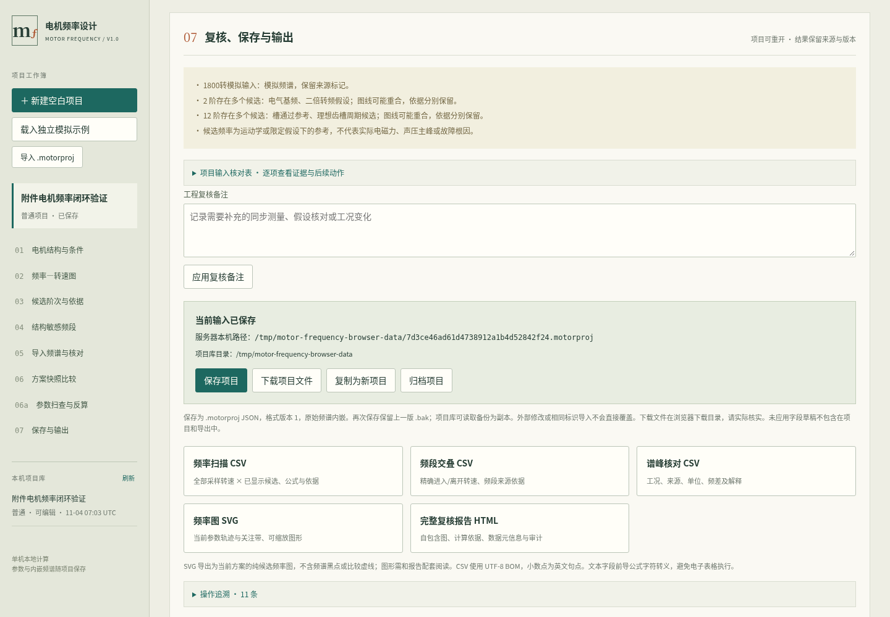

## 14. 成果导出与文件核对

频率扫描 CSV 包含全部采样转速下的显示候选、阶次、频率Hz、公式、依据、项目标识、软件版本、来源和输入哈希。频段交叠CSV给出精确进入与离开转速；谱峰核对CSV包含工况、参考量、来源、单位、容差、频差和边界解释。导出使用已应用输入，不要求先覆盖磁盘项目。

“频率图 SVG”可在浏览器或矢量软件查看缩放图，但只包含当前方案的候选线与敏感带，不含谱峰点和快照虚线。“完整复核报告 HTML”为自包含文件，可离线打开查看电机条件、公式、图表、频段、频谱元信息、比较、提示与审计。输入核对JSON便于保留结构化复核内容。

下载成功提示表示已向浏览器发起下载，目标目录由浏览器设置决定，应实际确认文件可打开。CSV使用UTF-8 BOM，文本前导公式字符会转义。原始频点CSV仅两列，不自带转速、单位和工况，必须与项目或报告配套保留。

操作位置和当前界面状态见图 13。

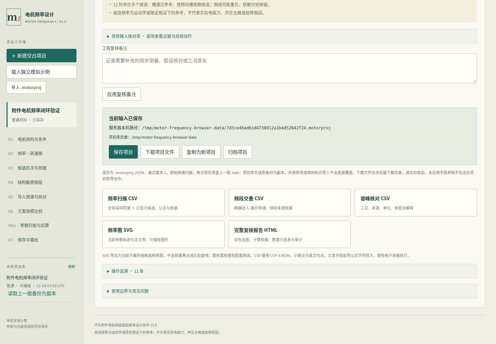

## 15. 错误恢复与退出前检查

参数错误：例如极对数填0并应用，状态区指出 motor.polePairs 及范围。电机草稿保留供修改，计算继续显示最后有效值。将极对数改回2并应用，或点击“恢复已应用值”放弃草稿。齿槽候选若提示缺假设，回到槽检查器确认假设并填写依据；不要把未验证结构直接当确认结论。

文件错误：若CSV有重复频率，定位提示的 points 行或预检行，确认原始采集导出是否有重复频点，修复文件后重新选择并预检。若项目缺字段、未知版本、JSON损坏或未知字段，程序拒绝载入，原文件不修改；不要手工删字段强行打开，可从项目库备份恢复为副本。

退出前：检查未应用草稿提示，应用需要保存的条件，再保存或下载项目并核实。浏览器离开提示可以取消；强制刷新、关闭服务或断开会话可能丢失未保存工作。Windows/macOS实际图形启动、最大规模性能、真实车辆效果仍未验证。此手册为当前实现材料，Microsoft Word实际分页与申请人模板核对尚待完成，不能把本环境PDF预览视为登记终稿。

操作位置和当前界面状态见图 14。

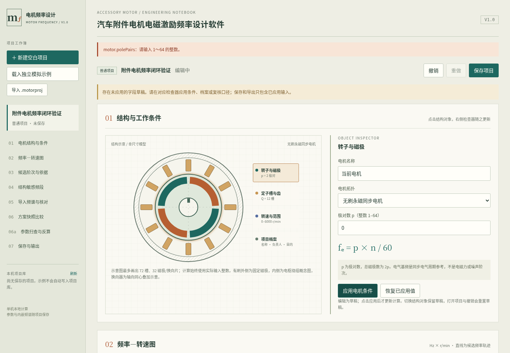
