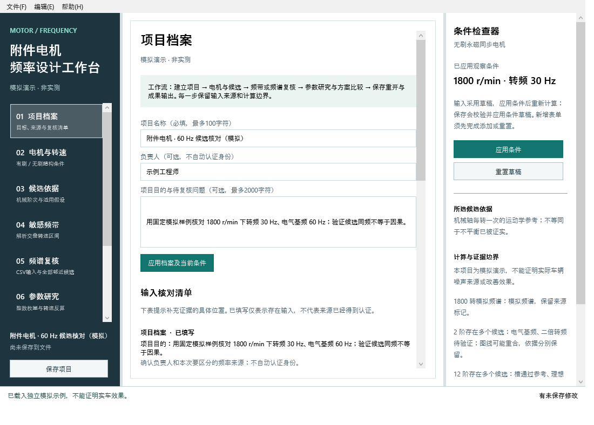
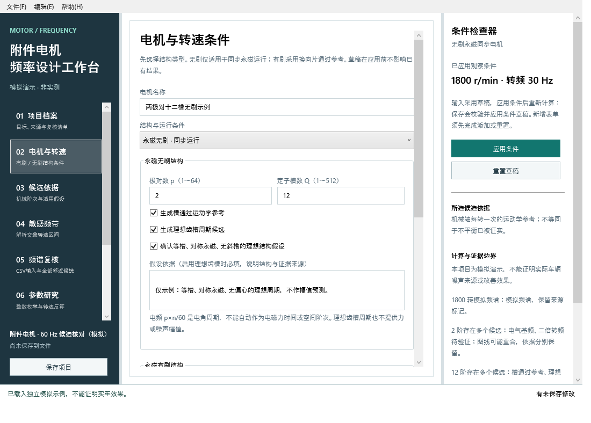
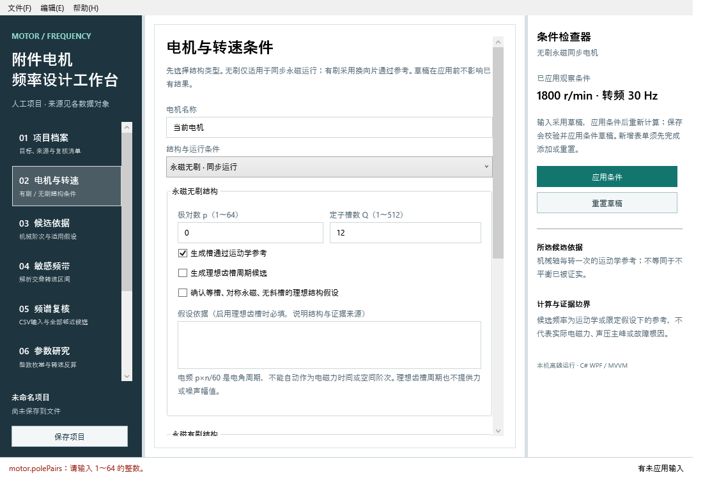
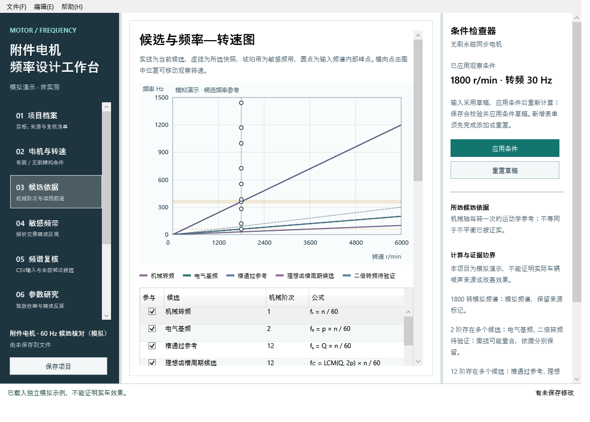
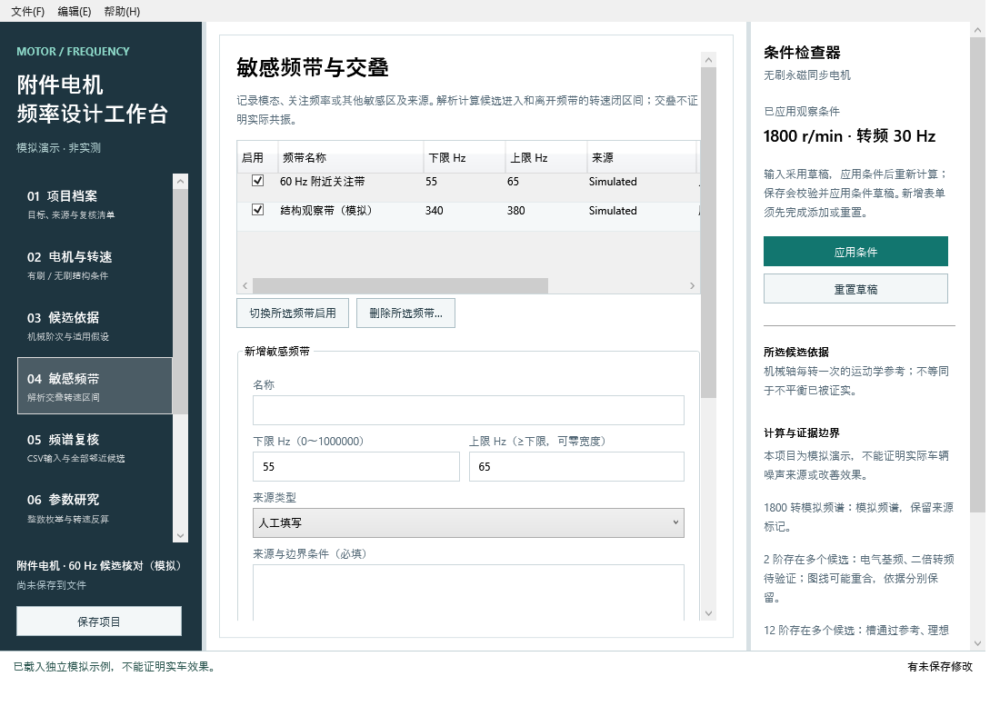
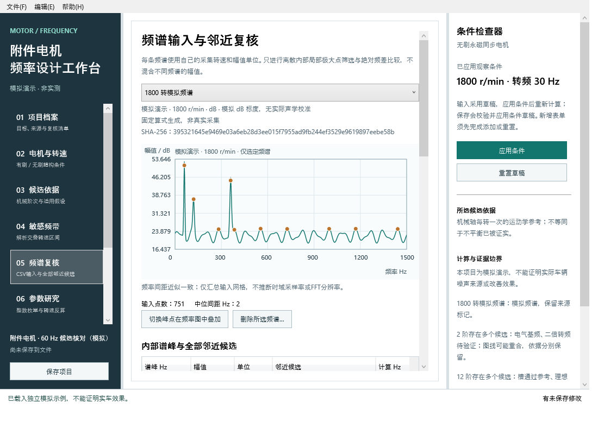
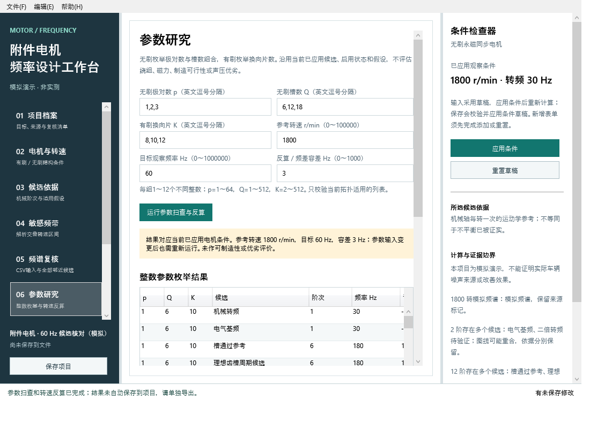
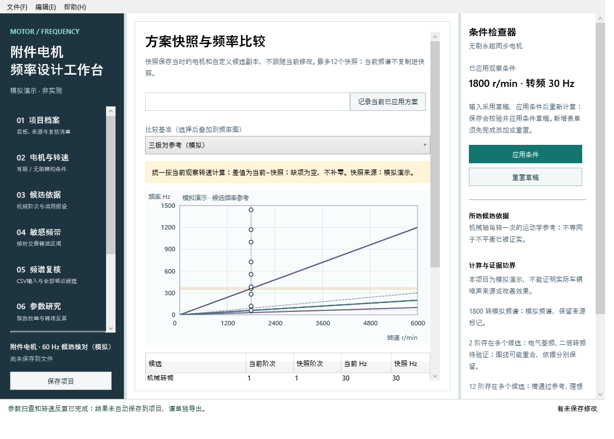
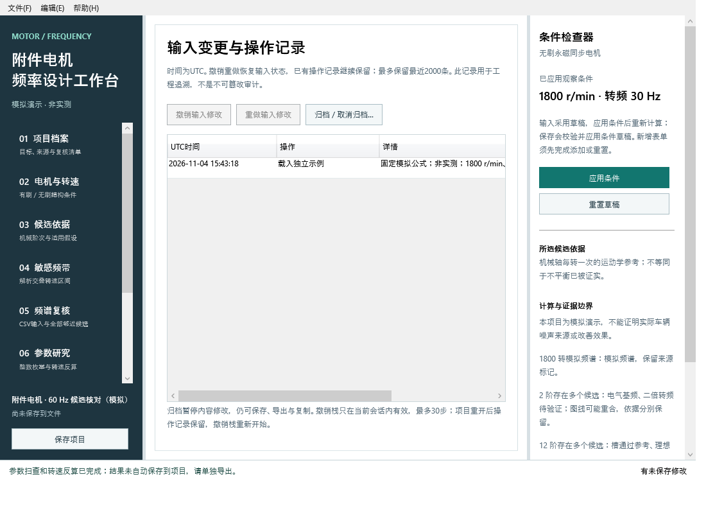
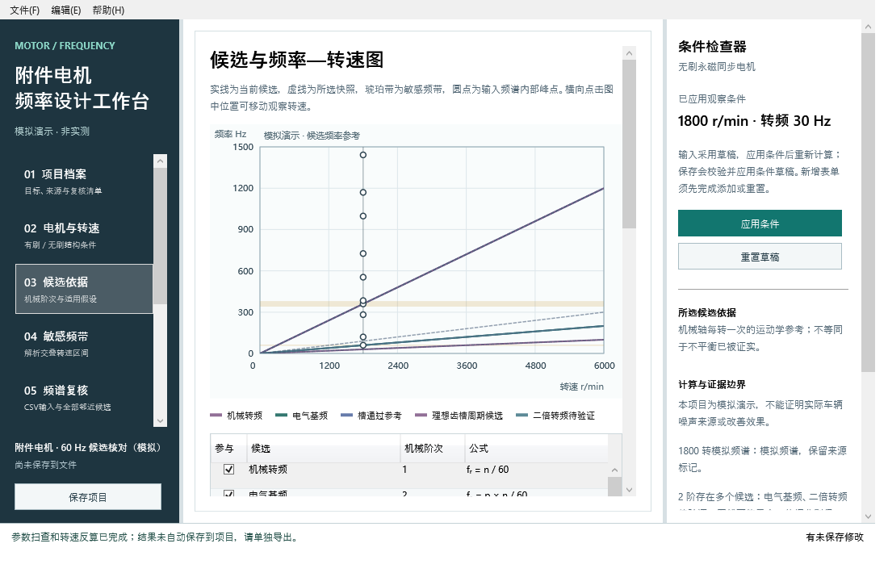

# 汽车附件电机电磁激励频率设计软件 V2.0 操作说明书（原生桌面版草稿）

## 1 软件介绍

### 1.1 应用背景

汽车附件电机的结构方案和运行转速会影响多类周期参考频率。工程人员在查看噪声、振动或电流频谱时，往往需要同时查阅极对数、定子槽数、换向片数、转速区间和结构关注频带。如果只在表格中记录一个频率数值，后续很容易遗漏该数值属于哪种周期、依据是什么、采用了哪个转速，以及频谱是否来自相同工况。特别是在比较有刷与无刷方案时，电气周期、换向片通过和实际电磁力并不是可以直接替换的概念，使用同一个“电磁阶次”名称会使复核失去边界。

本软件面向负责附件电机方案设计和频率复核的工程人员，用项目文件集中保存电机条件、候选依据、敏感频带和原始频谱，使每项换算可以回溯到输入。软件帮助用户安排进一步试验和模型分析，不凭频率接近认定噪声来源、故障或车辆改善效果。没有真实数据时，可以使用独立模拟示例学习完整操作，但示例结果不代表任何真实车辆或设备。

### 1.2 软件概述

软件为使用C#语言与Windows Presentation Foundation（WPF，Windows原生界面框架）开发的桌面程序，采用Model–View–ViewModel（MVVM，模型、视图与视图模型分离）结构。启动后直接显示原生窗口，模块从左侧纵向项目目录进入，中央显示工作页，右侧条件检查器持续显示观察转速、候选依据和计算限制。软件不启动本地网络服务，也不需要浏览器承载业务界面。导出的HTML是供阅读和归档的静态报告，不是软件运行入口。

主要工作从新建或打开项目开始，录入档案、电机拓扑与扫描条件，应用后生成有依据的候选频率，再添加敏感频带、导入频谱并查看邻近关系。用户可以枚举整数结构参数、反算目标频率对应转速，记录并比较方案快照，最后保存可重新打开的项目与成果。原始频点内嵌于项目，不需要在搬迁项目时保留外部CSV路径。软件不提供异步电机滑差模型、自动PWM边带、实际电磁力计算或声压预测。

本说明书对应V2.0当前源码和界面定义。本地开发环境为Linux，现已在GitHub Actions的Windows Server 2025真实运行WPF窗口，完成核心与应用层共八十项检查、窗口绑定检查和自包含程序启动关闭。文中截图来自已显示的实际WPF客户端，原始PNG、来源提交和运行记录保存在windows-evidence目录；工作区局部图仅在Word图片框内裁切，未改写原图。Windows十和十一设备、高DPI、全部手工路径仍需补验。本稿的Microsoft Word实际分页与逐页排版尚未验收，不能作为已满足页数要求的终稿。

## 2 启动、窗口与基本操作

### 2.1 使用离线发布包

1. 将release目录的MotorFrequency-V2.0-win-x64.zip下载到Windows 10或Windows 11的x64计算机。右键解压整个压缩包到可访问的本机文件夹，保留其中所有DLL、运行时文件和示例目录，不要只提取单个EXE。
2. 双击MotorFrequency.exe。发布包包含.NET与WPF运行依赖，正常运行不需要网络、Node或Python。Windows CI已经直接启动其自包含发布程序并正常关闭；仓库release压缩包仍保留交叉发布来源，不能把不同产物的验证混为一谈，具体哈希与验证范围见发布清单和运行记录。
3. 首次普通启动应显示“建立可复核的频率设计项目”，当前没有项目，不会自动载入示例。在此状态下可以“新建空白项目”“打开项目文件…”或选择“独立模拟示例”。
4. 在窗口下方查看操作反馈。错误以红色文字和具体原因显示，正常状态使用文字说明。右下方显示空白、未应用输入、未保存修改、已保存或归档状态；标题中的星号提示当前有需要处理的工作。

左侧目录依次为项目档案、电机与转速、候选依据、敏感频带、频谱复核、参数研究、方案快照、成果输出和操作记录。它们是同一项目的不同工作区域，不是九个独立文件。拖动中央两侧分隔线可以调整导航、工作区和检查器宽度，较长页面使用滚动条阅读。窗口最小尺寸为1100×720，字体与高DPI显示需要在实际Windows设备检查。

文件菜单提供新建、打开、保存、另存为、复制、独立示例、归档和退出。Ctrl+N新建、Ctrl+O打开、Ctrl+S保存、Ctrl+Shift+S另存为。Ctrl+Z与Ctrl+Y分别用于会话输入撤销和重做。快捷键、字体与高DPI完整兼容仍需人工验收。左侧目录在较矮窗口中可滚动，较宽表格也有水平滚动条，不要求所有列同时可见。

### 2.2 从源码构建

安装.NET 10 SDK后，在项目目录执行dotnet build MotorFrequency.sln -c Release。在Windows执行dotnet run --project src/MotorFrequency.Desktop -c Release启动。也可以使用支持.NET10的Visual Studio打开MotorFrequency.sln，将MotorFrequency.Desktop设为启动项目。第一次还原目标包可能需要网络，发布完成后运行不需联网。生产程序没有额外第三方NuGet依赖。开发工具、测试和软著材料生成脚本不属于生产启动条件。

下图1对应本节实际原生运行状态；图中模拟数据不表示实测。

## 3 建立项目与档案

### 3.1 新建空白项目

1. 从空白首页点击“新建空白项目”，或使用文件菜单中的同名操作。左侧“项目档案”页成为当前区域，项目中不应包含模拟频谱、频带或快照。
2. 在“项目名称”输入易于识别的名称，例如“雨刮附件电机频率复核”，长度不超过100字符且不能全为空白。名称只是用户档案，不意味着软件具备该具体电机的专用结构模型。
3. 在“负责人”填写可选的工程记录文字，最多100字符。软件不验证身份，不把这一字段作为权属或申请人信息。
4. 在“项目目的与待复核问题”说明本次希望比较的方案、关注的频率与需要补充的证据，最多2000字符。记录清楚目的，便于在报告和输入核对清单中区分参数研究与实际采集结论。
5. 点击“应用档案及当前条件”，或右侧检查器“应用条件”。该操作同时验证当前档案、电机和复核设置草稿；全部合法才替换有效项目条件并重算。如果其他页有错误草稿，需要先按提示修复对应字段。

应用后，项目档案下方“输入核对清单”显示项目目的、拓扑、扫描点数、候选、频带、频谱追溯与快照提示。状态“已填写”仅说明有输入，并不证明内容经过认证。“待补充”指出可以继续完善的位置。空白项目仍可以开展参数研究，但不能据此判断实际激励来源。

### 3.2 独立示例与草稿

文件菜单“载入独立模拟示例”包含两极对十二槽无刷参数、两条模拟关注频带、一条由固定公式生成的模拟频谱和三极对参考快照。界面会持续显示“模拟演示·非实测”，各数据对象的来源及导出也保留标记。当前项目若有未保存工作，会先要求选择保存、放弃或取消，示例不会自动静默覆盖。

档案、电机与复核字段是草稿，编辑后尚未用于计算。右侧“应用条件”使合法草稿进入项目；“重置草稿”经确认放弃所有未应用字段和新增表单，恢复已应用条件。新增候选、频带、CSV和快照需要分别完成添加或导入，不能只填写一半就认为已经进入项目。保存和导出会明确检查这些未完成表单。

下图2对应本节实际原生运行状态；图中模拟数据不表示实测。

## 4 电机结构、转速与输入边界

### 4.1 永磁无刷同步结构

在左侧进入“电机与转速”，填写电机名称，然后在“结构与运行条件”选择“永磁无刷·同步运行”。这表示使用同步永磁电机的电角与机械角关系，不适用于带滑差的异步电机。填写极对数p和定子槽数Q，p范围1至64，Q范围1至512。极对数是磁极数量的一半，不要将四极电机误填为四极对。

“生成槽通过运动学参考”默认启用，给出Q个等间距槽相对转子参考点每转通过的周期。它不表示已经识别出实际声压峰。“生成理想齿槽周期候选”默认不启用。若需要使用，必须同时勾选“确认等槽、对称永磁、无斜槽的理想结构假设”，并在假设依据填写适用结构与证据来源。依据最多2000字符；缺少确认或依据时应用失败，已有有效结果保留。

齿槽周期候选采用槽数Q与极数2p的最小公倍数，即LCM(Q,2p)阶。LCM是最小公倍数的缩写。例如Q=12、p=2时为12阶；Q=12、p=5时为60阶。该理想周期不包含偏心、斜槽、饱和、制造差异和负载影响，也不提供力波或幅值。电气基频p×n/60只表示电角周期，不能把它直接等同于实际电磁力的时间或空间阶次。

### 4.2 永磁有刷直流结构

选择“永磁有刷直流”后，使用换向片数K，范围2至512。无刷的p/Q字段在本页禁用，有刷的K字段在无刷模式禁用；不适用拓扑的档案值仍保留且必须合法，便于后续切换。软件只计算等宽换向片相对单个固定电刷的K×n/60参考，不乘电刷数，也不自动提供同步电气基频、槽通过或理想齿槽候选。

如果实际换向脉冲存在同步重合、接触差异或不同谐波，用户需要提供独立依据，在候选页另建有依据的机械阶次。软件不从电刷个数推断全机换向事件数，更不能由一个片通过参考认定电磁噪声根因。

### 4.3 扫描与观察条件

转速单位统一为r/min，即每分钟转数；频率单位Hz，即每秒周期数。起始与终止转速均在0至100000范围内，终止必须大于起始。扫描步长为0.1至100000 r/min，区间除以步长不得超过2000。观察转速必须位于区间内，可以不落在步长网格上。频率图上限允许1至1000000 Hz，仅决定显示裁切，不删去原始数据或完整计算表。

例如输入起始0、终止6000、步长100、观察1800、频率上限1500。点击“应用条件并重新计算”，成功后右侧显示1800 r/min及转频30 Hz。零速是合法边界，所有当前机械阶次参考在零速均为零。扫描总是包含终止值，即使最后一段不是完整步长；交叠区间按解析公式计算，不把扫描网格当成连续证据。

下图3对应本节实际原生运行状态；图中模拟数据不表示实测。

下图4对应本节实际原生运行状态；图中模拟数据不表示实测。

## 5 候选依据与频率图

在“候选依据”页，中央频率—转速图横轴是转速r/min，纵轴是Hz。当前候选为实线，选择方案快照后出现虚线，琥珀色带为启用的敏感频带，圆点来自输入频谱的内部峰点。圆点大小相同，不编码声级或幅值。图例颜色与候选对应，不能只靠颜色作判断；下方表格提供名称、机械阶次、公式和类别。

选择候选表格中的一行，右侧“所选候选依据”显示适用解释。点击“切换所选候选参与状态”，可以使该候选退出或重新参与图形、扫描、交叠和谱峰邻近核对。参与状态变更进入项目历史。隐藏项不会被当作零值；报告仍列出其依据和隐藏状态。同频候选各自保留，图线可能重合，应查看表格分别核对。

在图的绘图区横向点击，可以把观察转速移到该位置，当前观察表随之更新。如果有尚未应用的电机等条件草稿，先应用或重置，再移动观察转速，以免混淆当前图形采用的条件。也可以回“电机与转速”直接填写准确观察转速并应用。

“有依据的自定义机械阶次”表单需要名称、阶次k与依据。k允许0.001至10000，可以使用小数，例如0.5阶。依据必须说明推导、假设或试验来源，不能只填“电磁力”而省略依据。点击“添加自定义候选”成功后，新项进入下方自定义列表，名称与依据表单清空；若出错，输入保留并显示原因。

自定义候选固定使用f=k×n/60，适用于随机械转速成正比的关系。固定PWM载波或其他恒定频率不能用一个恒定机械阶次代替整个转速范围。删除时先在自定义列表选行，再点击“删除所选自定义候选…”并确认；已有快照中的历史副本仍保留，不随当前删除而改写。

下图5对应本节实际原生运行状态；图中模拟数据不表示实测。

## 6 敏感频带与交叠转速

进入“敏感频带”，在新增区域填写名称、下限Hz、上限Hz、来源类型及来源与边界条件。上下限范围0至1000000 Hz，上限不小于下限，允许零宽度频带。来源可选人工填写、用户声明实测、模拟或估算；用户声明实测只记录声明，不等于软件完成了仪器校准或工况认证。

例如名称填“60 Hz附近关注带”，下限55，上限65，来源选模拟，依据填“人为设定的流程核对频带，非结构模态实测”。点击“添加频带”，上方列表出现新项。列表显示启用状态和来源；选中后可以切换启用或经确认删除。名称和依据为新增表单，添加成功后清空；如要修改现有带，删除并按新边界重新建立，操作历史保留变更。

下方“交叠转速区间”按当前启用候选与频带求解析闭区间。对阶次k，进入转速为扫描起始与60×频带下限/k中的较大值，离开转速为扫描终止与60×频带上限/k中的较小值。进入不大于离开时保留该行，因此端点接触和零宽度交叠也可以出现。对于两极对电气基频，55至65 Hz对应1650至1950 r/min。

在交叠表选择该行，点击“在所选区间中点观察”，观察转速变为1800 r/min，并进入候选页查看。若存在未应用条件草稿，应先处理草稿。空表表示启用对象在扫描范围中没有几何交叠；它不证明不存在实际激励或结构响应。

频带来源和边界条件应来自用户的结构测试、模态分析或工程关注设定。没有阻尼、振型和幅值信息时，软件不判断共振、不评分风险。频带超出图表上限时可能只显示一部分，完整交叠表仍按输入范围计算，右侧会提示图表裁切。

下图6对应本节实际原生运行状态；图中模拟数据不表示实测。

## 7 频谱文件与预检导入

### 7.1 准备CSV

CSV是以英文逗号分隔的文本文件。本软件只接受表头frequency_hz,amplitude，后续每行正好两列：频率Hz与幅值。使用UTF-8编码，可含BOM标记，小数点使用英文句点，不使用千位分隔符、引号包裹数字、注释或中间空行。末尾空行允许。频率必须严格递增，不能重复或倒序，范围0至1000000 Hz。

每条谱允许2至10000点，单个CSV不超过1 MiB。幅值必须为有限数值，绝对值不超过十亿。dB可以为负值；Pa、m/s²、g、A、V和任意单位等线性幅值不接受负值。这里的输入应是频谱值，不是时域采样点；软件不会自动进行FFT、单位换算、声学标定或采样率推断。

1. 在“频谱复核”页展开“导入新频谱”。点击“读取CSV文件…”，在原生打开对话框中选择文件，内容进入可编辑文本框。也可以直接粘贴符合格式的文本。
2. 如需模板，点击“保存CSV模板…”，选择本机位置保存。模板只是格式示范，不是实测数据；如用作流程演练，应在元信息选择模拟，并说明参考量未校准。
3. 填写频谱名称和采集转速r/min，转速允许0至100000。此值属于该条谱自己的工况，不会自动跟随当前观察转速改变。使用错误转速会改变邻近关系，必须核对。
4. 选择幅值单位和来源类型。参考量/幅值口径为必填，例如“模拟dB刻度，无实际声学校准”，或用户能够核实的测量参考。采集工况与来源为必填，应说明负载、供电、测试条件或模拟生成方式。
5. 点击“预检当前输入”。全部通过后显示频点数，尚未进入项目；有错误时逐条显示位置和原因，整条谱拒绝，不会只导入有效行。
6. 核对点数、转速、单位和来源后点击“确认导入频谱”。成功后频谱进入选择列表，原始点内嵌保存，新增内容表单清空。若预检后改变CSV或任一元信息，必须重新预检，旧预检不能继续提交。

项目最多12条谱、总计30000点；超过限制时提交失败，已有谱保留。文件名和导入文本SHA-256随谱保存，哈希用于识别文本，不证明仪器、采集真实性或校准。实际频点与元信息都需要工程人员复核。

### 7.2 错误恢复

提示“line 3, amplitude”时，在CSV文本框或原文件第三行检查第二列是否包含文字、NaN或非法分隔符。提示频率不递增时，检查重复行和排序，不能只删除提示而不核对频率。提示编码错误时，用能够明确保存UTF-8的文本工具转换后重新读取。修正后重新预检，确认完全通过再导入。

## 8 阅读频谱、谱峰和复核口径

在频谱复核页上方下拉框选择一条已导入频谱。下方显示来源、转速、单位、参考量、工况和文本哈希，幅值图只显示这一条谱，不与其他单位的谱混合。横轴是Hz，纵轴是该条谱的幅值单位；琥珀点标示参与复核的内部离散峰。超过图表上限的数据仍保存在项目中。

统计区显示原始点数、频率网格中位间距与提示。间距一致仅说明输入网格近似均匀，不推断采样率或FFT真实分辨率。最大输入幅值可能位于端点，而端点不参与内部找峰；因此最大幅值与邻近表所列峰不一定相同。频率点超过1000个时，绘图按桶保留极小与极大值，原始计算和保存不抽稀。

内部峰规则为某点大于左邻点、且不小于右邻点；平台取左缘，不做插值、滤波或峰显著度判断。默认每条谱按幅值取前10个内部峰，可在“每谱最多内部峰数”填1至50整数。容差为绝对频差，默认3 Hz，允许0至1000；它是用户工程设置，不是标准限值或统计置信度。

表中“谱峰Hz”是原始离散点位置，“计算Hz”由该谱采集转速换算，“观测−计算Hz”保留差值方向。容差内所有候选均列出；同频候选可能对应同一个谱峰多行，不是重复数据错误。没有候选时列“无邻近候选”，没有内部峰时表格无行，均不排除未建模激励。

需要修改容差或峰数时，在复核口径输入新值，可填写复核备注，点击“应用复核口径及当前条件”。此操作重算邻近表，不改变原始频点，也不重新认证来源。应结合局部频率间距理解容差，网格过粗可能漏检，软件不会补造频点。

“切换峰点在频率图中叠加”控制该谱的峰点是否出现在频率—转速图；选定谱自己的幅值曲线仍可阅读。删除谱需要确认，会同时移除内嵌频点；删除前应保存必要原始资料。频率邻近和幅值峰都不能独自证明电磁来源或故障根因。

下图7对应本节实际原生运行状态；图中模拟数据不表示实测。

## 9 参数扫查与转速反算

进入“参数研究”。先确认档案、电机和复核草稿已经应用。无刷方案输入极对数列表和槽数列表，有刷方案输入换向片列表；每组1至12个不同整数，使用英文逗号分隔。p范围1至64，Q范围1至512，K范围2至512。只校验当前拓扑适用的列表，其他列表不参与计算。

例如无刷输入p为1,2,3，Q为6,12,18，参考转速1800，目标观察频率60，容差3。点击“运行参数扫查与反算”。整数参数表列出各组合的候选、阶次、计算频率及计算−目标频差，“容差内”只标明数值关系，不代表此方案更优。候选启用状态和理想假设沿用当前已应用条件，不检查绕组可制造性或电磁幅值。

下方反算表使用当前电机候选，不是每组枚举参数。中心转速为60×目标频率/阶次；下限和上限由目标频率±容差换算，负下限频率先截零。结果不裁切到扫描范围，单独标明中心是否位于扫描区间。两极对电频对60 Hz、3 Hz容差应得到中心1800、下限1710、上限1890 r/min。

运行结果区明确显示实际采用的参考转速、目标和容差。改变项目、电机条件或扫查输入后，旧表仍保留供阅读，但需重新运行，成果导出会拒绝陈旧结果。会话结果不会自动保存到.motorproj；如需留档，进入成果输出分别选择“本次参数扫查”和“本次转速反算”写入CSV，并同时保存相应项目条件。重新打开项目后需要按记录条件重新运行。

下图8对应本节实际原生运行状态；图中模拟数据不表示实测。

## 10 方案快照与统一条件比较

在“方案快照”填写快照名称，例如“两极对基准”，然后点击“记录当前已应用方案”。快照复制当时的电机条件、自定义候选和来源标记，不含频谱副本。项目最多12个快照，名称必填且不超过100字符；有未应用条件草稿时先处理，防止把草稿误当成快照内容。

记录后，在比较基准下拉框选中该快照。现在回到“电机与转速”修改极对数为3并应用，再进入方案快照页。所有频率都统一按当前观察转速换算；在1800 r/min下当前电频90 Hz、基准电频60 Hz，差值当前−快照为30 Hz。这是候选频率变化，不是声级、振动或效率改善。

表格按稳定候选标识对应。新增、删除或未参与的一侧显示空值，不补零，因此有些行没有差值。拓扑不同时，提示“仅频率参考对照”；扫描范围不同时提示不能直接比较区间覆盖。所选快照也作为虚线叠加到频率图，图的坐标仍采用当前项目范围，图外部分裁切。

修改当前项目不会改写旧快照的候选依据。若需要新的基准，填写新名称再次记录；删除旧快照时选择后点击“删除所选快照…”并确认。比较不替用户判断方案优劣，必要时需要结合相同工况实测、模型和制造约束进一步研究。

下图9对应本节实际原生运行状态；图中模拟数据不表示实测。

## 11 保存、重开、备份与未保存保护

### 11.1 正常保存与搬迁

1. 完成条件应用和新增表单提交后，选择文件→保存，或在成果输出页点击“保存”。首次会出现原生保存对话框，选择本机目录和.motorproj文件名。
2. 如果档案、电机或复核有合法草稿，保存会先验证并应用。如果候选、频带、CSV或快照新增表单尚未完成，保存会明确阻断，提示先完成操作或重置，不会默默忽略。
3. 写入成功后，底部显示实际路径，标题星号消失。项目内嵌原始点、条件、来源、频带、快照与历史；保存不依赖外部CSV继续存在。
4. 正常关闭后，通过文件→打开项目或备份…选择该.motorproj。检查名称、观察条件、频谱点数、来源和快照是否恢复。可以把文件复制到另一个目录再打开，验证搬迁。

再次保存同一文件，会先保留上一版为同路径加.bak。若原文件被外部修改、移动或删除，保存拒绝覆盖，以免无意丢失外部工作。应先保留当前所需内容，再用“另存为…”选择新路径，或重新打开原文件核对。另存到已存在目标需要单独确认覆盖并备份，不应在不了解目标内容时盲目确认。

### 11.2 备份与退出

通过打开对话框选择.motorproj.bak，软件把备份作为新标识副本载入，名称含备份恢复提示。需要再选择新路径保存，原文件不会因打开备份而自动被覆盖。“复制为新项目”也创建新标识并解除归档，仍保留来源标记；它不能把模拟数据转换成实测。

关闭窗口、新建、打开其他项目或载入示例时，如果有未保存工作，会出现是、否、取消选择：是表示先保存后继续；否表示明确放弃继续；取消返回当前工作。若保存对话框被取消或输入校验失败，则仍留在当前项目。未完成新增表单时，应返回相应页面完成或重置后再选择保存。

文件写入采用同目录临时文件后替换，已有目标备份，读取时哈希用于发现正常外部编辑冲突。它不提供多人事务或跨进程原子锁保证，也不能防止硬件故障、强制结束和磁盘损坏。建议用户自行保留独立备份，负责人文字和频谱的访问由本机文件权限控制。

## 12 成果输出与来源解释

进入“成果输出”，在“可追溯成果”选择所需类型，点击“选择位置并导出…”。导出前要求应用所有条件并完成或重置新增表单，确保输出与用户当前理解的输入一致。原生保存对话框取消时不写文件；覆盖已有成果需确认。只有磁盘写入成功后才更新“最近成功写入的位置”，可点击“在资源管理器中定位”查找。

“自包含复核报告”输出HTML，包含项目档案、候选依据、频率图、频带、交叠、频谱与邻近、快照比较、复核提示和历史。它不访问外部数据，阅读时可使用系统支持的工具；这不改变软件本身使用原生桌面的性质。“全转速频率扫描”输出包含单位字段、来源、版本和输入哈希的CSV，按设置网格并纳入终点。

“敏感频段交叠”“全部频谱邻近核对”和“选定快照比较”分别输出对应表格。快照比较需要先选基准，原始点输出需要先选频谱。CSV用UTF-8 BOM，数字使用英文小数点，文字字段引号转义并防止公式起始字符。使用电子表格工具查看时仍要核对列名，不要把空差值当成零。

“频率—转速矢量图”输出SVG，包含当前候选轨迹、敏感带、图例、版本和来源提示。它不包含桌面中的快照虚线或频谱峰点，文档对此单列说明，不能把导出图与全部桌面叠加混为一谈。“输入核对与来源”输出JSON核对清单，供复核输入和后续行动。

“选定频谱原始点”只有frequency_hz与amplitude两列，以便保持标准导入格式；转速、单位、参考量、工况和来源应与配套项目或报告一起保存。参数扫查和反算为本次会话结果，需分别导出，条件改变时必须重新运行。所有成果中的模拟标记不得改写为实测，不得把频差、交叠或候选对照写成车辆改善效果。

下图10对应本节实际原生运行状态；图中模拟数据不表示实测。

## 13 从空白到成果的完整核对案例

本案例全部为人工设定和模拟输入，用于独立核算流程，不代表实车。先新建空白项目，在项目档案填名称“1800转候选复核”，目的填“核对机械、电气、槽通过与理想齿槽周期；比较参数变化”。在电机与转速选永磁无刷同步，p=2、Q=12、K保留10，起始0、终止6000、步长100、观察1800、上限1500。

勾选槽通过和理想齿槽候选，确认等槽对称无斜槽假设，依据填“理想十二槽四极结构，人工核对，不是实物认证”。点击应用条件。到候选页应看到转频30 Hz、电气基频60 Hz、槽通过360 Hz、理想齿槽周期候选360 Hz。两条360 Hz候选分别保留，因为它们的周期解释不同。若有数值不符，先检查极对数是否误填为磁极数、转速单位是否为r/min。

在敏感频带新增名称“关注带”，55至65 Hz，来源模拟，依据填“人为设定范围，非模态实测”。添加后，电气基频交叠应为1650至1950 r/min。选择这行并在中点观察，观察转速仍为1800。此处只核对几何关系，不认定共振。

在频谱页填写名称“三点模拟峰”，转速1800，单位dB，来源模拟，参考量“模拟刻度，无实际校准”，工况“离线人工三点流程验证”。CSV文本输入以下四行：frequency_hz,amplitude；59,1；60,10；61,1。实际文本每项单独一行，不输入中文分号。预检应显示3点，通过后确认导入。内部60 Hz为峰，按默认3 Hz容差应列出电气基频邻近，且保留“仅频率邻近”的解释。

在方案页记录“两极对基准”。到电机页把p改为3并应用，再回方案页选择该基准。观察转速1800时，当前电气基频90 Hz、快照60 Hz、当前−快照30 Hz。将p改回2并应用，进入参数研究，按默认p列表1,2,3、Q列表6,12,18、目标60、容差3、参考1800执行。反算电频应显示中心1800、1710至1890 r/min。

确认所有新增表单已完成或清空。文件→保存，将项目保存到一个新.motorproj路径。关闭后重开，检查3个原始频点、关注频带、候选依据和快照仍存在。在成果输出导出报告、交叠CSV、谱峰CSV及比较CSV，并核对文件中的版本、来源、单位和差值方向。将项目复制到另一文件夹重开，原始CSV不在场也应恢复频点。这一闭环已在Windows和Linux应用层测试中核对；原生窗口已实际运行，文件对话框与人工路径的范围以windows-evidence记录为准，不由应用层适配器测试代替。

## 14 历史、归档与异常恢复

“操作记录”保存已应用输入的动作与详情，时间为UTC。应用、添加、删除、显示状态和归档等动作记录在项目内。撤销与重做只恢复输入状态，已有操作记录继续保留；会话最多30步，重开后撤销栈清空。历史最多2000条，超出后保留最近记录；它是工程追溯，不是防篡改审计。

归档前必须处理未应用草稿和新增表单。点击“归档/取消归档…”并确认后，内容修改暂停，保存、导出和复制仍可用；需要继续编辑时取消归档。归档不是文件压缩或权限加密，不能替代操作系统文件保护。

参数应用错误时，按底部显示的字段路径回到对应页面，检查合法范围、空白和小数点。不要通过反复点击应用掩盖错误。预检失败时修正原CSV或内容框后重新预检。保存冲突时先检查原路径是否被外部修改或移动，必要时另存为新文件；打开损坏项目会拒绝读取，当前有效项目不会被坏内容替换。

图为空时先检查项目是否存在、候选是否参与、频率上限是否过低、频谱是否有图内点和内部峰。邻近表为空不一定是程序错误，可能没有符合规则的内部局部极大。比较缺项时检查该候选在两边的参与状态和是否新增删除，不要自行补零。扫查结果提示旧条件时重新运行，而不是用旧表得出新条件结论。

下图11对应本节实际原生运行状态；图中模拟数据不表示实测。

## 15 验收状态与材料补全

当前已完成本地跨平台验证和Windows Server 2025运行验证。Windows运行记录为GitHub Actions运行41860507345，源提交21e81e15b4c47d1b120b325e84278ef798d48fae。windows-evidence/result.json记录九个工作页、空白启动、错误绑定拒绝与最小窗口检查，绑定错误为空；published-exe.json记录实际自包含进程创建窗口及正常退出。相应核心五十七项和应用层二十三项均通过，日志和输入证据也在该目录。

首轮Windows运行暴露验证程序把StartupUri设为空的运行期异常，修正后才得到通过结果，失败记录单独保留，不能将首轮写成通过。原始窗口截图逐张检查了来源标记、控件、图表、表格与滚动条。它们是已显示WPF窗口客户端可视树的实际捕获，不含系统标题栏；不是浏览器截图，也不是根据XAML绘制的模拟图。文中局部图标明裁切，完整原图可用于放大核对。

该runner没有注册Microsoft Word COM，word-pagination.json记录available为false、actualPages为空。没有Word导出PDF或实际页数，不能用其他渲染器的预览页数替代。仍需在真实目标设备补充高DPI、字体、键盘、断网环境、所有对话框异常与最大负载检查，再使用Microsoft Word逐页验收。

本文已加入实际截图的图号、图注与对应引用，仍须使用Microsoft Word检查实际分页、页眉页脚、表格与断页。终稿必须不少于十页，以Word打开或其导出PDF的真实页数为准；本稿不报告未经执行的页数。申请人身份、权属、开发日期和首次发表等事实由申请人核实填写，不从旧材料或软件版本推断。最大负载、实车性能和改善效果未验证，不能写入已完成效果。

下图12对应本节实际原生运行状态；图中模拟数据不表示实测。

