# 车身声学泄漏路径与封堵试验分析软件 V1.0 操作说明书

## 1 软件介绍

应用背景：车辆声学工程人员常通过临时封堵密封条、孔隙或连接部位，观察同一工况下车内声级的变化。试验涉及基线、单项、组合和解除封堵后的恢复，若只用表格临时汇总，容易遗漏测点、计权、标定或工况差异，也容易把分贝差误写为某条路径的独立贡献。本软件用于组织这些记录、检查比较条件并输出可回查的分析材料。

软件概述：本软件 V1.0 面向负责试验组织、数据整理和结果复核的工程人员。用户建立项目，定义封堵位置和测量工况，录入频带声级，手动配对基线与目标，查看差值、重复性、漂移和恢复，再保存项目并导出报告。普通启动为空白；模拟样例通过单独按钮载入，界面和导出始终保留来源说明。

软件处理已经提取的频带声级，运行于本机 Python 服务及浏览器，不依赖在线计算平台。它不读取音频、不替代仪器标定、不认证数据真实性，也不开展路径独立能量贡献分解。封堵会改变边界条件和路径耦合，因此结果只能称为封堵前后测得声级差；单项分贝不能相加预测组合。

本手册的操作案例均使用明确标记的模拟数据，不包含真实车辆测量。申请人、权属、开发完成日期和发表事实未由本软件确定，登记前须另行核实。本手册采用通用 A4 版式；当前云端未安装 Microsoft Word，DOCX 在 Word 中的最终实际分页尚待复核。

## 2 启动与界面导航

前提：在运行电脑安装 Python 3.12 或更高版本，准备支持 JavaScript 模块和文件下载的现代浏览器。将 acoustic-seal-analysis 文件夹完整复制到可写目录，保持 acoustic、web 子目录结构不变。生产程序无需安装第三方 Python 包，不需要 npm，也不从网络加载界面资源。

1. 打开终端，进入软件目录，执行 python -m acoustic.server。Linux 可执行 ./run.sh，Windows 可双击 run.bat。终端应显示本软件名称、版本和本机访问地址。若提示端口占用，改用 python -m acoustic.server --port 8766，并打开相应端口地址。

2. 在浏览器访问 http://127.0.0.1:8765。正常启动显示“项目工作台”，四个计数均为零。左侧依次为项目、位置、工况、试验、导入、配对、统计、复核和输出。顶栏提供“打开项目”和“下载项目”，来源栏显示当前记录的模拟、实测或人工填写数量。

3. 页面显示的工作副本在浏览器内存中。应用表单只是更新当前项目，不能替代下载保存。退出前查看是否出现“有未下载修改”；若有，先下载项目并确认文件落盘。云端使用无头 Chromium 验证界面，图1为实际运行截取，不能据此声称已验证 Windows 图形环境。

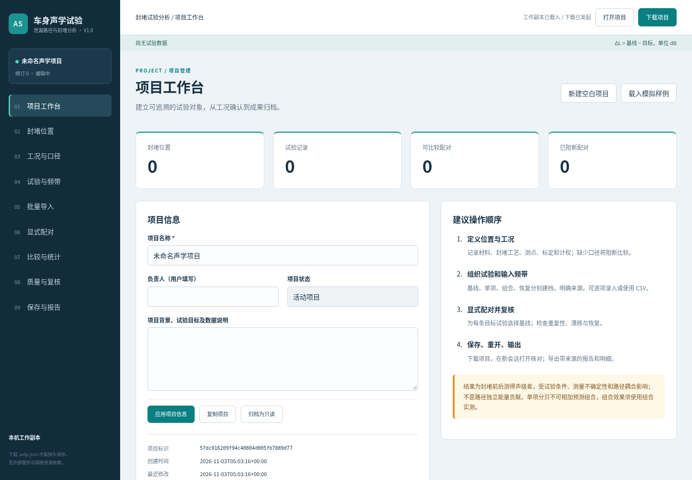

## 3 建立、复制与归档项目

1. 在“项目工作台”的“项目信息”区，将项目名称改为本次试验的可识别名称，例如“模拟验收项目”。负责人仅按实际人员资料填写；项目背景中说明试验目的、数据来源和边界。项目名称必填，最多160字符。点击“应用项目信息”，左上项目标签和修订号随之更新。

2. 页面底部显示项目标识、创建时间、最近修改时间和文件格式版本。这些是程序记录的工作副本信息，不应直接作为软件开发完成日或首次发表日期。修改后及时用顶栏“下载项目”保存。

3. 需要从已有对象创建独立任务时点击“复制项目”。副本获得新的项目标识，名称附加“副本”，原始试验、来源和配对继续保留。应在副本中调整项目说明，避免把复制的测量误认为新采集数据。

4. 完成整理后点击“归档为只读”并确认。归档表单会禁用，仍可保存和导出；需要继续编辑时回项目页点击“解除归档”。新建空白或载入样例会替换当前工作副本，若有未保存内容将出现确认提示，取消可保留当前工作。

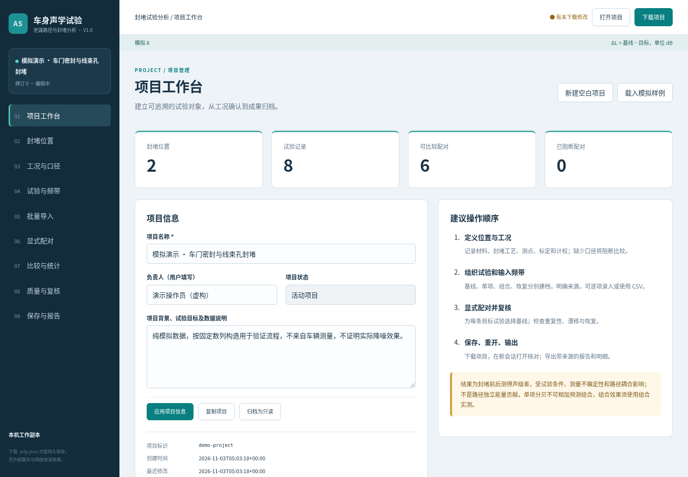

## 4 定义封堵位置和操作记录

前提：已经建立项目，且项目未归档。进入“封堵位置”，右侧默认是新增表单。位置是试验引用的对象，不是软件自动识别的泄漏结论；名称应对应试验人员能够找到和复现的位置。

1. 在“位置名称”填写“左前门上沿密封（模拟）”；在“车身区域”填写“左前门”。材料与规格按实际情况填写，模拟案例可写“模拟胶带”。在“封堵步骤与覆盖范围”描述覆盖起止点、覆盖长度或照片记录编号，在备注中说明恢复注意事项。点击“应用新增”。

2. 新位置出现在左侧列表，保存后自动生成稳定标识。选中列表中的名称，右侧进入编辑状态；修改材料或工艺后点击“应用修改”。点击“清空 / 新增”返回新增表单，避免覆盖已有对象。

3. 删除前先检查它是否被单项或组合试验引用。点击“删除”后会确认；如果仍有引用，软件阻止删除并给出关联试验名称。先到“试验与频带”修改试验的位置选择，或先移除不再需要的配对和试验，再回来删除位置。不要通过手工改项目文件制造悬空引用。

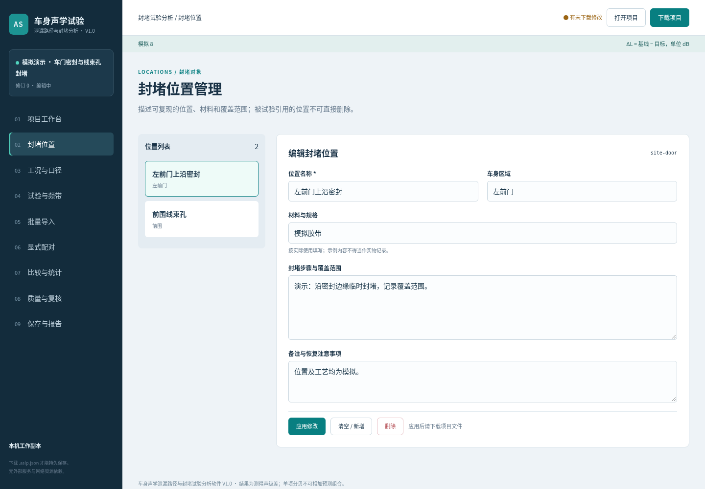

## 5 建立可比较工况与测量口径

进入“工况与口径”，填写工况名称。车辆标识、测点及安装位置、声源或激励、路面或试验场、挡位、频率计权、时间计权、频带制、仪器、标定链路和单位是比较所需的必要口径。可以保存未填齐的草稿，但这样的工况不能产生有效比较。

1. 对静态模拟案例，依次填写车辆SIM-UI、模拟耳旁测点、模拟宽带声源、模拟试验室、挡位P、车速0 km/h、转速0 r/min、温度23 °C、积分时长30 s。数值空白表示未知，不能用0代替未知；0仅用于确实为零的条件。

2. 选择Z计权、时间定义Leq和倍频程；填写模拟仪器与标定记录。真实数据必须使用仪器记录中的定义。软件不会将A、C或Z自动转换，也不会因为选择了某种计权就再次加权输入声级。单位固定支持dB re 20 µPa。

3. 确认频带互不重叠时才勾选对应声明；它只允许对录入频带合成，不等于全频总声级。点击“应用新增”后，试验页才可选择该工况。修改被引用工况会影响相关结果，系统会重新计算并记录修改字段；请根据真实记录修改。

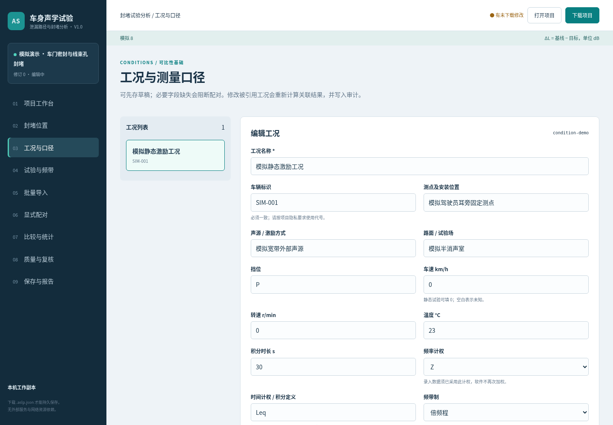

## 6 建立基线、单项、组合和恢复试验

前提：至少建立一个工况；单项或组合试验还需先有封堵位置。进入“试验与频带”，点击“新增试验”，输入名称，选择类型和关联工况。每次测量都建立独立试验，不能把相同数值重复复制后当作独立采集。

1. 基线试验表示封堵前状态，不选任何封堵位置。单项封堵必须选一个位置；组合必须至少选两个位置。恢复试验表示解除封堵后状态，不选位置。选错数量会拒绝应用并保留表单，按提示调整后重试。

2. 时间使用带时区ISO 8601，例如2026-01-01T10:00:00+08:00。重复组用于后续重复性统计，同名组仍按试验类型、位置集合和来源类别拆分。没有重复计划可留空。来源类别选择“模拟”“实测”或“人工填写”，来源说明必填。

3. 实测说明写数据文件、记录编号或采集依据，模拟说明写生成方法。填写操作员和备注后输入频带，点击“应用新增”。列表可按类型筛选，也可在查找框输入名称、标识或重复组并按回车。选中名称可编辑，应用后修订号增加。复制试验结构不复制测量、重复组或配对，必须重新录入并复核时间来源。

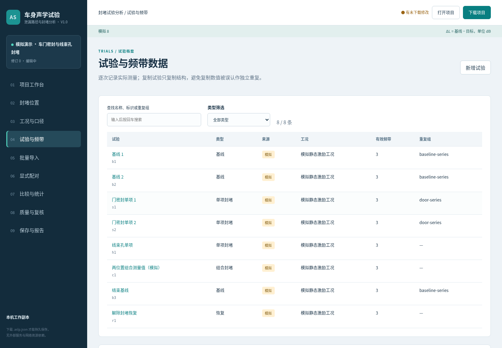

## 7 逐行录入频带与缺失值

在试验编辑表单向下滚动到“频带数据”。每行只写两列：频率Hz、声级dB，中间使用英文逗号，不带表头。例：125,70；下一行250,60。频率允许1—100000 Hz，声级允许-100—200 dB。范围只是输入保护，不是仪器有效量程。

1. 建立“基线70（模拟）”，来源说明写“手工构造数值70，模拟验证”，输入125,70及250,60并应用。再新增“单项67（模拟）”，选择一个封堵位置，工况相同，来源同为模拟，输入125,67及250,后应用。第二条250Hz的声级留空，表示缺失。

2. 输入声级0时，软件保存的是0 dB，并非缺失。声级空白、NA、N/A或null表示缺失；软件绝不补零。频率重复（例如125和125.0）、非数字或列数错误会提示具体行，修正该行后再应用。每试验最多200频带。

3. 预期结果：完成显式配对后，125Hz得到70−67=3 dB；250Hz显示缺失且差值为空；由于存在缺失，两试验不会产生录入频带合成差。这一步是独立数值核对，不证明真实车辆封堵能得到3 dB改善。

4. 编辑既有频带时，“应用修改”会以表单内容替换该试验的频带对象。需要保留旧频带时不要从文本中删除它，或使用下一节的CSV合并模式。操作前下载项目可保留可恢复版本。

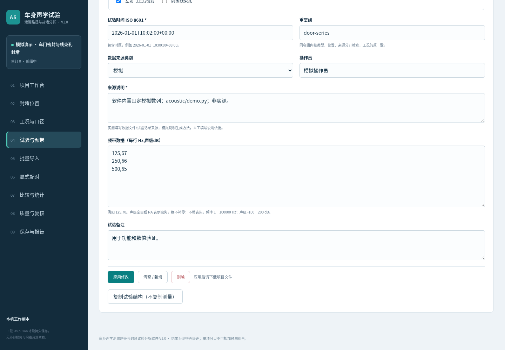

## 8 CSV 批量导入与事务预检

前提：先在试验页建立试验并填写来源；CSV只输入频带，不自动新建试验。进入“批量导入”，选择UTF-8 CSV文件，或直接粘贴文本。表头必须严格为trial_id,frequency_hz,level_db，使用英文逗号、句点小数。trial_id填写试验列表显示的标识，而不是名称。

1. “合并”保留未涉及的旧频带，只覆盖同名频带；“替换”清空本次涉及试验全部旧频带，再写入新频带。替换不会清空未在CSV中出现的试验。选择模式后点击“预检CSV”，此时项目数据尚未改变。

2. 核对预检的行数、受影响试验、缺失数和同频覆盖数；检查右侧试验名称与频带数量是否符合预期。点击“确认导入”，确认对话框中的覆盖范围，整个批次才应用并写审计。预检后改内容或模式会使预检失效，需重新预检。

3. 未知试验、重复频带、超范围数值、NaN或表头错误会取消整批，错误说明含CSV行号。用表格软件将文件另存为CSV UTF-8；将试验标识替换成当前项目的真实标识。导入后的来源沿用试验档案，请勿将模拟数值导入实测档案而不修正来源。

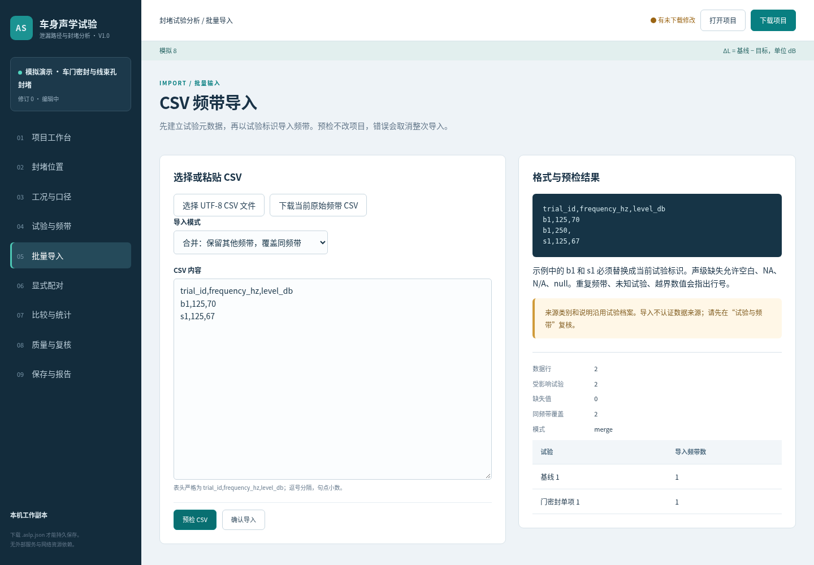

## 9 显式配对与比较条件检查

进入“显式配对”。每条结果必须由用户明确选择基线和目标，软件不根据名称、时间先后或导入次序猜测。基准必须为基线试验；用途为“封堵声级差”时目标为单项或组合，“基线漂移”目标为另一基线，“解除封堵恢复”目标为恢复试验。

1. 在下方新增配对表单选择用途、基准、目标，填写为什么使用这条基线的备注，点击“应用新增”。基线不可与自身配对，同一用途的相同基线与目标不可重复。需要改配对时在上方表格点击“编辑”。

2. 建立配对后立即检查状态。文本口径须完整并一致；车速、转速、温度和积分时长差须在设置容差内；来源类别不能混合。条件不符的配对可以保留以追溯意图，但计算被阻断，原始声级保留、差值为空，原因在表格、结果页和报告中可见。

3. 遇到阻断，先到试验页确认工况引用，再到工况页核对测点、计权、仪器、标定和缺失字段。只有原始记录证明条件一致时才能统一文字；不能为了产生结果随意放大容差或伪造条件。需要保留当前判断时，在结果页点击“记录当前分析复核”。

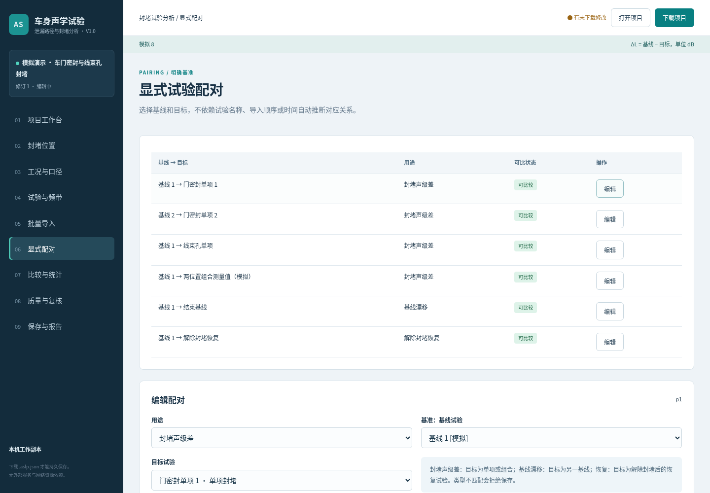

## 10 阅读测得声级差与组合比较

进入“比较与统计”，按用途筛选封堵、漂移或恢复。每张卡片显示基线、目标、来源、可比状态、逐频带柱图和数值表。横轴为Hz，纵轴为ΔL/dB，差值定义为基线减目标。正值表示该配对目标声级较低，负值表示较高；颜色同时配文字和数值。

1. 内置模拟样例的“基线1→门密封单项1”在125、250、500Hz分别为3、2、1 dB。先逐频带核对输入，再查看合成差。合成只在频带集合相同、无缺失并声明互不重叠时给出，旁边明确只覆盖录入范围。

2. 同页下方的单项与组合矩阵横向排列各配对。门密封单项125Hz差3，线束孔单项差2，组合自身模拟测量差4.5，而非3+2。每列使用它自己的基线和工况，因此不能根据表格直接作独立贡献排序。

3. 在矩阵扫描框填写下限200Hz、上限300Hz，点击“筛选显示频带”，只显示250Hz。留空表示不限；下限大于上限会拒绝。点击“显示全部频带”恢复。这个筛选只改变矩阵显示，不删除原始数据，不改变导出报告。来源与时间顺序可在各卡片的详情中展开核对。

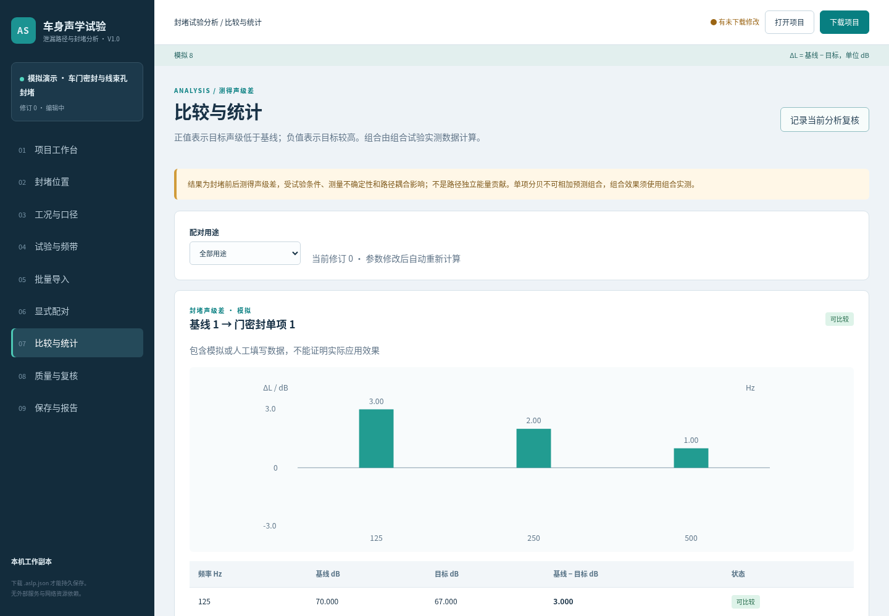

## 11 重复配对统计与置信区间

在比较页向下找到“同封堵方案的重复配对统计”。软件按目标封堵位置集合与来源分类，再检查跨配对工况是否一致。每频带只使用基线和目标都有效的完整配对，样本量n可能随频带变化。工况不一致时禁止汇总，仍保留原因。

1. “配对差均值”先算每对基线减目标，再对差值做算术平均；“组能量均值差”先分别对基线和目标做等权能量平均，再相减。它们不是同一指标。独立样例：基线60和70、目标60和60，配对差均值为5 dB，组能量均值差为7.403626895 dB。

2. 差值SD是配对差的样本标准差。双侧95%区间使用Student t方法，前提为独立配对差近似正态，不包含仪器系统不确定性。当n=1或同一组配对复用了任何试验，软件不生成区间并说明原因。n=1不是零宽区间，也不表示结果确定。

3. 自由度1—30使用内置临界值；超过30保守采用自由度30，说明中保留这个限制。样本很少或分布明显偏离假设时，不应把区间作为强结论。置信区间不证明路径独立、不证明因果，也不替代测量不确定度分析。

4. 初次核对能量运算可使用两个已知数：60和70的等权能量均值为67.403626895 dB；两个互不重叠60dB频带的能量合成为63.010299957 dB。它们分别是平均与求和，不可互换。

## 12 重复性、漂移、恢复与参数

进入“质量与复核”。顶部参数是工程筛查初值，不是标准限值。默认车速容差0.5km/h、转速20r/min、温度2°C、积分时长0.01s；漂移和恢复绝对差阈值、重复性样本SD阈值均为1dB。点击“应用参数并重新计算”后，历史输入统一按新参数重算并写审计。

1. 重复性按同重复组、同类型、同位置集合和来源统计，每频带列出有效n、缺失数、算术均值、能量均值、样本SD和极差。n<2显示样本不足；跨工况不一致显示阻断。重复性SD是dB数值的离散度，不能写成仪器精度。

2. 漂移和恢复摘要来自已建立的对应配对，逐频带绝对差的最大值超过阈值则警示。未设置配对或没有共同有效频带时无法检查。阈值内只说明本筛查没有超限，不等于恢复到完全相同的物理状态。

3. 下方数据覆盖区显示四类试验计数、工况缺失字段、位置覆盖、频带缺失/未声明及时间线。它描述录入情况，不证明样本充分。审计显示最近100条，完整项目保留最近10000条；点击“记录当前分析复核”可保存当前参数和阻断原因，记录不是防篡改签名。

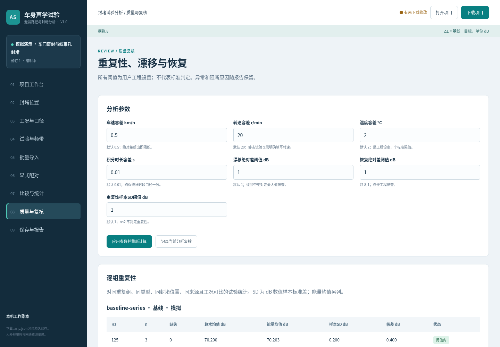

## 13 保存、搬迁与重新打开

本软件没有后台自动持久化，刷新、关闭页面或关闭浏览器会丢失未下载工作。先逐个应用当前表单，再在顶栏点击“下载项目”或到“保存与报告”点击“下载.aslp.json项目”。有未应用表单时导出被阻止，先应用或取消。

1. 浏览器会发起下载，文件名由项目名生成。软件显示下载目标文件名，但实际目录由浏览器设置决定；它无法确认用户是否取消保存。请打开浏览器下载记录，找到文件并确认大小大于零。不要仅凭提示认为文件已落盘。

2. 点击“打开项目”，选择刚下载的.aslp.json。若当前有未保存工作，会先确认替换。打开成功后核对项目名、修订号、位置数、试验数与结果。格式不支持、JSON损坏、未知引用或重复标识会拒绝打开，并保留原工作副本；不要覆盖原文件，先核对文件版本或使用备份。

3. 把项目文件复制到另一文件夹，再通过打开入口选择它。项目内嵌全部频带、来源、工况、配对、参数和审计，不依赖当初的CSV路径。只有原始音频或照片的文字编号不会自动携带对应实物文件；本版本不管理音频照片附件。

4. 建议按试验阶段保留不同文件名的备份，删除或覆盖旧文件由操作系统管理。归档项目仍能下载和打开；需要编辑时解除归档。最终交付前把报告与对应修订项目放在一起，避免错用其他修订的报告。

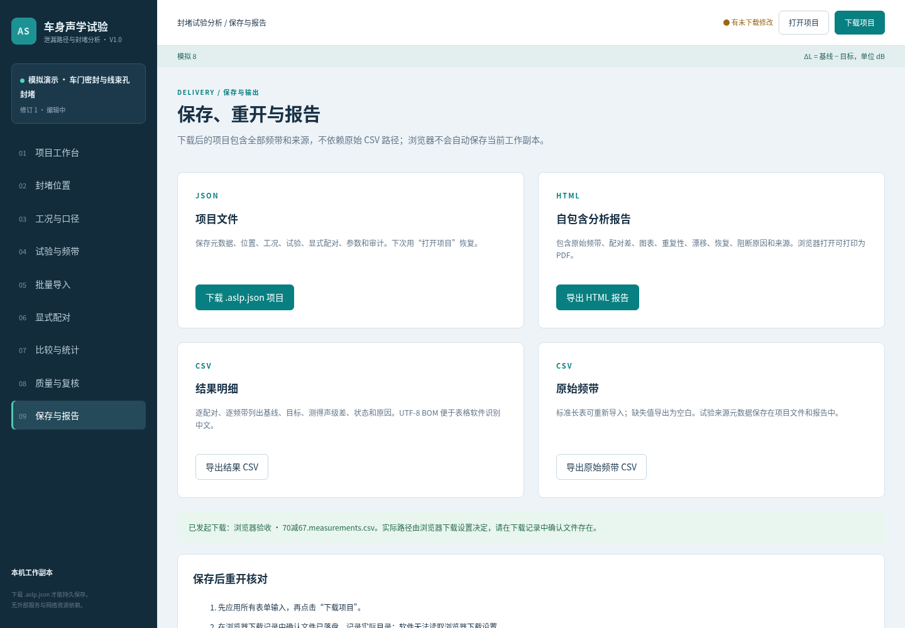

## 14 成果导出与完整案例复现

1. 在“保存与报告”导出HTML报告。文件包含项目及来源、位置、工况、原始频带、配对差与图表、重复统计、筛查、参数、质量问题、审计、覆盖和矩阵。用浏览器打开，可通过打印另存PDF；这类试验报告没有固定页数要求，检查打印预览是否裁切宽表。

2. 导出结果CSV可供二次复核，列名保留frequency_hz、baseline_db、target_db和measured_difference_db，另有项目修订、配对用途、来源和原因。导出原始频带CSV可重新导入，缺失保持为空白；它不含全部试验元数据，不能替代项目文件。

完整模拟案例：先在项目页点击“载入模拟样例”并确认，预期看到2个位置、1个工况、8个试验和6个配对。到比较页核对门密封单项125Hz差3dB、线束孔单项差2dB、组合差4.5dB；到复核页查看基线重复性和漂移、恢复。所有来源应为模拟。

继续点击“记录当前分析复核”，下载项目，再打开刚下载的文件，核对修订号和6条配对仍在。导出报告与两类CSV，在报告中查找模拟来源、125Hz差值、阈值与限制说明。此流程使用的数列在acoustic/demo.py中，可重复验证。真实数据需另行采集并记录真实来源，不能把本案例替换名称后当作实测成果。

## 15 常见异常与恢复步骤

页面无法连接：回到启动终端，确认服务仍运行且端口与浏览器一致。若端口占用，使用--port指定新端口；不要把监听地址改成公网。保留尚未关闭的浏览器工作副本，恢复服务后再下载。仅关闭Python服务不会自动保存项目。

配对被阻断：到显式配对查看基线与目标，再到试验页核对各自工况引用；在工况页逐项核对车辆、测点、声源、路面、计权、标定等字段以及数值容差。图12演示清空车辆标识后全部阻断，差值为空。按真实记录补充后应用，结果才会重新计算。

CSV导入失败：查看提示中的行号和字段，核对表头、逗号、UTF-8编码、试验标识和重复频率。修正后重新预检，未通过的批次不改变旧测量。恢复原数据可打开事先下载的项目副本；没有备份时不要使用替换模式试错。

删除失败：先处理提示中列出的引用。源码错误或内部服务错误：保留项目文件和终端日志，记录触发步骤与软件版本；不要公开上传敏感测量资料。无法生成置信区间时先查看n与复用试验说明，这通常是规则限制，不应手工填入虚假的区间。

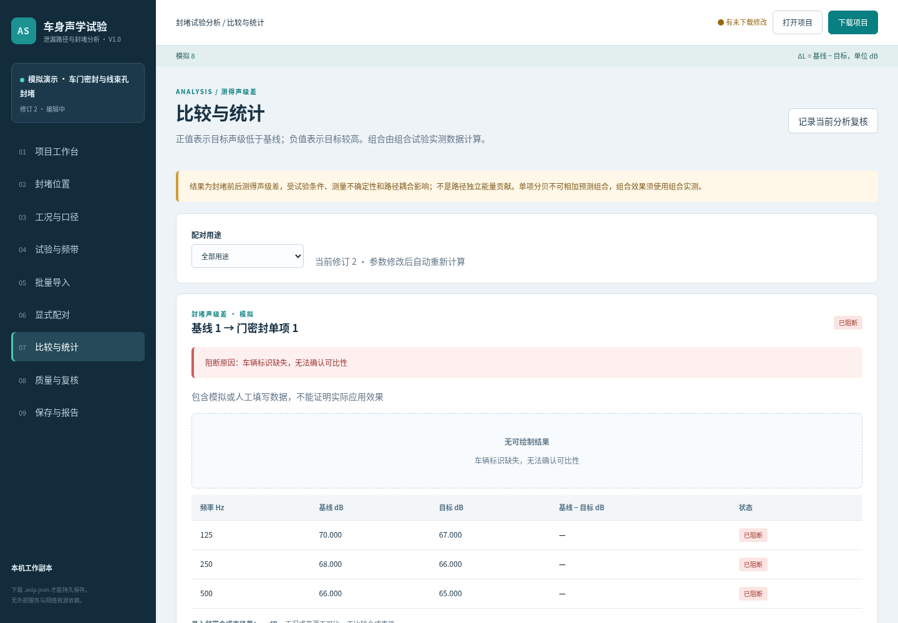

## 16 使用边界与交接核对

本版本已实现本机单用户项目管理、位置与工况管理、四类试验、逐行及CSV频带输入、显式配对、比较图表、重复性、漂移恢复检查、覆盖和矩阵扫描、项目保存重开以及HTML/CSV输出。没有声源分离、独立路径贡献反演、自动组合预测、音频频谱分析、云端协作或账号权限体系。

交接时依次核对：软件目录完整；Python可启动；普通启动为空白；模拟入口不会覆盖未保存内容而不提示；已知70与67差为3；缺失不补零；工况不一致阻断；项目下载后可重开；报告包含单位、来源、参数和修订。核对不通过时保留证据并修复，不把未执行项写成通过。

当前验证环境为Linux、Python3.12与无头Chromium，已有真实运行截图、浏览器记录和核心测试记录；未执行Windows/macOS实际启动、真实车辆数据验证、最大数据规模压力试验和Microsoft Word实际分页检查。软件名称显示V1.0，内部程序版本1.0.0，文件格式版本1。

本操作说明书DOCX是可编辑交付稿，配套PDF为浏览器打印预览。没有提供申请人专用模板，因此使用通用A4页眉和图注。正式软著提交前，申请人需用Microsoft Word检查实际不少于10页、图表断页和模板格式，并确认身份、权属、开发及发表日期、正式源码页数范围。不能用本稿虚构登记事实。
