# 车身声学泄漏路径与封堵试验分析软件 V2.0 操作说明书

## 1 软件介绍

应用背景：车身声学试验常通过临时封堵密封边、孔隙或接合处，比较封堵前后的车内频带声级。基线、单项封堵、组合封堵及解除封堵后的恢复需要共同记录车辆、测点、激励、计权、标定和环境。仅依靠临时表格容易遗漏条件、混淆试验对应关系，或把分贝差误认为某条路径的独立能量贡献。

软件概述：本软件V2.0面向负责试验组织、数据整理和复核的工程人员，使用C#/.NET与MVVM结构，提供AcousticSeal.sln解决方案。用户从空白项目开始定义位置和工况，记录四类试验及频带，显式建立基线与目标关系，核查比较、重复性、漂移和恢复，再实际保存、重开和输出报告。浏览器是本机C#应用的界面宿主。

软件处理已经提取、采用所声明计权的频带声级，不读取音频、不自动标定、不认证标准符合性。结果是封堵前后测得声级差，不是路径独立能量贡献；单项分贝不可相加预测组合。所有内置案例均为固定模拟数列，不能证明真实车辆应用效果。申请人、权属、开发与发表事实必须另行核实。本手册提供可编辑稿，Word实际分页尚待复核。

## 2 安装、解决方案与启动

前提：安装.NET SDK 10.0.403或global.json允许的同版本带后续补丁，并准备现代浏览器。将acoustic-seal-analysis文件夹完整复制到可写目录，保留src、解决方案和配置文件。生产程序不需要Python、npm或第三方NuGet包；Python工具仅用于浏览器检查与材料生成。

1. 在支持.NET10的Visual Studio中打开AcousticSeal.sln，将AcousticSeal.App设为启动项目后运行。也可终端执行dotnet build AcousticSeal.sln，再执行dotnet run --project src/AcousticSeal.App。Windows可运行run.bat，Linux可运行./run.sh。云端已实际构建解决方案并启动命令行服务，未验证Windows Visual Studio按F5的图形操作。

2. 浏览器打开http://127.0.0.1:8765。默认空白项目显示零试验。端口冲突时传入--port 8766并使用对应地址。数据默认保存到应用目录Data，可用--data-directory指定可写目录。仅监听本机回环，不提供公网访问或多人远程协作。退出前须应用表单并保存，刷新或关闭会丢失未保存工作副本。

## 3 项目身份、目标与本机项目库

1. 在“项目工作台”填写项目名称、实际负责人、车辆项目代号、试验目标和来源说明。项目名必填，最多160字符。点击“应用项目信息”，左侧项目标签和修订号更新；这一步只更新工作副本，还没有写入磁盘。顶栏状态会提示有未保存修改。

2. 项目详情包含稳定标识、创建与修改时间、软件及格式版本和保存位置。这些时间是用户项目操作时间，不应直接填作软件开发完成日或首次发表日。下方本机项目库只列出软件实际保存的.sealproj，点击刷新可重新读取磁盘状态；损坏文件会显示读取错误而不静默丢失。

3. 点击“复制为新项目”生成新项目标识并保留已应用输入与来源，不能把复制测量当作新采集。点击“归档为只读”并确认后，编辑控件禁用；仍可保存和导出，解除归档后恢复编辑。新建、载入案例或打开其他项目会确认替换范围，当前有未保存内容时先取消并保存。

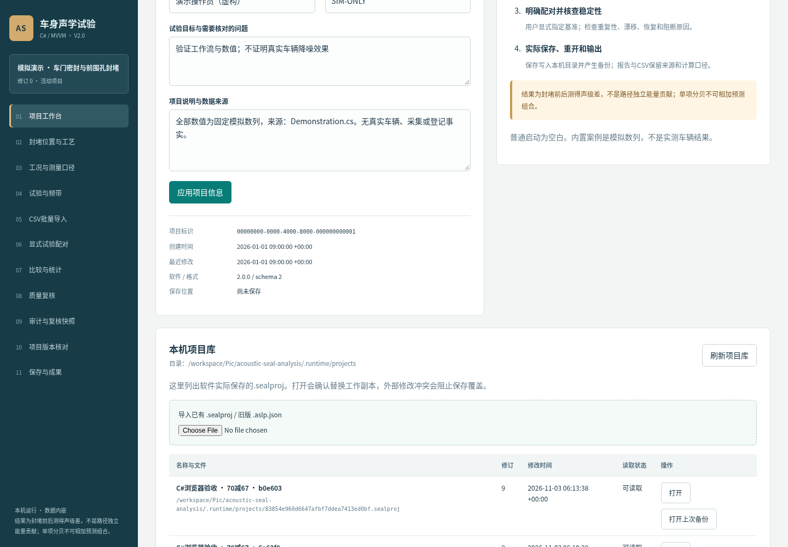

## 4 封堵位置、覆盖与恢复工艺

前提：项目未归档。在“封堵位置与工艺”点击“新增位置”，右侧填写名称、车身区域、材料规格、覆盖范围、封堵步骤、解除封堵与恢复步骤。可填写照片或作业记录编号，但该字段仅为文字引用，不自动把图片装入项目文件。

1. 模拟案例可填名称“模拟车门位置”、区域“左前门”、材料“模拟胶带”，在步骤中说明模拟覆盖范围。点击“应用新增”，列表出现位置，标识保持稳定。选中已有位置可编辑并应用修改；“清空/新增”返回新的草稿，避免覆盖旧对象。

2. 位置是试验对象，不是自动确认的泄漏路径。删除时软件先确认并检查引用；若仍被单项或组合试验引用，显示关联试验并阻止删除。先处理相关配对和试验或修改其位置引用，再删除。未应用的输入不会改变原项目，切换对象时可取消放弃操作。

## 5 工况与测量口径

进入“工况与测量口径”，先填名称。车辆、测点、激励、路面场地、挡位、频率计权、时间定义、频带制、仪器、标定链路和单位是比较所需口径。可以保存草稿，但缺失任一必要字段会阻断比较；不能为通过软件伪造一致性。

1. 静态模拟工况填写车辆SIM-UI、模拟耳旁测点、模拟宽带、模拟试验室、挡位P、车速0km/h、转速0r/min、温度23°C和积分时长30s；计权Z、时间定义Leq、倍频程，填写模拟仪器和标定说明。未知数值留空，0只用于实际为零的条件。

2. 采样率和同步定义可填写真实记录，再在质量页选择是否强制检查。输入须已完成所声明计权，软件不重复加权。只有确认频带互不重叠时勾选对应声明，合成仅代表录入范围，不是全频总声级。应用工况修改会重新计算全部相关结果并写审计。

## 6 四类试验与来源档案

前提：至少已有一个工况，封堵试验还需先定义位置。在“试验与频带”点击“新增试验”，填写名称、类型和关联工况。基线与恢复不选封堵位置；单项恰好选一个；组合至少选两个。数量错误会拒绝应用并保留表单。

1. 时间采用带时区ISO8601，例如2026-01-01T10:00:00+08:00。重复组用于同类、同位置集合、同来源且工况可比的重复性统计。每次测量建立独立试验，不把相同数值复制后当作独立采集。来源类别可选模拟、实测（用户声明）、人工或估算，来源说明必填。

2. 实测来源填写采集文件或记录编号，模拟、估算和人工说明构造方法及依据。填写操作员、准备状态和备注。应用后列表可按名称、GUID、重复组和类型筛选，每页40条。复制试验结构不复制频带、重复组或配对，并更新为待录入名称，须复核时间和来源。

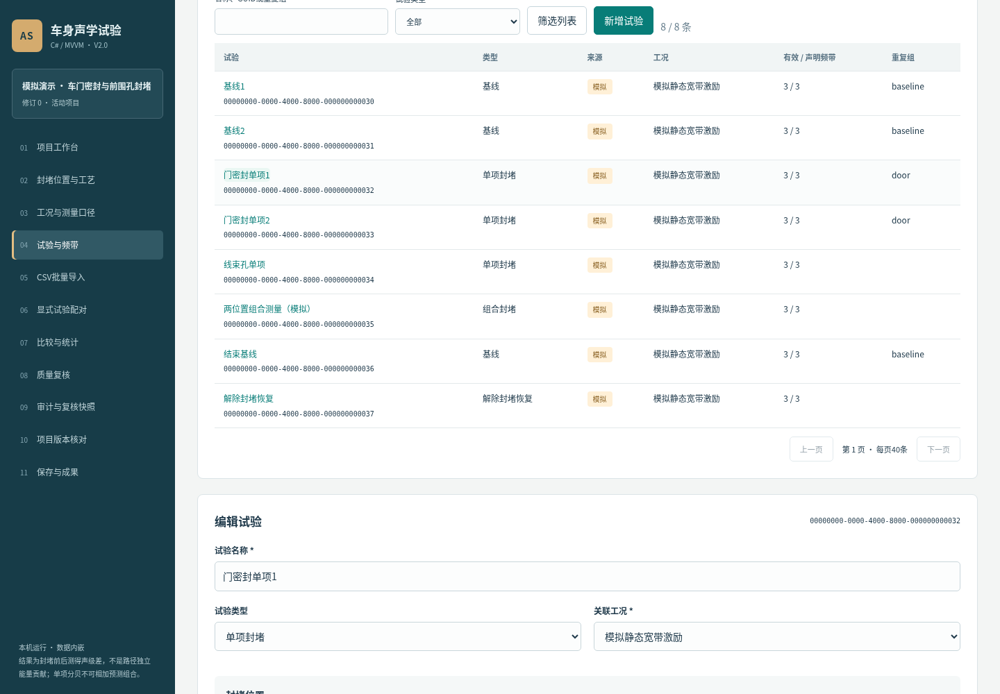

## 7 结构化频带输入与粘贴

在试验表单向下滚动到“结构化频带数据”。每行填写中心频率Hz、声级dB和可选备注。频率1—100000Hz，声级-100—200dB；这些是软件输入保护，不代表仪器量程。点击“新增频带行”增加草稿行，可移除单行或选中行，应用试验前项目不变。

1. 建立“基线70（模拟）”，来源说明写“手工构造70”，输入125Hz、70dB。再新增“封堵67（模拟）”，选单项及一个位置，工况相同、来源同为模拟，输入125Hz、67dB。完成显式配对后预期差值3dB。

2. 声级空白表示缺失，0dB是有效数值；缺失不补零。可展开粘贴入口，输入每行Hz,声级两列，不带表头，空白、NA、N/A、null可表示缺失。点击“解析并替换草稿表”只替换当前草稿，错误时原表不变。重复频率或越界值会指出行号，修复后应用。

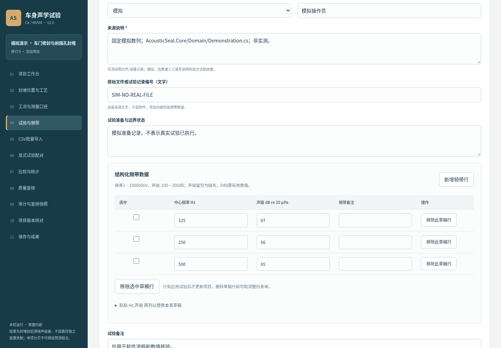

## 8 CSV批量预检与整体应用

进入“CSV批量导入”，选择UTF-8文件或粘贴内容。先建立试验档案，CSV不自动创建试验。表头按顺序为trial_id、frequency_hz、level_db，试验标识使用GUID。选择逗号、分号或制表符与文件一致，数值使用句点小数。

1. 合并模式保留其他频带并覆盖同名频率；替换模式清空本次涉及试验的全部旧频带，再写入新频带，不影响未涉及试验。点击“预检CSV”尚未改测量，核对行数、受影响试验、新增、覆盖和缺失数量。预检后改文本、模式或项目需重新预检。

2. 点击“核对后确认导入”，再次核对确认框才整体应用。未知试验、重复频率、错列、错引号、无效编码或非有限数值会阻止整批，显示CSV行号及具体原因。来源沿用试验档案，不会因导入数值而认证实测。需要恢复原值可用当前会话撤销，或打开保存备份。

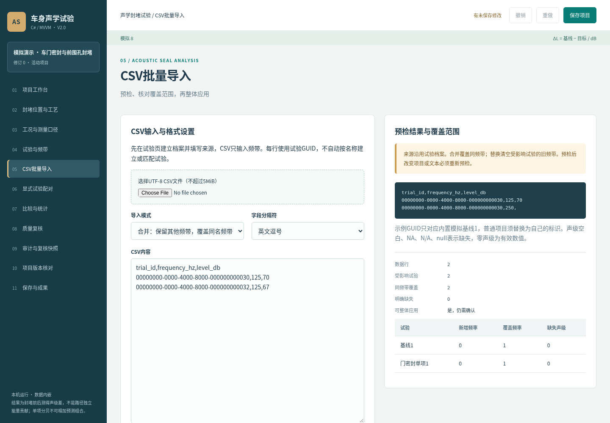

## 9 显式配对与批量对应关系

在“显式试验配对”选择用途、基线和目标。基准必须是基线；封堵声级差目标为单项或组合；漂移目标为另一基线；恢复目标为恢复试验。不可自配对或重复相同用途的相同对应关系。填写选用此基线的依据后应用。

1. 上方列表显示状态。工况或来源不符的配对允许保留，但差值被阻断并列出原因。回试验核对工况引用，再按真实记录补充口径；不能只放大容差消除提示。基线、目标和来源应与试验计划相符，时间仅辅助核查，不用于自动推断配对。

2. 批量操作时明确选择一个基线与用途，逐个勾选目标，再点击预检。逐行检查基线、目标、重复项和条件阻断原因后确认建立。共享基线会造成统计依赖，软件不把这样的重复配对作为独立样本生成均值区间。预检后项目改变会拒绝过期应用。

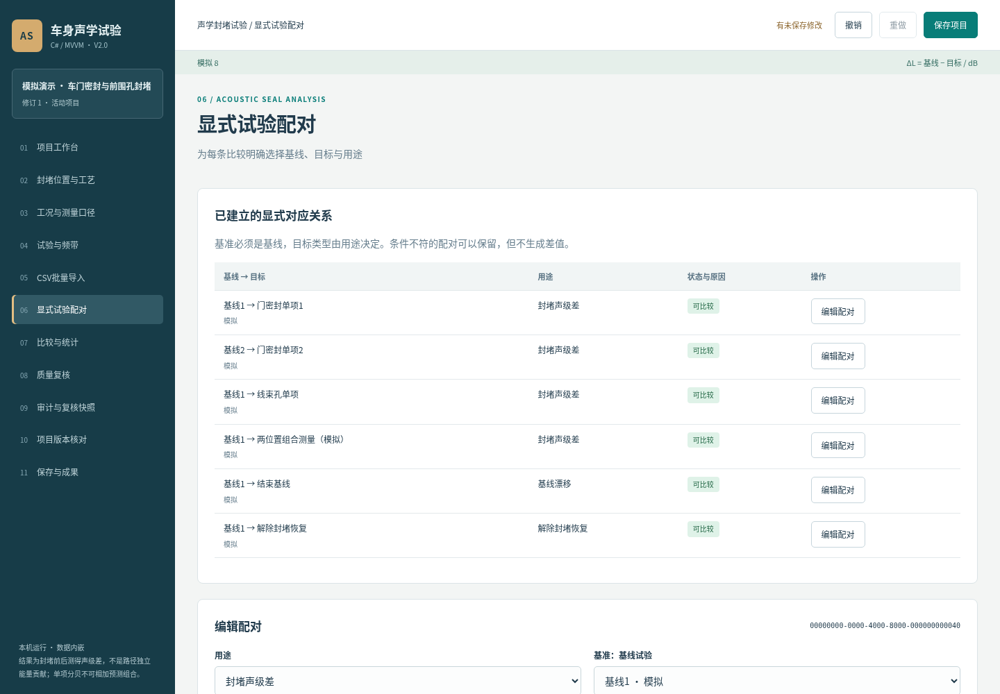

## 10 差值图、频谱与矩阵

进入“比较与统计”，按用途、来源、状态、位置或名称筛选。填写频率下限与上限，点击“应用显示筛选”；留空为不限，下限不可大于上限。筛选只改变显示，不删除原始数据或改变完整报告。

1. 卡片列出基线、目标、来源、差值图和表格。ΔL=基线−目标，正值表示目标较低，负值表示较高。模拟门密封单项在125、250、500Hz差值为3、2、1dB。只有频带集合一致、无缺失且确认互不重叠时给录入频带合成差，并明确不是全频总声级。

2. 点击“基线与目标频谱”查看原始声级，横轴为对数Hz，纵轴截断dB并有说明。缺失处断线，不插值补数。超过30频带提示缩窄范围，完整数值仍保留。下方单项/组合矩阵只并列各自测得差；模拟单项3与2dB不能相加预测组合，组合自身测量得到4.5dB。

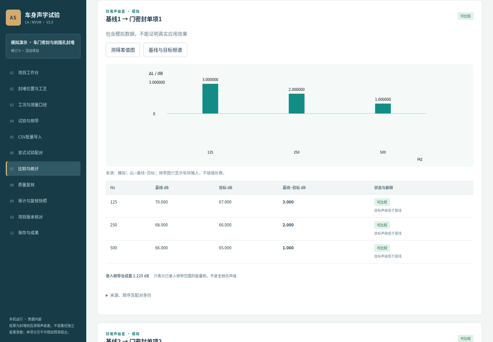

## 11 重复配对统计与区间限制

同方案统计按封堵位置集合与来源分类，再对各配对工况两两核查，避免容差经多次关联累积。每频带仅使用基线与目标都有效的完整配对，n可能随频带变化。工况不一致禁止汇总，保留原因。

1. 配对差均值先求各对差再算术平均；组能量均值差先分别求两组等权能量平均，再相减。独立反例：基线60/70，目标60/60，配对差均值为5dB，组能量均值差为7.403626895dB。两列不能互换。60与70能量均值为67.403626895dB，两个互不重叠60dB频带能量和为63.010299957dB，平均与求和也不能混用。

2. 双侧95%均值区间使用Student t，要求配对差独立、近似正态。n=1或同组复用任一试验不生成区间；自由度超过30保守用30并说明。不包含仪器系统不确定性，不证明独立路径贡献、因果或标准合格。先核对n、来源和独立性，再决定是否补测。

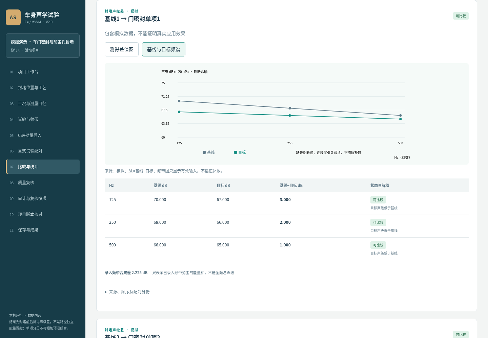

## 12 重复性、漂移与恢复

进入“质量复核”，先核对参数初值：速度容差0.5km/h、转速20r/min、温度2°C、积分时长0.01s；漂移、恢复与重复性SD阈值各1dB。它们是工程初值，不是标准限值。变化标记阈值默认0，只改变解释文字。

1. 同组重复性显示每频带有效n、缺失、算术均值、能量均值、样本SD和极差。n小于2不生成SD或判定，工况不一致阻断。dB数值样本SD是离散度，不应写作仪器精度。修改参数草稿后点击“应用参数并重算”才改变项目，历史输入统一按新参数计算并写审计。

2. 漂移与恢复摘要来自对应显式配对，使用逐频带绝对差最大值与用户阈值比较，列最差频率。超过阈值警示，阈值内不保证边界完全恢复；无对应试验或共同有效频带不能判断。检查声源稳定性、标定、环境与材料恢复状态，必要时补测，不以改阈值替代复核。

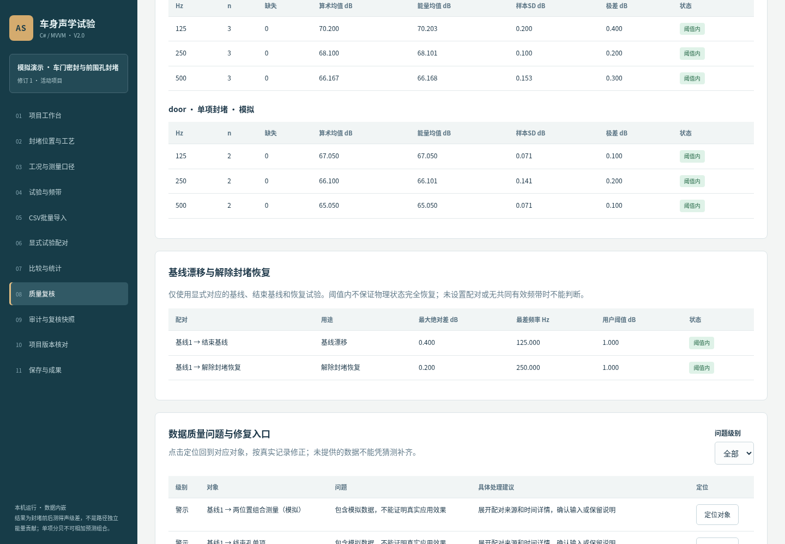

## 13 质量定位、覆盖和输入核对表

质量问题表按阻断、警示、提示列出对象、原因与具体修复建议。点击“定位对象”回到对应工况、试验或配对；有未应用表单时先确认放弃。按真实记录补充后应用，不能凭猜测补齐缺测。覆盖区显示四类试验计数、位置、工况缺字段、频带完整性和按时区时间线，仅描述录入情况，不证明样本充分。

1. 明确缺失指频率已声明但声级为空；未声明指该试验没有频率键。两者都不补零。原始核对工作表显式勾选1至20条试验，输入可选频带范围并生成横向原始声级表；不同来源或工况给出警示，但不自动建立配对或计算封堵差。

2. 工作表列示试验、工况、来源和频带状态，可下载含溯源段的CSV。候选试验查找最多显示前100条，使用名称或重复组定位其他对象。项目改变后工作表标为旧输入快照并拒绝下载，须重新生成。核对表不是完整项目文件，也不是独立贡献分析。

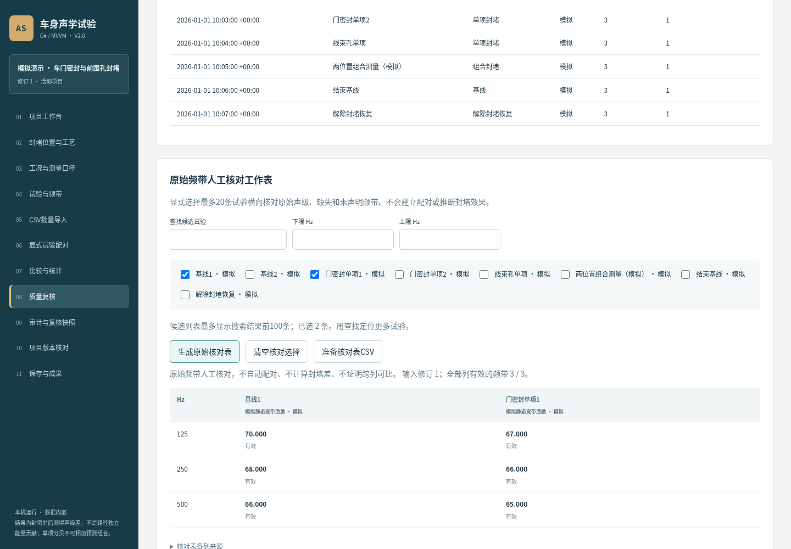

## 14 工程规则情景核对

规则情景用于了解同一输入在不同工程参数下的阻断和筛查状态，不推荐放宽参数，不改测量，不是组合效果预测。在质量页选择一个参数，在假设值框用英文逗号填写1至20个互不重复的数值，范围与该参数允许范围一致。

1. 例如选择漂移阈值，填写0.2,0.5,1，点击“运行规则情景”。内置模拟案例的最大漂移约0.4dB，0.2情景有1条漂移/恢复警示，0.5和1没有对应超限。表中显示各情景可比较/阻断配对数、漂移恢复警示和重复性警示频带数，可展开逐配对状态与原因。

2. 当前项目参数保持不变。要改变正式设置，必须回顶部参数区根据真实工程依据应用；不能将情景自动当作推荐值。项目或情景请求改变后，旧结果会提示过期且禁止导出。准备情景JSON后点击下载，保留输入哈希和假设参数；它不是可重开的.sealproj项目。

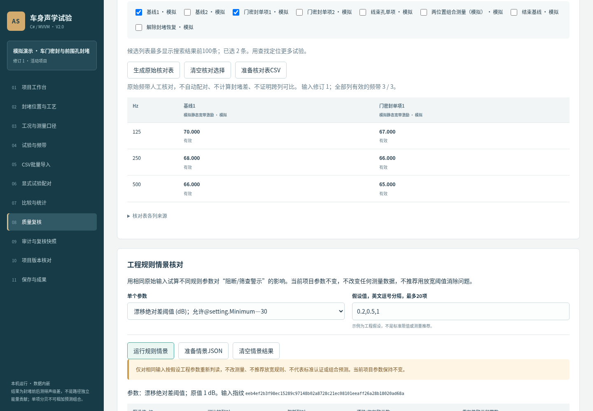

## 15 审计、撤销重做与复核快照

应用数据修改后，可用顶栏撤销/重做恢复当前会话最近20步。修订号保持递增，累计审计和复核不被删除；打开项目不会恢复撤销栈。未应用表单会先确认放弃，输入校验失败不会增加历史或改变旧项目。

1. 在“审计与复核快照”填写实际复核人、判断和补测安排，点击记录。快照保存当时输入修订、有效/阻断配对数、全部阻断原因、参数JSON和输入SHA-256。后续数据修改不会伪装成当时已被复核的新结论。复核记录不是认证证书。

2. 展开记录查看参数及阻断原因；下方显示最近200条审计，项目最多保留10000条。哈希便于核对内容，指纹排除纯审计/复核及操作修订更新时间。磁盘冲突ETag则对整个文件字节计算。文件和审计可被用户编辑，没有防篡改签名保证；必要资料应按单位要求另外留存。

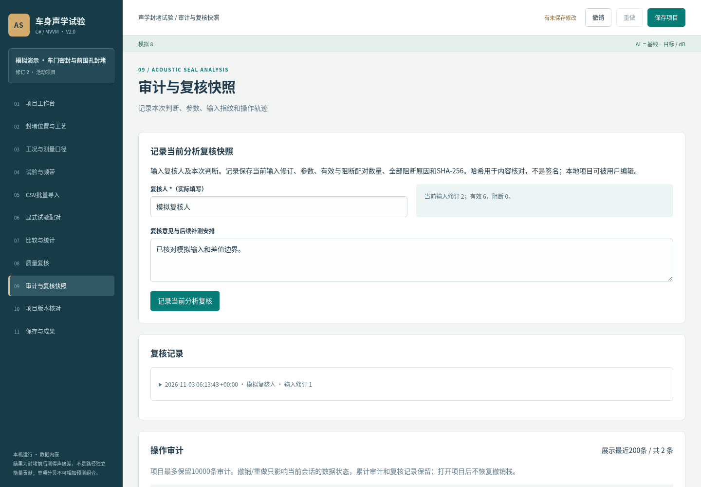

## 16 两份项目的版本内容核对

在“项目版本核对”分别载入左右两份.sealproj或旧版项目，也可使用当前已应用工作副本快照。核对副本不覆盖当前项目，不包括尚未应用表单。旧版迁移说明会显示，原文件不改。

1. 点击“核对两份项目内容”，软件按GUID匹配位置、工况、试验和配对，按频率匹配频带。新增、移除和修改分列显示，路径定位到具体字段；不按名称猜测对象，项目标识不同时明确提示不能断言属于同一试验版本。

2. 可按路径/内容和变化类型筛选，每页50项。展开长内容查看全文，下载JSON保留两侧身份、修订和输入指纹。审计及复核只比较数量，详细历史仍在各项目中。此功能比较输入内容变化，不把67改为空的记录解释为声学效果变化，也不自动合并文件。

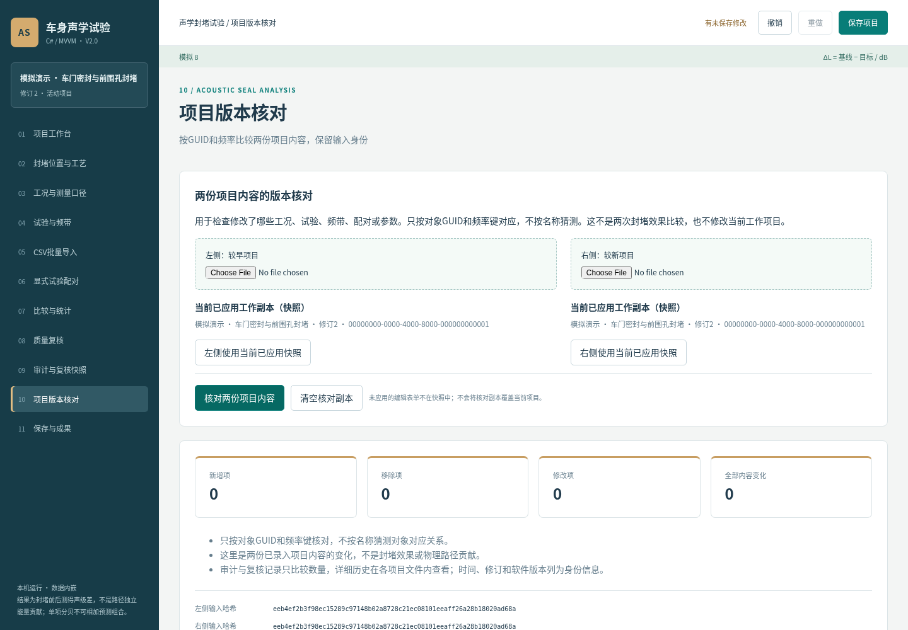

## 17 实际保存、备份与冲突处理

应用所有表单后点击“保存项目”。软件在本机目录实际写入GUID命名的.sealproj，提示完整目标路径；写临时文件并刷新后替换，覆盖前保留.bak。默认目录可在启动参数中改为可写目录。首次保存没有旧版本备份，之后保存保留上一次文件。

1. 回项目工作台刷新项目库，打开刚保存的项目并核对名称、修订、试验数和配对。打开上次备份仅载入未保存副本，不自动覆盖当前文件；确认内容后再显式保存。备份与原子写不能代替单位备份策略，也不能保证所有断电或硬盘故障下绝不丢失。

2. 另一会话修改/删除文件或同标识导入未经打开时，磁盘ETag不匹配会阻止覆盖。先取消并保留工作，可复制成新项目另存，或重新从项目库打开磁盘版续改，不反复覆盖。关闭页面不会自动保存；有未保存修改会提示，但浏览器行为和断网不能作为数据备份。

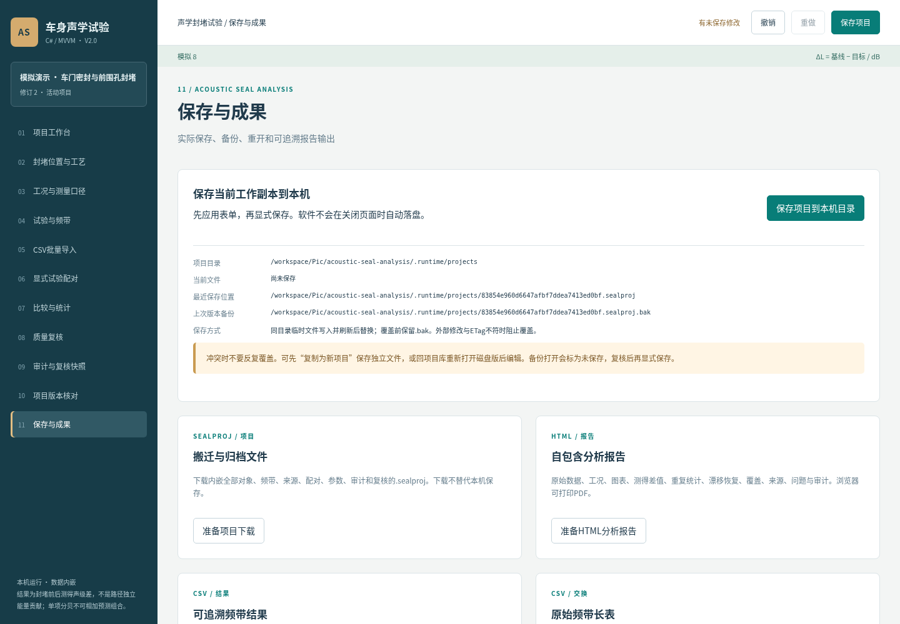

## 18 搬迁、旧格式导入与成果输出

1. 在“保存与成果”准备项目下载，再点击出现的下载链接，在浏览器记录确认实际目录。链接约10分钟有效，过期重新准备。下载不会替代本机保存。把.sealproj复制到另一目录，通过项目页导入打开，核对全部内嵌频带、来源和关系不依赖原CSV路径。

2. 旧版schema1的.aslp.json在内存中明确迁移，字符串标识稳定映射GUID，保留来源、数值和配对，新增字段留空，不捏造记录。原文件不改，另存schema2。项目库已有同GUID时先打开磁盘版或复制新标识再保存，导入本身不会直接覆盖。

3. HTML报告自包含数据、图表、来源、参数和审计，可浏览器打印PDF。结果CSV含版本、单位、对象、参数和哈希；原始频带CSV只交换三列，不替代项目。分析JSON含输入和完整结果快照，不能当项目重新打开。输出后核对对应修订、Hz、dB和来源，报告不作标准认证。

## 19 完整模拟案例与异常恢复

完整案例：空白项目定义“模拟车门位置”和完整静态工况，建立基线125Hz/70dB与单项125Hz/67dB，来源均模拟，显式配对后差值3dB。实际保存并从项目库重开，核对2个试验及差值；准备下载报告和项目，搬迁后导入核对。内置案例另含8试验6配对，门密封单项差3、线束孔单项差2、组合差4.5，不能相加成5。

条件阻断：打开模拟工况清空车辆标识并应用，6条配对全部阻断、差值为空。按真实记录修复字段后才能比较。CSV失败按行号检查表头、分隔符、GUID、重复频率和范围，整批错误不改旧数据。删除被引用对象时先处理关联试验/配对，不手改文件制造悬空引用。

无法启动时检查.NET10版本、终端错误、端口和目录写权限。连接断开先恢复服务并保留页面，已保存文件从项目库重开；不要假定未保存内容已经落盘。未知版本、损坏JSON或无时区时间拒绝导入，保留原文件和备份。无区间时核查n及试验复用，不手填虚假置信区间。

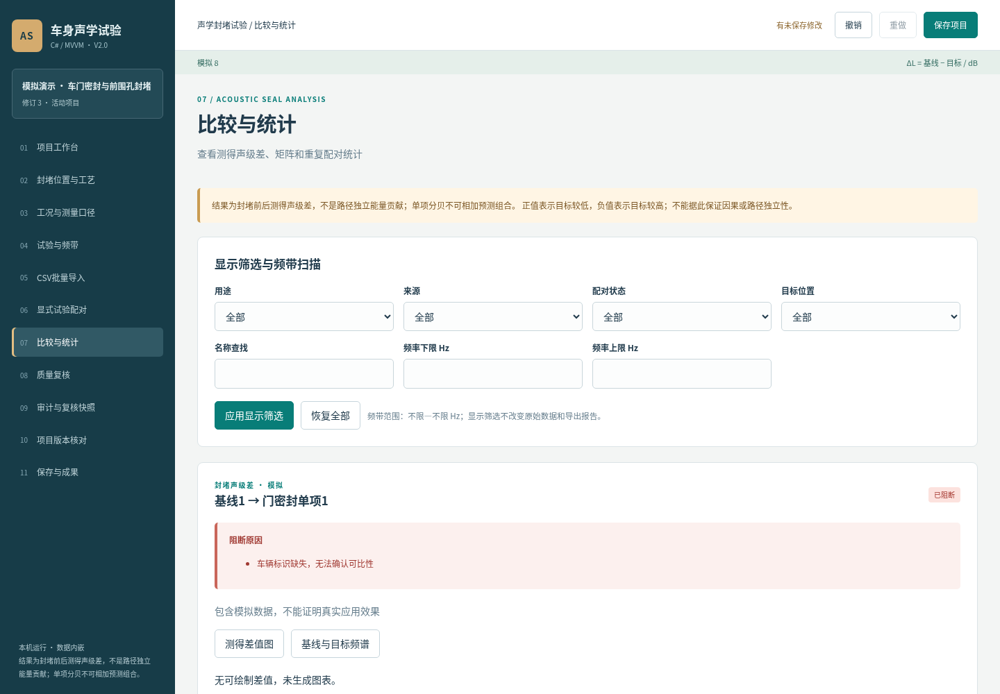

## 20 交接与正式材料核对

交接时按实际操作核对：打开AcousticSeal.sln并构建，启动应用，空白输入、配对、查看、保存、重开和输出；执行C#验证工程检查已知数值和异常。源码按src下C#、Razor和CSS生产非空行统计，排除bin/obj、测试、工具和文档；旧基线3523，本次最低目标7046，实际值见源码清单和逐文件哈希。

本次云端为Linux/.NET10与无头Chromium，已有独立数值与文件测试、真实浏览器流程、界面截图和预览分页证据。未执行Windows/macOS图形启动、Visual Studio按F5、真实车辆应用效果、最大规模性能及Microsoft Word实际分页，不把这些写为通过。

本说明书是通用A4可编辑稿，配套PDF为浏览器打印预览，不能替代Microsoft Word打开或Word导出PDF确认不少于10页的正式要求。未收到申请人专用模板；申请人、权属、开发完成和首次发表状态日期均待核实。提交前适配当次模板，逐页检查手册、信息表、源码范围和签章，不冒用模板事实或宣称已登记。
