# 车外行人警示声音传播与覆盖设计软件 V1.0 操作说明书

## 软件介绍

本手册介绍车外行人警示声音传播与覆盖设计软件V1.0的使用方法。软件面向汽车NVH、附件声学和布置工程人员，用于在设计前期比较警示扬声器的位置、朝向、参考频谱和背景条件，并把方案及计算依据保存到可重新打开的项目文件中。NVH指噪声、振动与声振舒适性；本软件聚焦其中的车外声音设计环节。

在布置讨论中，工程人员常需要同时查看扬声器安装图、频响表、背景声记录和不同位置的估算结果。各文件分开维护时，容易把不同参考距离、接收高度或背景条件下的方案直接比较。本软件围绕同一个项目组织这些条件，使用户能够核对每一次声场计算的输入，以及声源更改前后的差异。

软件提供项目档案、扬声器频带与位置编辑、背景和接收网格设置、频谱批量导入、观察点管理、自由声场计算、方案快照比较、参数扫描、方向剖面、数字音频分析、相对试听以及成果输出。用户从空白项目开始，依次输入、应用、计算、核对、保存、重开与导出，形成完整工作流程。

软件采用自由声场近似和非相干能量叠加。车辆外形只作为布局和内部网格排除的轮廓，不参与遮挡、反射、衍射或地面作用计算。结果是工程估算，不能代替真实安装条件下的测量，也不提供法规符合性、行人可听性或实际性能保证。模拟示例始终保留来源标记。

### 基本工作对象

项目保存责任人与设计目标；扬声器保存坐标、指向参数、七个频带与音频；观察点保存平面坐标；设置定义背景和接收平面；快照冻结方案输入，供后续复核比较。

### 开始使用前

准备轴向参考距离下的频带声压级及来源。如果只有未标定录音，应保留数字音频身份，不能直接把数字幅值当作声压级。所有默认工程阈值都需要使用者按设计目的判断。

## 启动软件与认识工作台

在已安装.NET SDK 10.0.403或同版本带补丁的电脑中，进入软件目录，执行dotnet build AvasCoverage.sln。构建成功后执行dotnet run --project src/Avas.App，或使用run.bat、run.sh。浏览器打开http://127.0.0.1:8786。若端口占用，启动时追加-- --port 8787，并访问对应端口。Windows集成开发环境可打开AvasCoverage.sln，选择Avas.App为启动项目。

正常启动显示空白项目，不自动装入示例。左侧导航从项目到帮助列出工作页；右上方提供撤销、重做、保存项目和运行计算。项目标题下显示项目修订、是否归档、编辑状态以及结果是否有效。界面顶部的状态条报告最近一次操作；错误框给出失败原因。

字段在编辑区输入后，先出现未应用编辑提示。点击应用编辑才更新项目；点击放弃编辑则恢复项目中已有值。未保存修改表示应用后的内容尚未写入项目库。无当前有效结果表示还没有计算，或计算输入已经改变。先理解这三个状态，再进行保存和结果判读。

### 运行边界

本机服务仅监听127.0.0.1，不提供远程账号或协作功能。浏览器刷新、关闭、连接过期或服务停止可能丢失未保存工作副本；外部导航提示不能代替定期保存。

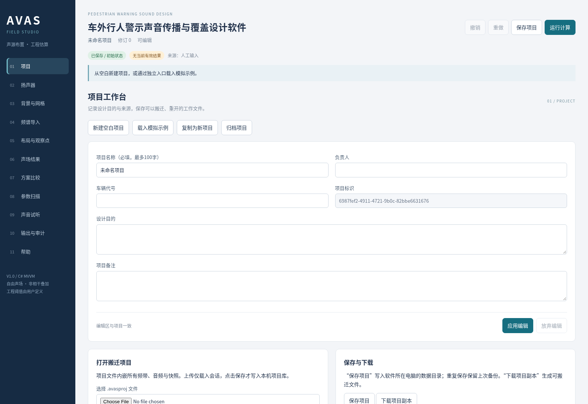

## 建立项目与填写档案

进入项目页。首次使用可直接在空白项目中填写项目名称、负责人、车辆代号、设计目的和备注。项目名称必填，最多100字符；负责人和车辆代号也各最多100字符。设计目的应说明要比较的位置或方向，以及希望通过结果采取什么下一步动作。

以核对案例为例，名称填写独立解析核对，负责人填写自己的姓名或岗位，设计目的填写核对全向单源在2米处的几何扩散。完成后点击应用编辑。标题区显示新的名称和递增修订，状态条说明字段已经应用。项目标识由软件自动生成，用户不需要手填。

新建空白项目会替换当前工作对象；如果当前有未保存或未应用内容，先出现确认提示。载入模拟示例会建立前部双扬声器、模拟背景和四个观察点，便于浏览功能。它是固定模拟数列，不代表任何车型实测。复制为新项目生成新的项目标识，适合保留原项目后独立设计。

### 归档与解除

归档项目使修改命令拒绝执行，仍可计算和输出。需要继续设计时回到项目页点击解除归档。归档状态需要保存才写入文件；它是软件工作状态，不是文件系统权限控制。

## 输入扬声器位置与传播参数

进入扬声器页，点击添加扬声器，在对象标签中选中要编辑的源。最多8个源，每个源可单独启用或停用。复制当前扬声器会复制频谱、参数和内嵌音频，并分配新标识；复制后位置暂时相同，应按安装设计调整。删除当前扬声器需确认，历史快照仍独立保留。

车辆中心为坐标原点。X正向为车前，Y正向为车左，高度沿竖直方向以米填写。位置坐标允许−100至100米，源高度0至10米。水平朝向0度指向车前，90度指向车左，允许−360至360度。核对案例将X、Y填0，高度填1.5米。

轴向参考距离是输入频带声级所对应的距离，范围0.1至10米；默认1米。全频带增益是对所有输入频带额外施加的分贝增量，范围−40至40，默认0。指向指数n为0时定义全向；大于0时前向声压幅值随水平角度余弦的幂变化，默认1。

背向幅值下限floor为0.01至1的幅值比，默认0.2，对应背向约−13.98分贝修正。它不是频率相关的真实极坐标测量曲线。核对案例将指向指数填0、增益填0、参考距离填1米，完成后点击应用编辑。源高度与接收高度共同决定三维传播距离。

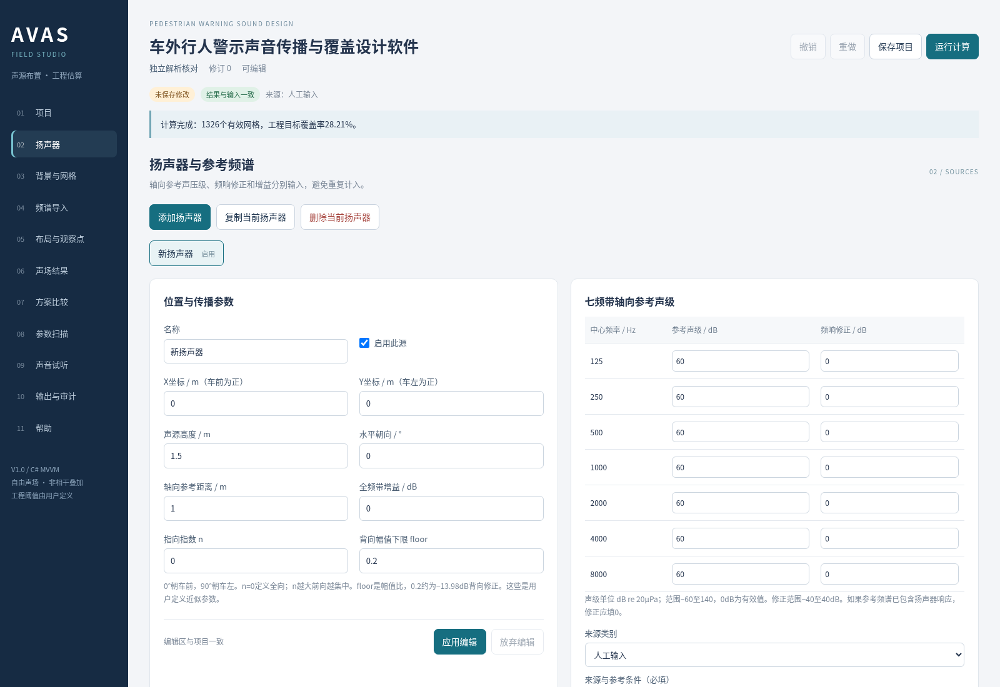

## 填写参考频谱与来源

在扬声器页右侧的七频带表格中，依次填写125、250、500、1000、2000、4000、8000赫兹的轴向参考声级。单位为dB re 20µPa，即相对于20微帕参考声压的分贝声级。软件要求七带完整，不能缺带，也不能把缺失值填为0；0分贝本身是有效输入。

参考声级允许−60至140分贝。频响修正是对该频带输入的增量，范围−40至40分贝，默认0。如果参考谱已经包含实际扬声器响应，修正通常应保持0，避免重复叠加。核对案例的七带参考声级均填60，修正均填0。

来源类别可选择人工输入、模拟示例、实测（用户声明）或估算。来源与参考条件为必填说明，应记录数据文件、测量位置、轴向参考距离及必要条件。核对案例填写人工核对：1m轴向60dB。软件接受用户声明，但不认证仪器、标定或数据真实性。

完成表格和来源后点击应用编辑。若声级输入141等超范围数值，软件在错误框指出对象、频带与允许范围，原项目输入保持不变。修正字段后再次应用；若要全部撤回当前字段，点击放弃编辑。来源标记会随项目和工程报告保存。

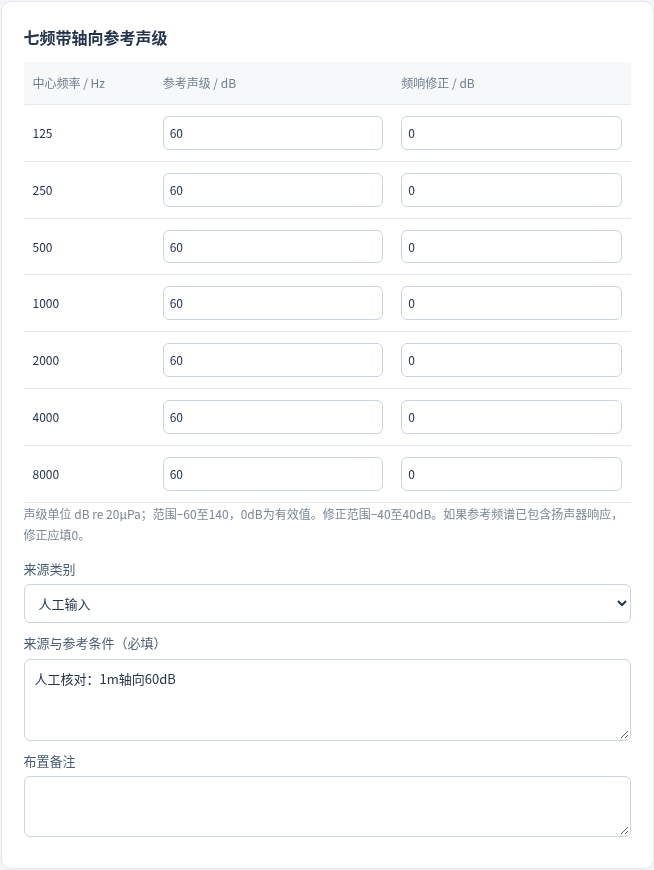

## 设置背景与接收网格

进入背景与网格页，先填写X、Y最小和最大值。默认X为−10至10米、Y为−8至8米，网格步长0.5米。最大坐标必须大于最小坐标，步长允许0.25至5米，总节点数不能超过20000。节点从最小坐标开始等步长生成，若不能整除，不强行追加最大边界。

接收高度对所有网格和观察点统一生效，默认1.5米。距离截断下限默认0.5米，用于阻止点源公式在零距离发散；它不是经过验证的近场模型。源与接收点距离小于该值时，使用下限计算并保留截断标记。

车辆长度默认4.6米，沿X轴；宽度默认1.8米，沿Y轴。排除轮廓内部网格默认开启，内部节点不参加覆盖统计。轮廓只用于示意和排除，不计算车身声学作用。观察点即使位于轮廓内仍独立计算，因此必须按车内示意点解释。

在空间均匀背景声区域填写七带声级，范围同为−60至140分贝，频带修正固定为0。默认各带35分贝是人工工程初值，应填写背景来源类别与来源说明。该背景被假设为空间均匀；上传背景WAV不会自动更新这些物理声级。完成后点击应用编辑。

## 选择判读指标与工程目标

在背景与网格页的工程判读目标区域，选择单个频带或七频带合成。单频带直接使用相应未计权声压级；七带合成以频带能量相加，可勾选A计权。A计权使用中心频率修正，属于有限频带工程近似，不能把七带合成称为全频积分总值。

工程声级目标默认45分贝，工程背景差目标默认3分贝。每个节点必须同时满足警示声不低于声级目标、警示声减背景声不低于差值目标，才计为满足工程目标。两个默认数值均不是法规限值，也不是经过人体试验验证的可听阈值。

覆盖率等于满足两个目标的有效网格节点数除以全部有效节点数，再乘百分之百。它不是人群可听率，也不是连续平面的精确面积比例。改变网格范围或步长会改变节点集合，因此比较方案时必须保持这些条件一致。

核对案例选择1000赫兹，接收高度1.5米，保留35分贝背景及默认目标。点击应用编辑后再运行计算。若后续需要查看A计权合成，应修改设置、应用、重算；旧指标下的结果不能直接当作新指标结果使用。

## 导入频谱与处理预检错误

进入频谱导入页。先决定导入背景还是当前扬声器；未勾选导入至背景时，从目标扬声器下拉框选择对象。点击下载频谱模板，页面底部出现下载链接，点击后由浏览器保存。文件要求UTF-8编码、英文逗号、小数点使用点，表头严格为FrequencyHz,LevelDb,CorrectionDb。

可通过选择CSV文件载入，也可把文本直接粘贴到三列CSV编辑框。最多20KiB文件或20000字符文本。每个支持频率恰好一行，共七行数据。背景修正必须为0；源修正允许−40至40分贝。空白行会忽略，其他错误不会静默丢弃。

点击预检频谱，软件逐行检查表头、列数、数值、范围、重复频率和缺带。例子125,bad,0会在第2行提示LevelDb错误，并列出未形成有效记录的频带。此时尚未覆盖任何旧输入。按错误行修正并重新预检。

预检通过后先核对对象和预览表，再点击应用频谱导入并确认整体替换。软件一次替换全部七频带，不做部分更新。更改目标或文本后，旧预检失效，必须重做。导入后到扬声器或背景页核对来源，再计算；CSV数值结构正确不代表数据真实或参考条件正确。

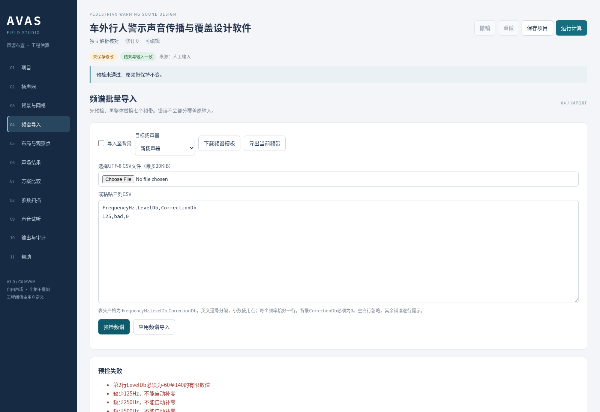

## 编辑布局与观察点

进入布局与观察点页。图上车辆中心为原点，X正向车前，Y正向车左。圆形源标记旁的短线指示朝向，观察点用名称标注。移动扬声器和转向使用扬声器页的坐标、角度字段，应用后返回本页查看；当前版本没有拖拽编辑。

点击添加观察点，在当前观察点下拉框中选中要编辑的点，填写名称、X和Y。坐标范围−100至100米，所有点共享接收高度。填写备注有助于说明位置目的，点击应用编辑后生效。核对案例把点名称设为2m核对点，X=2，Y=0。

追加环形观察点适合快速检查多个方向。填写半径1至50米、数量4至36，点击追加环形观察点。软件以车辆中心为圆心，从X正轴起等角生成，最多总计100点。该点集是自定义几何点，不是法规或标准测点布置。

观察点位于网格之外时仍计算独立点值，不计入网格覆盖。位于车辆内部时显示车内示意提示，不能解释为车内实际声级。删除观察点需确认；历史快照不随删除改变。切换点或页面前应应用或放弃字段，避免误以为草稿已经写入项目。

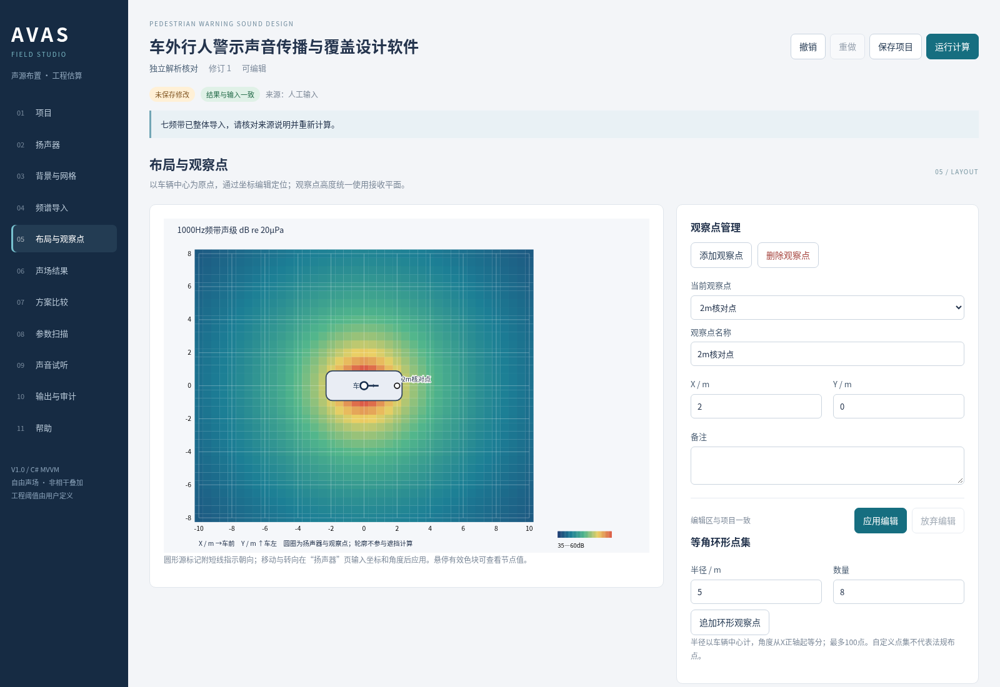

## 批量交换观察点

在布局与观察点页底部展开观察点CSV批量输入与交换。点击下载观察点模板，文件表头为Name,X_m,Y_m,Note，分别表示名称、X坐标、Y坐标和备注。可以选择UTF-8 CSV，或在观察点CSV文本框粘贴内容。

每行需要四列，名称必填且最多100字符，备注最多2000字符，坐标必须为−100至100米有限数。支持字段外包双引号、引号内逗号和两个双引号表示一个双引号；不支持字段内换行。同一导入批次名称不能重复，以便清楚区分。

点击预检观察点查看有效行数、错误信息和预览表。未勾选替换现有全部观察点时，应用会追加；勾选后应用会移除旧点并替换。确认操作前核对模式，因为新导入点总会建立新标识，同名点不能被视为同一个历史观察点。

导出观察点输入用于交换平面几何，保留名称、坐标和单行备注，不保留对象标识。多行备注会折为单行。完整搬迁或继续同一方案比较应使用.avasproj项目文件。导入后如总点数超过100，整次应用拒绝，旧点集保留。

## 运行计算与阅读声场

确认编辑区已应用后，点击右上方运行计算。计算时按钮显示处理中，完成后状态条列出有效网格数与工程目标覆盖率。进入声场结果页，确认结果与输入一致，再查看四项汇总：覆盖率、最低警示声、最高警示声和能量平均声级。

连续色图中蓝色表示当前网格相对低值，暖色表示相对高值，右下角给出声级范围；不同计算会按数值范围调整色阶，不宜只凭颜色跨方案比较。勾选显示目标覆盖二值图时，绿色表示同时满足两项工程目标，琥珀色表示至少一项未满足。颜色不表示法规合格或不合格。

把鼠标停在色块上可查看节点坐标、声级、背景差和工程目标状态。车辆轮廓覆盖的区域仅为几何示意；色块边缘与节点中心的显示宽度不参与精确面积积分。距离截断节点数在汇总和提示中列出，近源结果须按模型边界理解。

本页截图使用软件固定模拟双源示例，目的在于展示色图与方向差异，不能作为真实车辆验证证据。若输入修改导致结果过期，本页只显示重新计算入口，不使用旧图冒充新结果。输出报告同样要求当前结果有效。

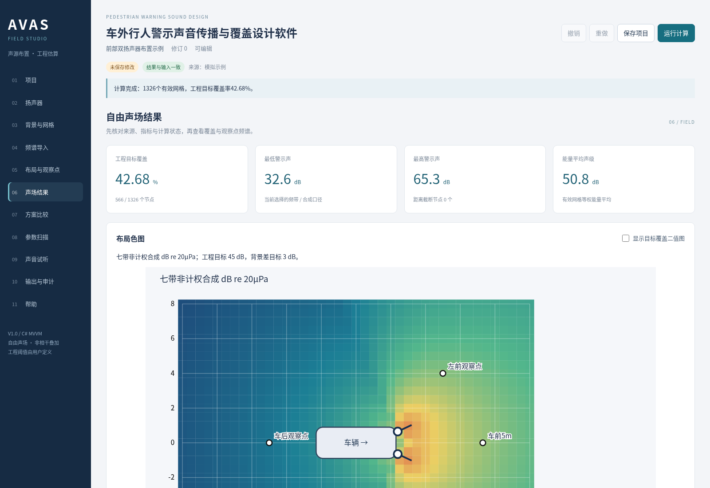

## 观察点频谱与解析核对

在声场结果页的观察点数值表中，查看警示声、背景、合成、背景差和目标状态。合成是警示声与背景的能量和，背景差是二者分贝差，不能将警示声与背景分贝直接相加。点击某行频谱详情，该点的未计权七频带折线和数值表同步出现。

频谱图蓝实线为警示声，棕虚线为背景。各声源贡献表进一步给出三维几何距离、几何扩散加指向性的传播修正，以及当前选择指标的源声级。各源频带最终按非相干能量叠加，多个源的分贝值不能直接算术相加。

用本手册前述解析案例进行独立核对：源在(0,0,1.5)米、观察点在(2,0,1.5)米，参考距离1米、1000赫兹60分贝、增益和修正0、n=0。期望警示声为60−20log10(2)=53.979400分贝；背景35分贝时，背景差18.979400分贝。界面保留三位小数，应显示53.979和18.979。

该核对验证软件在指定输入下的公式执行，不证明真实车辆声场准确。若将七带都设为60分贝并选未计权合成，参考位置七带合成为68.451分贝；若增加同等强度的非相干源，理论增加3.0103分贝。使用实测前仍需核对来源和模型是否适用。

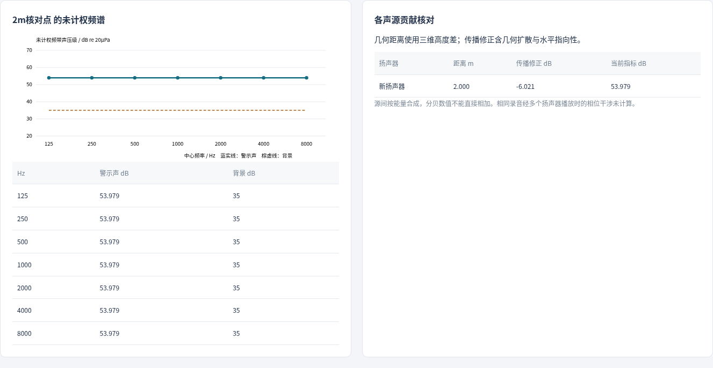

## 保存快照并比较方案

先计算当前有效输入，进入方案比较页，在新快照名称填基线A，点击保存当前方案快照。快照冻结扬声器、背景、计算设置、观察点和内嵌音频，最多20个，并记录创建时间和输入哈希。项目档案与快照分别管理；保存快照后还需保存项目，快照才会写入磁盘文件。

对解析案例，把当前扬声器增益从0改成3分贝，应用并重新计算；回到比较页，以增益3dB方案B为名称保存第二个快照。选择基线A与方案B，点击比较所选快照。观察点差值应为目标减基线，即+3.000分贝。覆盖差单位为百分点。

软件要求计算区域、步长、高度、轮廓、背景、目标、指标和观察点标识及坐标一致，并核对启用源的来源类别。条件不一致时列出阻断原因，不输出差值。需要保持其他条件一致，只更改声源数量、位置、朝向、频谱或增益，再计算和保存。

恢复输入会将所选快照的布局、背景、频谱和观察点替换到当前项目，须确认并重新计算；项目名称、负责人和审计不被快照覆盖。删除快照需确认。比较可导出CSV，正声级差不自动表示方案更优，覆盖提高也不能直接推断实际可听性改善。

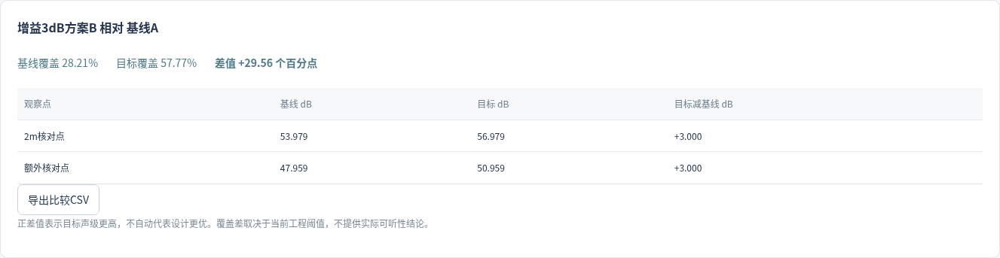

## 参数扫描与方向剖面

进入参数扫描页，选择一个启用扬声器和参数，可扫描朝向、增益、X坐标或Y坐标。填写初值、终值及正步长，终值不能小于初值，每次最多25组。以增益0至4分贝、步长2为例，应得到0、2、4三个取值。点击运行参数扫描，原项目保持原值。

结果逐行列出工程覆盖率、最低和最高声级、最小背景差以及满足目标的观察点数量。任意取值超出参数范围会使本次扫描失败，不给部分结果。点击某行应用该值并确认后，该值才写入项目，扫描表清除，原计算结果过期；随后应重新计算并另存方案。

同页下方的指定方向距离剖面可填写起点、方向、长度和采样步长。默认起点(0,0)、方向0度、长度10米、步长0.5米；最多501点。点击运行方向剖面后按沿线距离列出声级、背景差、工程目标和车内/截断提示，不向项目追加观察点。

剖面显示采样状态转换次数和最后满足目标的采样距离。该距离不是连续覆盖半径，不能用最远一个满足点代表整条线均满足。剖面不跳过车辆内部点，必须按提示解释。扫描和剖面都可导出CSV，项目更改后应重新运行，禁止导出过期剖面。

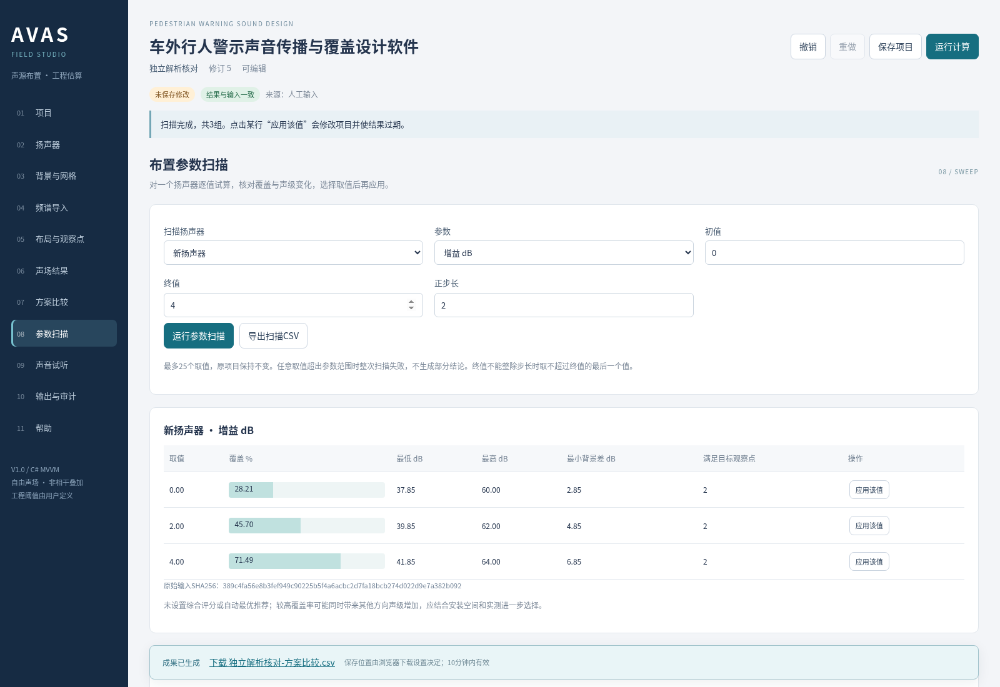

## 导入声音与分析数字频谱

进入声音试听页，选择音频对象为当前扬声器或背景。选择扬声器时先核对当前源下拉框，再上传16位PCM WAV文件；支持单声道或双声道、16000至96000赫兹、最多30秒且不超过10MiB。已有音频时需确认替换。MP3、压缩和浮点WAV应先在其他工具中转换。

导入成功后显示文件名、采样率、声道、时长和SHA256校验和，并生成数字频谱。音频以原始字节内嵌到项目，不依赖上传路径。双声道先取平均，反相内容可能抵消；4096点FFT矩形窗能量分带存在有限记录频谱泄漏。频谱单位dBFS RMS参考数字幅值1，不是声压级。

上传音频不会改变物理频带输入。若要参考录音的频带比例，填写人工声明的七带合成参考声级0至120分贝，再点击应用音频相对频谱并确认。软件按七带数字能量占比分配声级，修正归零，来源改为估算，并记下人工参考和音频哈希。

该操作没有传声器灵敏度、增益或声学校准链路，不是自动标定；七带能量过低或分配后超出允许声级范围会拒绝，而不补底噪。采样率较低时高频带受奈奎斯特频率限制。点击移除音频只删除该对象音频，已填写的物理频带仍保留。

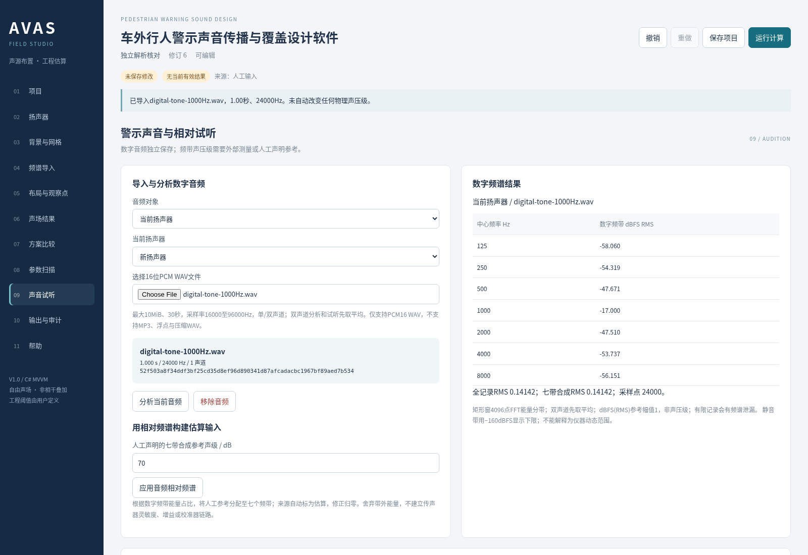

## 生成观察点相对试听

先完成当前输入计算，在声音试听页选择观察点，设置试听长度1至8秒和数字播放参考60至140分贝，按需要勾选叠加背景，然后点击生成当前观察点试听。数字播放参考定义物理估算数值映射到数字幅值的比例，不表示扬声器或耳机已经校准。

软件将导入音频重采样并作七带频谱整形，根据当前点传播结果形成相对幅值；没有导入音频的源使用固定种子模拟频带噪声，背景没有音频时同样用模拟噪声。输出24千赫兹单声道，具有50毫秒淡入淡出，短录音尾部补静音。

生成成功后出现播放器、下载相对试听WAV链接和制作说明。浏览器可播放生成文件，亦可下载后独立播放。比较两个点或方案时，应保持相同数字播放参考和设备音量。软件不会逐文件归一化，预估峰值超过0.98时会拒绝，并给出提高参考所需的分贝增量。

建议先将设备音量调低，再按需要调整。试听未模拟到达时延、双耳线索和车身作用；波形瞬态相位叠加与声场的非相干统计能量模型不同。设备音量、耳机和声卡均未校准，不能据此证明实际可听性。修改输入后应重算并重新生成，旧试听不再显示。

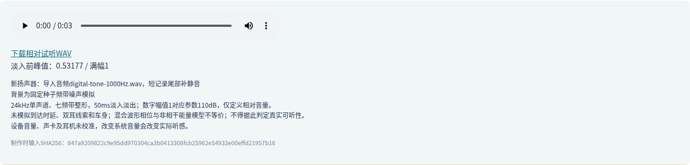

## 保存重开与搬迁完整案例

完成解析案例后，在任意页点击保存项目。前提是所有字段已应用，数据结构有效。首次保存用项目标识形成.avasproj文件；顶部状态条显示实际本机路径。软件数据目录默认在Avas.App的Data下，也可用--data-directory参数指定可写目录。

重复保存会先保留上次文件为同路径.bak，再原子替换当前文件。若同标识文件被其他会话修改，哈希校验阻止覆盖。此时先下载当前副本留存，再打开磁盘版核对；需要独立保留时点击复制为新项目。打开备份后也应复制为独立项目再保存，避免覆盖当前版本。

在项目页点击刷新项目库，找到刚保存的名称与时间，点击打开。未保存替换先提示。重开后结果不内嵌为可用状态，应点击运行计算。解析案例2米点应再次显示53.979分贝；如果保留增益3分贝方案，则应为56.979分贝。

搬迁时点击下载项目副本，再点击页面底部下载链接，确认浏览器实际保存了.avasproj。新建空白项目后，用选择.avasproj文件上传副本，重新计算并核对点值、快照数量与音频名称。完整输入和原始音频均内嵌，不需要原始CSV或WAV路径；计算JSON成果不是项目打开格式。

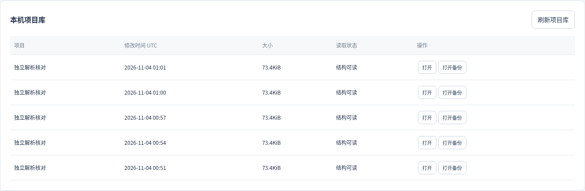

## 导出成果与检查来源

进入输出与审计页。确保结果与输入一致，再按需要生成工程报告HTML、网格CSV、观察点CSV、声场SVG或完整计算JSON。每次生成后，页面底部显示文件名与下载链接；点击后由浏览器决定最终下载位置。临时链接默认10分钟有效，也可能因容量回收失效，重新生成即可。

工程报告是自包含HTML，带项目身份、负责人、来源、七带输入、计算设置、声场图、观察点、贡献、模型限制和最近30条审计。可在浏览器打开并打印。CSV按节点或观察点输出坐标、警示声、背景、合成、差值、状态、截断与七频带，并保留模型版本、来源和输入哈希。

SVG为矢量图，保留当前选用的连续或二值显示方式，应与报告参数共同使用；计算JSON则完整保存输入与结果明细，供程序核对。输入频谱CSV和观察点交换CSV只用于特定数据交换，不能代替项目文件的完整保存。

下载后实际打开文件，检查名称、版本、单位、来源与点值。演示或估算标记不能在报告中改写为实测。输出与审计页显示最近100条操作，项目累计最多保留1000条；撤销重做继续保留审计。审计记录操作，不证明输入真实性、申请人身份或软件权属。

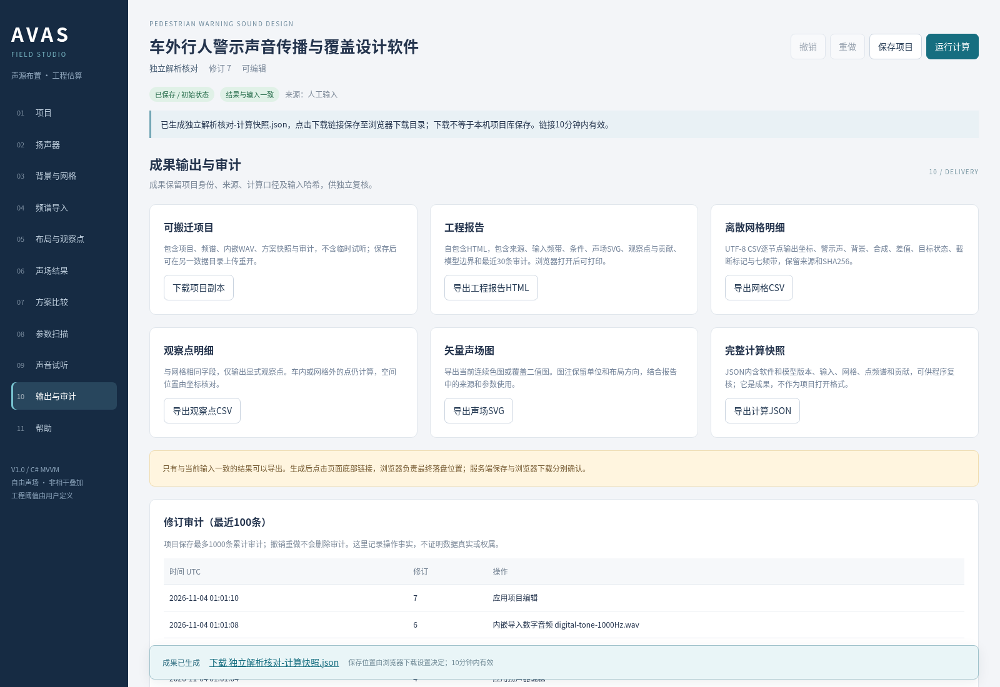

## 错误恢复与后续复核

遇到未应用编辑提示，留在当前页面点击应用编辑；字段不需要时点击放弃编辑。输入错误框指出的路径通常包含源名称、频带或设置字段，回到对应页修正，不要用反复点击保存绕过。缺少或损坏的项目字段、未知格式、重复标识、音频哈希不一致都会拒绝加载，当前对象保持不变。

网格超限时，在背景与网格页缩小X/Y范围或增大步长后应用；全部节点被车辆内部排除时，扩大区域或关闭内部排除。CSV报错时检查表头、UTF-8编码、频率是否齐全且唯一、小数点及背景修正；观察点CSV则检查四列、引号和坐标范围。

比较阻断时核对快照条件和观察点标识。不要删除后重建同名点来代替原点；若需新条件，应在新条件下分别计算两方案并保存新快照。试听峰值过高时提高数字播放参考，保持比较时统一参考；音频低能量不能推导频谱时，应补充有依据的频带输入。

本软件验收证据包括解析公式测试、异常输入测试和真实浏览器工作流，不包含真实车辆或人体效果验证。设计推进时应根据模型边界选择适当实测方法，对安装、遮挡、地面、气象、相干效应和可听性单独核对。实际登记材料的专用模板、申请人、权属、开发及发表事实由申请人确认。

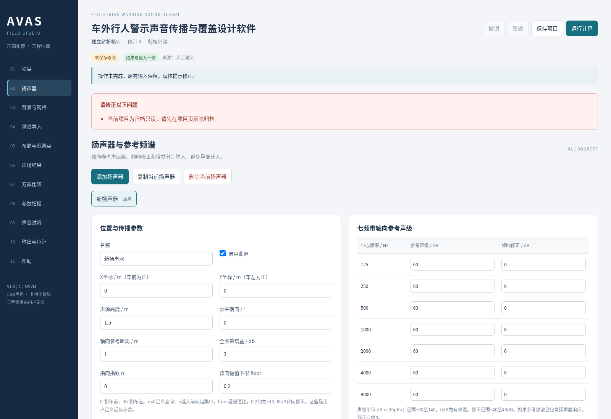
