# 汽车内饰卡扣与防异响接触设计软件 V1.0 操作说明书

本稿待Microsoft Word实际分页及专用模板复核。

## 1 软件介绍

**应用背景：**汽车内饰饰板通常通过卡扣、毛毡与缓冲块同骨架连接。装配间隙、公差、预紧量和材料刚度同时影响接触保持与卡扣反力。在颠簸或惯性加载下，部分接触点可能分离，另一些点可能出现切向滑移。工程师需要比较多种布置并决定先验证哪些装配和材料条件；仅凭零散表格或口头修改，不容易追溯每次判断采用的参数。

**软件概述：**本软件面向内饰结构与噪声振动工程人员，将简化饰板轮廓、双向卡扣、单边接触点、惯性载荷和公差组合放入同一项目。用户从空白项目开始，建立几何与点位，输入参数依据，计算离散相位包络，比较候选设计，再形成样件验证清单。项目可以实际保存、重开、搬迁和导出，工程结果与来源声明、模型版本及输入摘要一同保留。

**适用范围：**V1.0采用刚性平面、小位移、准静态模型，材料按用户输入的等效线性刚度处理。计算结果帮助筛查接触分离、摩擦限幅和卡扣受力，不预测真实异响声压，不证明实车改善效果。频率只是工况标签；柔性振型、阻尼、碰撞与摩擦记忆不在本版范围。所有内置演示均为模拟参数，真实方案须用装配、材料及台架试验识别输入并验证结论。

**文档身份：**软件全称为“汽车内饰卡扣与防异响接触设计软件”，版本V1.0，项目格式schema 1。手册按当前C#本机浏览器应用编写。版式参照仓库已有A4操作说明书，未收到申请人专用模板；本稿需要在Microsoft Word中核对最终分页与申报版式。

## 2 安装、解决方案与启动

**准备条件：**准备可写目录与.NET SDK 10.0.403。把trim-contact-design整个目录放到本机，保持src、TrimContact.sln和global.json的相对位置。生产软件只依赖.NET及ASP.NET Core共享框架，浏览器承担界面宿主。可选Python验证工具不属于日常运行依赖。

**构建与运行：**在软件目录执行“dotnet build TrimContact.sln -c Release”，确认构建成功，再执行“dotnet run --project src/TrimContact.App -c Release --no-launch-profile”。保持终端运行，浏览器打开http://127.0.0.1:8775。Windows可运行run.bat，Linux/macOS可运行./run.sh。软件尚未在Windows图形开发环境中实际按F5验证。

**端口和目录：**端口占用时，在运行命令末尾增加“-- --port 8776 --data-directory 本机可写目录”，浏览器同时改用8776端口。默认数据写入应用二进制目录下Data。服务只监听本机回环地址；停止终端会结束服务，工作副本应事先保存。启动后应看到图示空白人工填写项目，不能把未出现界面当作已成功运行。

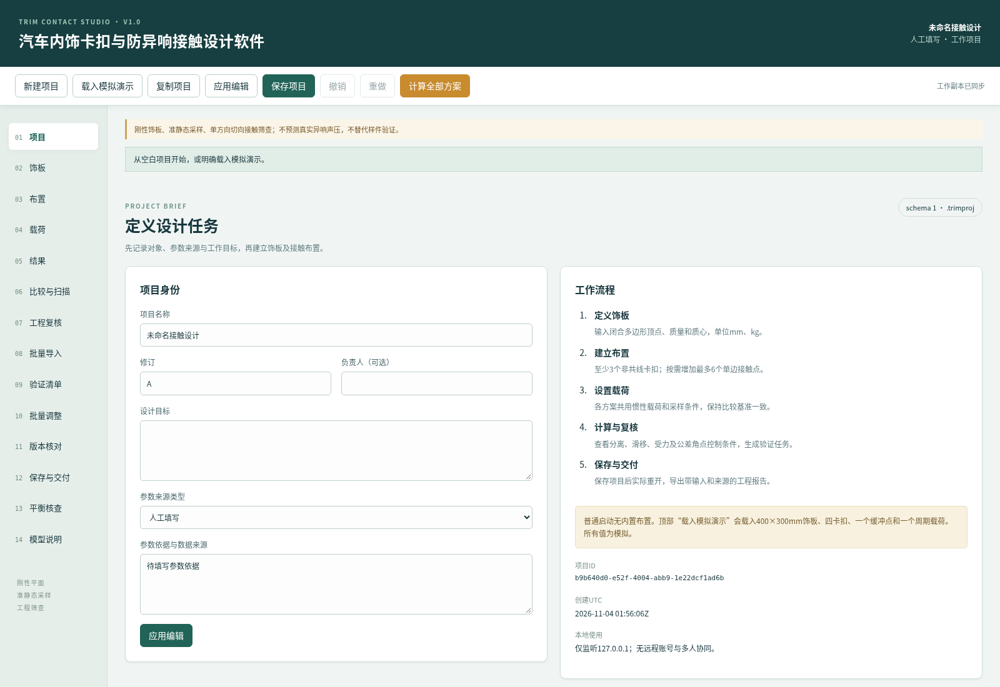

## 3 新建项目与参数来源

**建立工作对象：**点击顶部“新建项目”。若当前有未保存或未应用内容，会出现确认框；需要保留时先取消并保存，确实要放弃时点击“确认继续”。新项目有独立ID，普通启动没有轮廓、布置或载荷。演示必须通过顶部“载入模拟演示”明确载入，不能把演示自动当作自己的车辆方案。

**填写身份：**在“项目”页输入项目名称、修订和可选负责人。例如名称填写“门板接触布置操作案例”，修订填写“A”，设计目标填写“比较预紧量变化对接触保持及卡扣反力的影响”。名称和修订为必填项，分别最多100字与30字；负责人可留空，软件不要求身份证件或其他个人敏感资料。

**区分来源：**来源类型可选模拟演示、实测（用户声明）、工程估算或人工填写。操作练习应选择模拟演示，并在参数依据中写明“模拟操作案例；非实测，待材料与装配验证”。真实数据需要记录称重、几何、压缩试验与摩擦识别等依据。软件只保存用户声明，不认证标定链，也不会因为改为实测类型就验证输入。

**应用与保存：**完成后点击“应用编辑”。状态区提示编辑已应用；这一步把页面工作编辑通过校验后写入工作副本，并不等于写入磁盘。顶部“保存项目”才会保存文件。所有编辑页共享工作编辑，切换页面不会自动计算。计算与保存会先执行同样的应用校验；错误时会指出字段路径，原已应用项目不被部分修改。

**历史与离开：**应用后的修改可用顶部撤销、重做恢复，最近20个已应用版本保存在当前会话。未应用编辑存在时，撤销会先确认是否丢弃。刷新或关闭前务必保存或下载项目；浏览器离开提示受浏览器策略限制，不能替代磁盘保存。

## 4 饰板轮廓、质量与质心

**建立轮廓：**进入“饰板”页，首次使用可点击“建立矩形轮廓”，确认后形成400×300mm矩形，质心设为(200,150)mm。也可点击“增加顶点”逐行填写。顶点按边界顺序排列，最后一点自动连接第一点，不要再重复首点。删除顶点需在对应行点击删除并确认。

**填写参数：**示例质量填写1kg。质心X、Y使用与轮廓相同的平面坐标和mm单位，须落在轮廓内或边界上。轮廓允许3至24个顶点，坐标在±10000mm范围内，面积至少1mm²；质量允许0.001至100kg。右侧预览显示当前轮廓与质心，但不包含板厚或实际曲面。

**校验和恢复：**点击“应用编辑”，若提示自交，应检查边界顺序，避免对角线交叉；若点位在轮廓外，应同时修改已有卡扣、接触点或质心。不能只缩小轮廓后保留原来的外部点位。图形的X、Y独立缩放仅便于阅读，尺寸以字段坐标为准。成功后进入布置页。

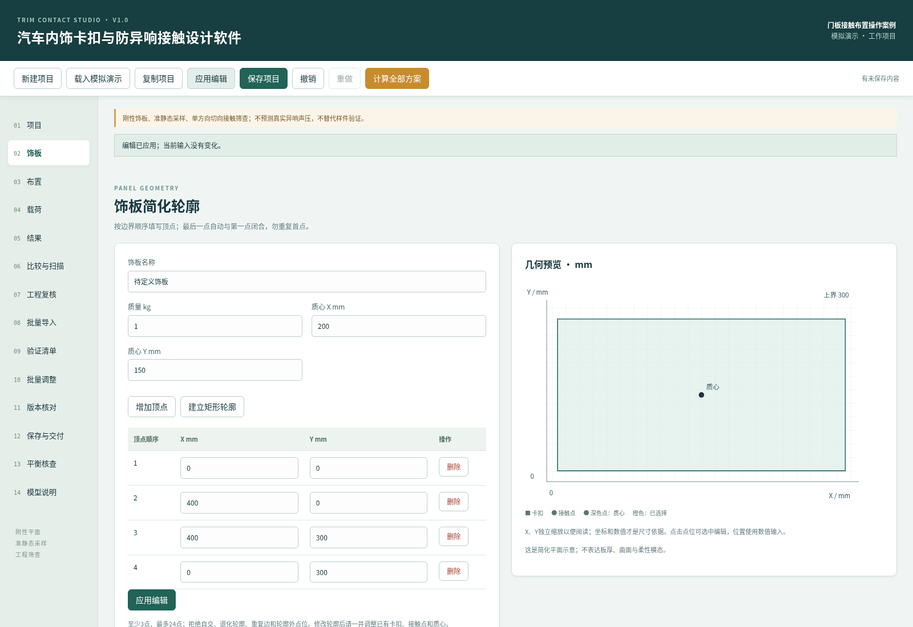

## 5 方案、卡扣与单边接触点

**建立方案：**进入“布置”，点击“新增方案”，将方案名称设为“A 基准布置”。先定义至少3个非共线卡扣，常用矩形四角布局为(40,40)、(360,40)、(360,260)、(40,260)mm。通过“增加卡扣”建立对象，再在卡扣列表或图形中点击选中，编辑名称、坐标与法向和切向刚度。

**卡扣参数：**卡扣是双向线性弹簧，示例法向刚度100N/mm、切向刚度50N/mm、合力限值80N。刚度须大于等于0.01N/mm，合力限值至少0.01N，最高均为100000。合力限值由用户结合方向和保持力试验给出，80N只是工程初值。三个自由度需要非共线稳定约束，不能将所有卡扣放在同一直线上。

**接触参数：**点击“增加接触点”，选中后填写中心坐标(200,150)mm、间隙0.1mm、公差±0.15mm、预紧等效压缩量0.2mm、允许压缩量0.8mm、法向刚度100N/mm、切向刚度40N/mm、摩擦系数0.3。材料名称仅是备注，不会自动提供材料物性。预紧量表示等效干涉位移，不是外加预紧力；最终压缩须由卡扣反力与接触反力共同平衡。

**复制与删除：**每项目最多8方案，每方案最多12卡扣、6接触点。复制方案会生成新点位ID，可独立修改；删除方案或点位需确认，关联验证任务保留并解除关联。橙色标记表示选中点位，方块为卡扣、圆点为接触点。完成输入后应用编辑。

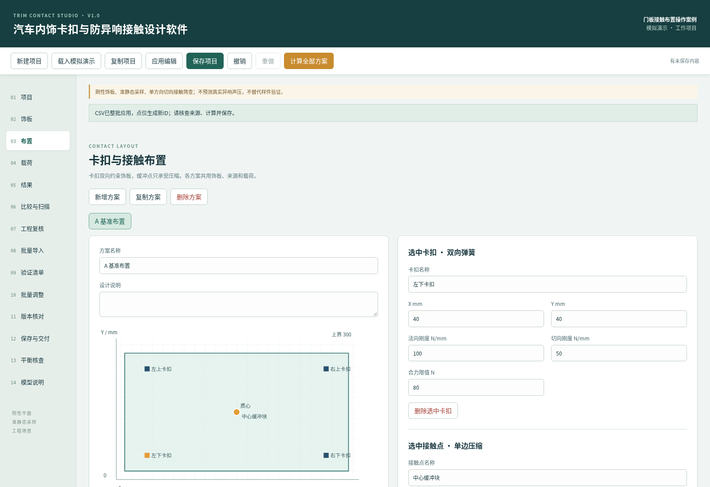

## 6 共用载荷与采样设置

**建立工况：**进入“载荷”页，点击“增加载荷”，选中新建工况后填写名称及来源。各方案共用这些载荷，以保证布置比较的共同条件。最多6个工况。示例使用法向偏置0g、法向幅值1g、切向偏置0g、切向幅值0.5g、相差90°，频率标签10Hz。

**物理含义：**加速度输入是g倍数，1g=9.80665m/s²。正法向惯性力使饰板朝接触支撑方向移动，负值使其反向。偏置允许−20至20g，幅值允许0至20g，不填峰峰值；切向按一个平移方向处理。法向使用偏置加幅值乘sinφ，切向使用偏置加幅值乘sin(φ+相差)。频率不参与动态放大。

**采样条件：**相位可选24、48或72点，一周期不重复360°。勾选全部间隙公差角点后，对每个非零公差接触点的正负间隙偏移进行全组合，再增加名义条件；六点最多64角点加一个名义条件。示例单点有两个角点，24相位一个载荷共72状态。角点及相位都是离散集合，计数不是发生概率，也不能保证捕获未采样极值。设置完成后应用编辑。

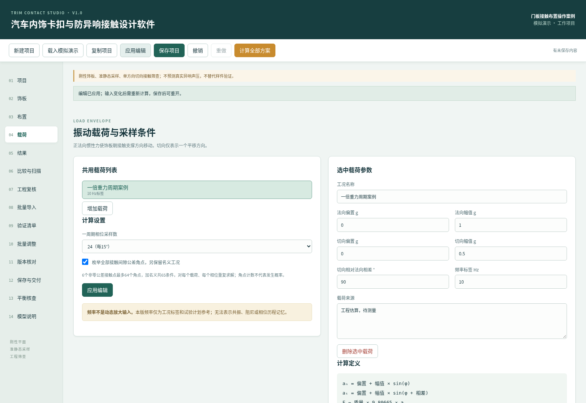

## 7 CSV整批输入与预检

**准备文件：**先在布置页建立并选择目标方案，再进入“批量导入”。点击“生成布置CSV模板”并下载，模板包含模拟四卡扣与中心缓冲块。也可使用samples中的模板。CSV为UTF-8、逗号分隔、英文小数点，不接受千位符，最大128KB与100条数据。表头及列顺序必须保持模板原样。

**预检操作：**选择目标方案和追加或替换模式，将文件读入或粘贴到文本区，再点击“预检CSV”。卡扣类型为Clip，仅填位置、两种刚度和合力限值，其余列留空；接触类型为Contact，填写间隙、公差、预紧、摩擦、允许压缩及材料，合力限值列留空。含逗号、换行或引号的文本按CSV双引号规则书写。

**应用和失败处理：**预检成功会列出新增数量、最终数量及替换影响，尚未修改工作项目。核对后点击“应用预检导入”并确认。任何一行错误均整批取消，状态区指出行号与字段；修正后重新预检。预检后编辑CSV或项目必须重做预检。替换会解除旧点位与任务的关联。布置CSV不包含项目来源，应用后须补充依据、重新计算并保存。

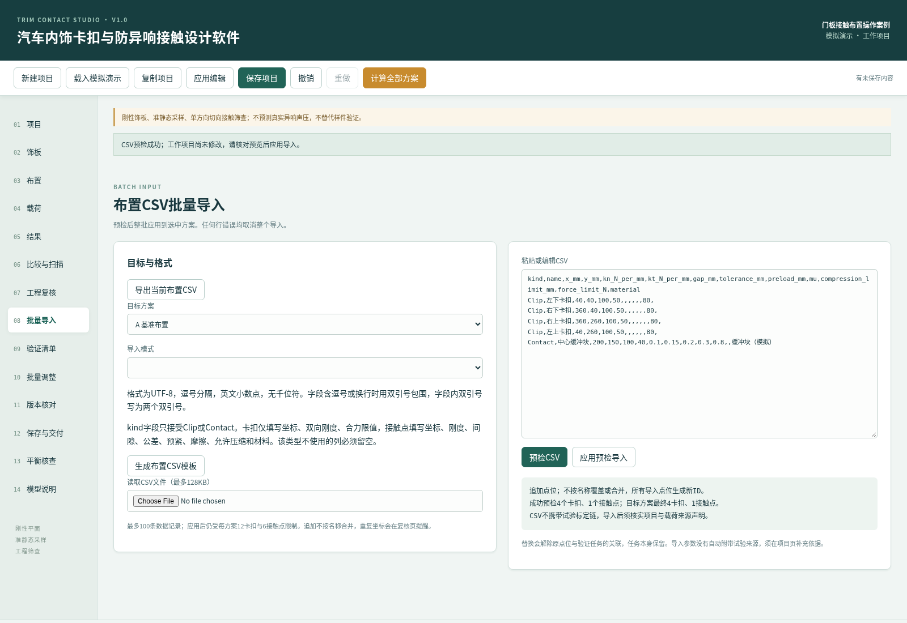

## 8 运行计算和阅读结果

**启动处理：**应用饰板、布置和载荷后，点击顶部“计算全部方案”。计算中显示状态和进度，其他编辑区暂时禁用，可点击取消计算。取消或求解失败不会发布部分结果；按提示修正不稳定卡扣布置或异常刚度后再运行。完成时自动进入结果页。

**包络与状态：**顶部选择方案与名义曲线载荷。包络表包含名义条件和所有已启用角点，逐点列出压缩、法向力、切向力、滑移余量和限值比。持续接触仅指所有已求解采样压缩大于1e−7mm；存在分离指至少一采样低于该阈值，全采样脱离指所有采样均未接触。卡扣负法向力表示反方向约束，不是错误；其压缩栏0只是占位。

**滑移与限值：**滑移余量是切向位移超过摩擦上限对应弹性位移的部分；脱离点不提供摩擦且滑移记0。接触限值比为压缩量除以用户允许压缩量，卡扣限值比为法向与切向合力除以用户合力限值。大于1表示超出用户输入值，不是软件判定标准不合格。

**逐点追溯：**点击表中点位，联动查看名义曲线、控制工况与原始核对表。曲线不包含公差角点，角点影响需读包络和控制向量。输入SHA256标识计算输入；参数编辑后会隐藏失效结果并要求重算。分离或滑移只是需要实物复核的线索，不能直接等同可听异响。

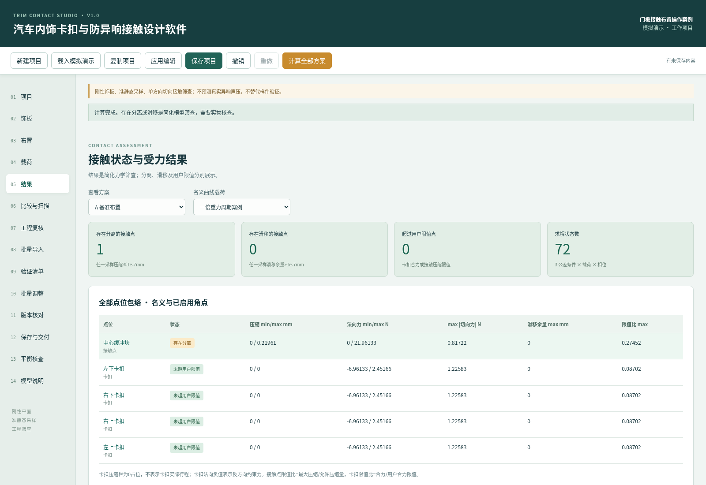

## 9 方案比较与参数扫描

**比较候选设计：**在布置页复制A方案为“B 增加预紧”，只将中心接触点预紧改为0.4mm并应用，然后计算全部方案。进入“比较与扫描”查看同次、同饰板、同来源、同载荷和采样条件的结果。分离点数、滑移点数和超限点数分别列出，不生成总分。点数随各方案接触点数量变化，不能单独视为优劣排名。

**设置扫描：**在下方选择方案和接触点，选择预紧量、间隙、法向刚度或摩擦系数。例如扫描B方案中心点预紧量，从0至0.5mm、6个等距值。点击“运行参数扫描”，软件在副本上逐值求解，原设计参数保持不变。起止值须递增，点数2至15；每个值仍须通过该参数的范围校验。

**使用结果：**表格列出各值对应分离、滑移、超限、卡扣限值比和接触压缩包络。增加预紧可能改善接触保持，同时增加卡扣反力，须同时读两者。点击“导出扫描CSV”保留结果；确认候选值后回布置页手动填写，软件不会自动推荐或应用所谓最优值。设计输入变化后旧扫描失效，需重新运行。

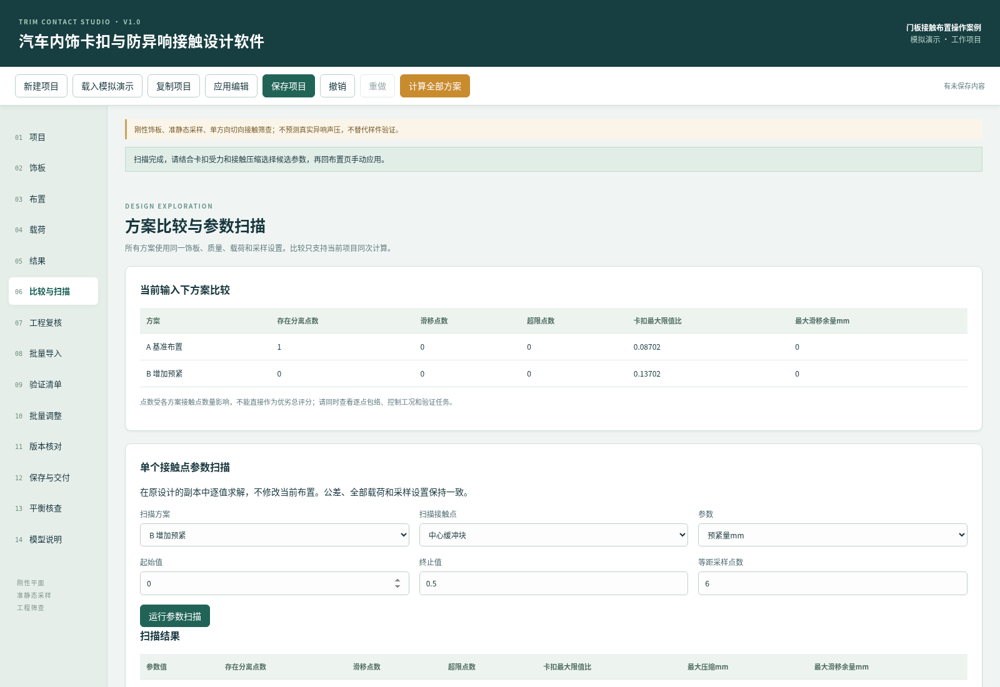

## 10 输入与模型适用性复核

**查看发现：**进入“工程复核”，逐项查看性质、对象、发现和建议行动。阻断项对应输入错误；来源项提醒模拟或用户声明状态；敏感项指出未平衡的装配干涉跨零；限制项说明频率未参与动力学。该页检查当前编辑，只有结果仍匹配输入时才读取结果，不会把旧计算附在新参数上。

**布置指标：**下方表格列出点位距最近其他卡扣的平面距离，以及接触点名义和公差上下限的未平衡干涉量。干涉量=预紧量−间隙，最小和最大值再加减间隙公差。该值尚未考虑饰板平移和转角，不能代替结果页最终压缩。卡扣的干涉栏0为占位。

**工程解释：**重复坐标可能是有意并联，也可能是误录，需人工确认；软件不禁止所有重合布置。名义位移或等效转角超过几何尺度5%时会提醒复核小位移假设，这个5%是工程提醒值，不是材料标准。提醒只覆盖名义相位，公差角点位移仍须进一步核查。最近卡扣距离不用于推导板柔性或声学风险等级。

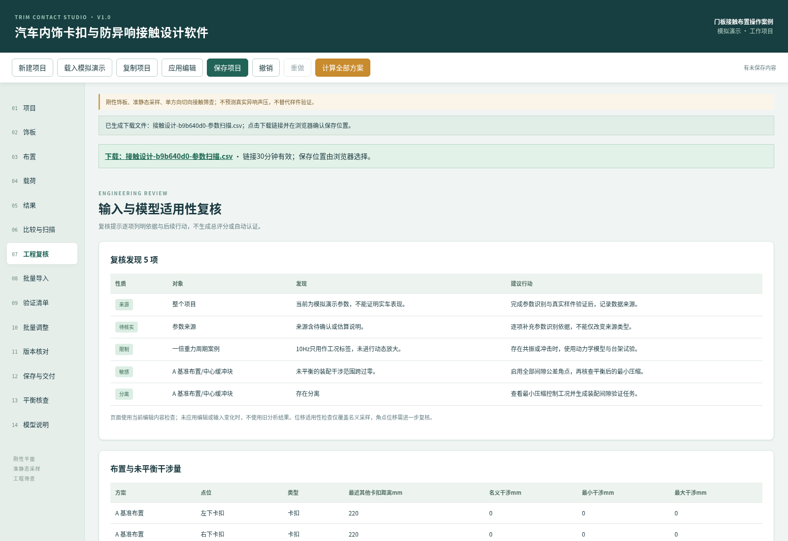

## 11 反力与力矩核查

**进入核查：**先计算当前输入，再进入“平衡核查”。该页从每个点位的法向和切向反力重新求和，列出名义公差相位中外力与反力差，不只读取求解器内部残差。顶部给出最大绝对法向差、切向差和法向力矩差，逐相位表可追查对应方案和载荷。

**读数口径：**惯性外力作用于质心，法向外力矩为零。以质心为原点，X轴法向反力矩为ΣNy，Y轴为−ΣNx，单位N·mm。反力总和减外力为正，表示反力合计较大。数值差应与求解精度一致；若异常较大，先检查模型版本及导出输入，再用独立手算样例核查。

**能量与范围：**储存弹性能是当前卡扣及接触弹簧可恢复弹性能总和，包含装配预紧，不包含摩擦耗散，不能当成声音能量。切向模型没有扭转或高度偏心，因此该页不检查切向引起的力矩。页面只覆盖名义公差，所有公差角点的求解残差在结果页另列。点击“导出平衡核查CSV”可保留逐相位核对数据与来源。

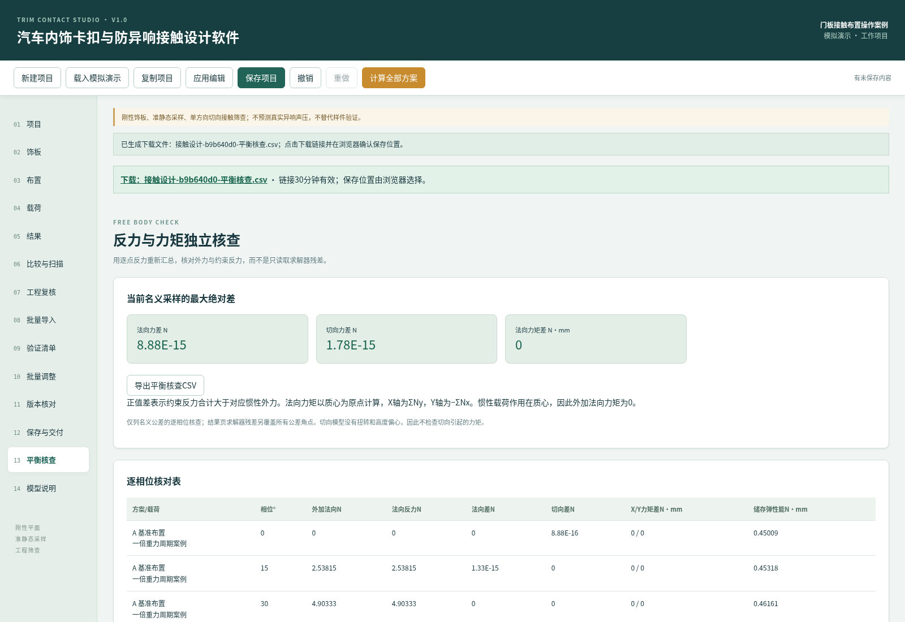

## 12 批量参数调整

**准备副本：**先在布置页复制目标方案以保留基准，再进入“批量调整”。选择目标方案与接触点、卡扣或全部点位范围。默认平移与增量0，刚度倍数1，因此默认操作不会改变设计；没有实际变化时预览会提示。

**填写与预览：**例如目标为B方案接触点，预紧增量填0.05mm，其余保持默认，点击“预览批量修改”。右侧逐行显示参数名称、单位、当前值与新值。X/Y平移分别允许±1000mm，刚度倍数大于0且不超过100，间隙和预紧单次增量不超过±20mm；最终值还须满足原字段范围和点位在轮廓内的要求。

**整批应用：**核对无误后点击“应用批量修改”并确认。卡扣不使用接触间隙和预紧量，仅卡扣范围时相关增量必须为0。任一目标点越界或参数无效则整批取消。预览后改了项目、方案或批量参数会阻止应用，须重新预览。应用后可用顶部撤销恢复，重做再次应用；随后重新计算并保存。批量调整不自动建立材料标定依据。

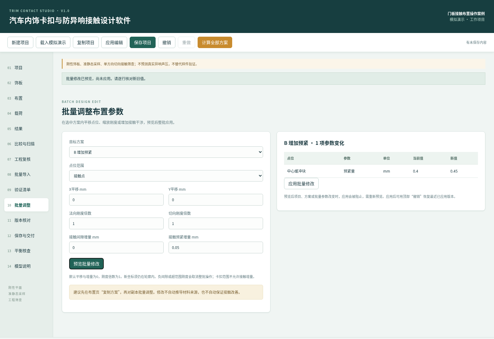

## 13 样件验证任务与证据

**生成清单：**计算当前输入后进入“验证清单”，点击“从当前结果生成任务”。软件建立参数识别任务，并按存在分离、滑移、接触压缩超限和卡扣合力超限生成相关验证任务。相同标题与点位不会重复生成；状态区会显示新增数量。也可用“新增任务”补充人工工作。

**填写任务：**点击左侧任务后，在右侧核对方法与判据。例如分离任务应按控制工况准备装配上下限样件并实测间隙，滑移任务需核实材料副、温度、表面状态和摩擦识别。建议文字只提供计划起点，具体允许值与可接受条件必须由项目负责人确认。可填写负责人、证据编号与验证说明。

**完成与维护：**勾选已完成后必须填写验证证据，再应用编辑；无证据时会拒绝保存完成状态。完成仅表示用户记录，软件不认证实际试验。最多200任务。删除点位会保留任务并解除关联；设计变化后旧任务不会自动重新适用，应逐项复核。点击“导出验证清单CSV”可交给试验人员，文件含来源、方法、判据和证据，未完成任务不能写成试验通过。

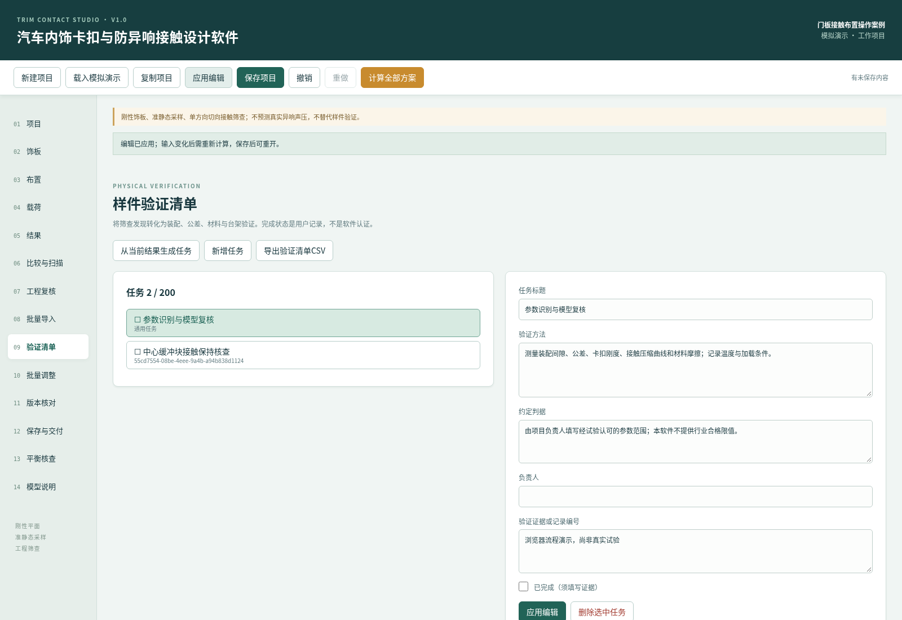

## 14 保存、项目库与备份恢复

**实际保存：**在任意页点击顶部“保存项目”，或在“保存与交付”点击同名按钮。软件先应用全部编辑并校验，再按项目ID写入指定数据目录。成功状态显示完整路径，项目库新增或更新条目。工作编辑应用成功不等于保存成功，应以保存路径反馈为准。

**重开核对：**保存后在项目库找到相应名称、修订与来源，点击“打开项目”。若有未保存内容，先决定取消保存或确认丢弃；重开后核对名称、轮廓、点位、载荷与任务。计算结果没有缓存进项目文件，重开后需重新计算。这一步验证实际磁盘文件，而不只是继续看当前会话。

**备份与覆盖保护：**每次覆盖前保留上一个文件为.bak，点击项目库“载入备份”可把它载入工作副本，核对后再保存恢复主文件。没有备份时会给出文件错误，不能假设一定存在。磁盘文件被其他程序修改或移走时，保存会阻止覆盖；先下载当前工作副本，再打开磁盘版核对，或复制新项目保存。归档后项目只读，继续设计应复制为新项目。

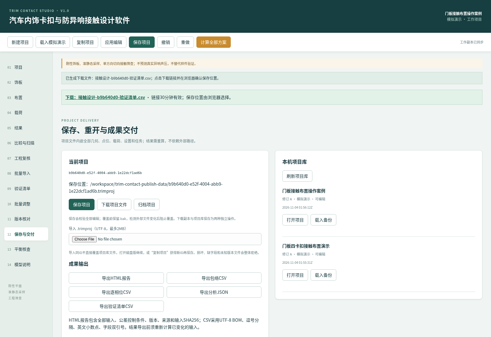

## 15 项目搬迁、导入及格式

**下载与搬迁：**在“保存与交付”点击“下载项目文件”，状态区出现下载链接后点击链接，并在浏览器确认实际保存位置。项目扩展名.trimproj，UTF-8 JSON，schema=1；文件内嵌饰板、所有方案点位、载荷、计算设置、来源、验证任务与操作记录，不依赖原电脑的外部文件路径。

**另一电脑打开：**在另一台具备运行环境的电脑启动软件，进入“保存与交付”，使用“导入.trimproj”选择下载文件。最大2MB，整个文件先校验再载入工作副本；无效、未知版本、缺字段、重复ID、无效任务引用或损坏JSON会整体拒绝，不部分覆盖当前工作。导入成功后核对数据并计算，再保存到新电脑项目库。

**处理同ID：**如果本机已经有相同项目ID，导入后直接保存会被阻止。要继续原项目，应从项目库打开磁盘版；要保留两份，应点击顶部“复制项目”获得新ID后保存。不要通过手改JSON中的ID绕过引用检查。导入本身不证明参数是真实测量，原来源标记会保留。

**交换约定：**布置CSV只交换当前方案点位，不包含项目身份、来源、任务或标定链，不能代替.trimproj备份。工程结果CSV采用带BOM的UTF-8、逗号分隔、引号字段和英文小数点；结果数据中的负数保持数值含义，文本字段以公式前缀开头时会做防误执行处理。完整设计输入应以项目文件或含输入的报告为依据。

## 16 参考项目输入版本核对

**读取参考：**进入“版本核对”，选择一份参考.trimproj文件。参考文件按相同格式校验后，只作为比较对象，不替换当前工作项目。页面列出当前与参考输入SHA256、参考名称及差异项；若当前编辑后来变化，点击“刷新输入差异”。

**匹配规则：**软件按对象ID匹配载荷、方案、卡扣和接触点，轮廓按顶点顺序核对。差异路径显示所属对象与单位。复制方案产生新ID，因此可能显示新增与删除，不按名称推断同一实体。比较覆盖几何、质量、来源、载荷、设置及布置参数，不比较试验任务证据和操作记录。

**判断条件：**共用条件不同会显著提示不能把两份结果差直接归因于布置变更。共同条件字段相同也不代表方案参数相同，仍需读差异表；该页不自动计算参考项目结果。可先从保存文件重开，再读取同一下载文件核对，正常应显示差异0项。核查完成后按需要保存当前工作，参考文件本身不被改写。

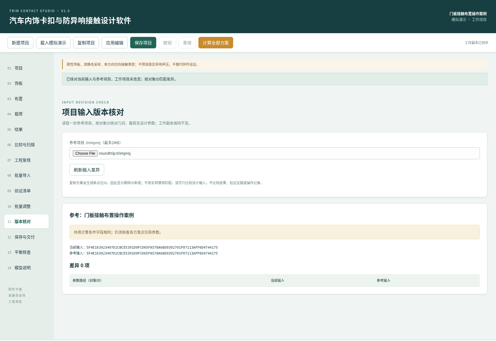

## 17 结果导出与交付核对

**选择格式：**完成当前计算后进入“保存与交付”。HTML报告包含版本、模型、来源、输入SHA256、逐点包络、控制工况、验证任务和全部设计输入，可在浏览器打开后打印。包络CSV适合整理名义与公差角点总体结果；逐相位CSV只包含名义公差曲线；分析JSON保留项目与结果结构。扫描和平衡核查CSV分别在对应页面生成。

**下载过程：**点击对应导出按钮后，页面生成带文件名的下载链接，再点击链接。链接30分钟有效，过期后重新导出。软件不会替浏览器指定任意本机下载目录，保存位置由浏览器选择；应实际打开文件核对内容，不只看状态提示。输入变化后结果导出会拒绝，需重新计算。

**交付复核：**核对软件名称V1.0、schema 1、模型RigidContact-1.0、来源标记、单位和输入摘要。报告中的模拟结果只能作为软件流程示例，不能写成实车试验。CSV仅含结果与追溯元信息时，应同时提供.trimproj或HTML中的全部输入以便复核。验证任务中的用户完成状态和证据须由负责人检查，不可作为自动认证。

**登记材料：**软著信息采集表将申请人身份、权属、开发与发表事实保留待核实，不能用文档生成日期代替开发完成日期。源码清单只统计实际参与构建的生产C#及Razor文件，测试、工具、文档与生成文件均不计入最低源码规模。正式页数、专用模板和签章要求应在当次申报时核定。

## 18 从建立到保存的手算核对案例

**案例前提：**本案例是独立可复核的模拟，不是实测。新建项目，名称写“对称静态核对”，来源选模拟并说明手算参数。建立400×300mm矩形，质量1kg、质心(200,150)mm；新建方案，四卡扣坐标依次为(40,40)、(360,40)、(360,260)、(40,260)mm，法向刚度均100N/mm、切向刚度均50N/mm，合力限值80N；暂不增加接触点。

**第一步结果：**建立载荷，法向偏置1g，法向幅值0、切向偏置0、切向幅值0，相差和频率标签均可设0。应用并计算。外加法向力=1×9.80665=9.80665N，四卡扣总刚度400N/mm，所以质心位移0.024516625mm，各卡扣反力2.4516625N。界面显示可能按五位小数舍入，精确值可查看导出。

**第二步结果：**在中心增加接触点，法向刚度100N/mm，预紧0.2mm，间隙和公差均0，允许压缩0.8mm，其他参数保留有效值；将法向偏置也改为0。应用后重新计算。平衡方程400z+100(0.2+z)=0，得到z=−0.04mm，接触压缩0.16mm、反力16N，四卡扣各−4N。不能直接把预紧0.2mm当成最终压缩。

**保存核查：**点击保存项目，确认路径，再从项目库实际重开，检查中心点预紧0.2mm和载荷全部为0。重新计算应获得同样结果。导出HTML报告与项目文件，在报告中核对来源和输入，保留作为版本验证样例。若数值不同，逐项检查卡扣刚度、接触间隙、公差、质心和偏置值，不要通过改变判据掩盖差异。

## 19 常见错误与模型边界

**计算被阻止：**空白项目需先定义轮廓、至少一个方案和一个载荷。卡扣不足或共线时，在布置页增加分散点位；矩阵近奇异时检查过大的刚度比与过近的点位。轮廓自交需调整顶点顺序；点位越界应同时修正几何与点位。任何修正后应用编辑，再计算。

**文件与旧结果：**文件导入错误需按状态区字段路径检查版本、缺字段、ID和任务引用，建议回到原程序重新导出。磁盘变化冲突时先下载工作副本，不能盲目覆盖。结果失效提示说明输入与上次计算不一致，需重新运行；如果只恢复到原已应用值，应用会提示输入没有变化。服务中断后尚未保存的会话无法保证恢复。

**范围限制：**线性刚度、摩擦与允许值必须与真实装配条件相符。模型不含板柔性、曲面、温度老化、接触面积变化、阻尼、频率响应、碰撞、粘滑时序或声压辐射；大位移和大转角不适用小位移假设。相位与公差角点包络不代表连续最坏值。图示仅为结构与曲线示意，参数来源和样件验证仍是最终设计判断的依据。

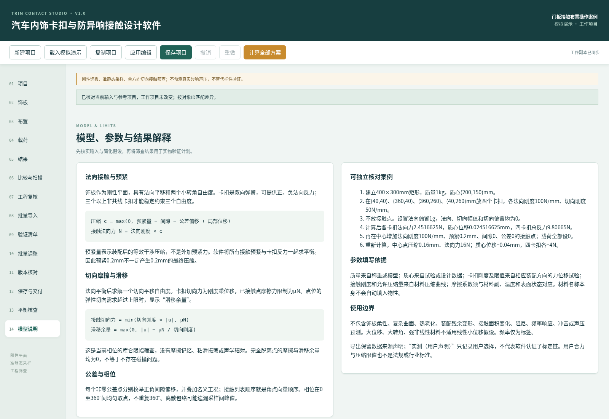
